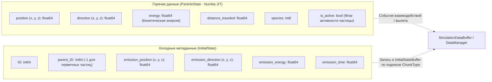
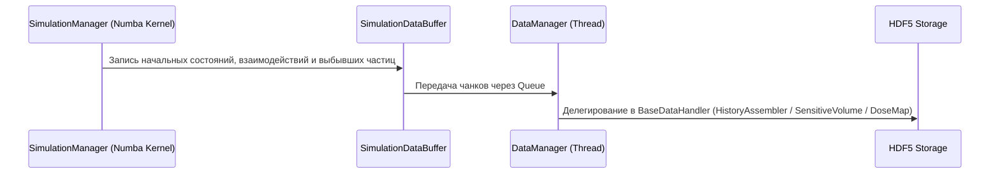

# Архитектура расчетного ядра NMSimToolkit (Core Architecture)

Данный документ описывает фундаментальную архитектуру расчетного ядра (**Core Engine**, Python 3.12+) программного комплекса **NMSimToolkit**, включая физико-математическую модель, высокопроизводительный Data-Oriented Design (DoD) транспорт частиц, структуру плоских буферов SoA, компилятор геометрии, реестр метаданных источников и принципы абсолютной физической точности.

---

## 1. Базовые архитектурные принципы и границы

1. **Абсолютная автономность и изоляция от интерфейса:**
   * Каталог `core/` полностью изолирован от графических зависимостей (`PySide6`, `pyqtgraph`, `vtk`, `pyvista`).
   * В физических структурах ядра отсутствуют визуальные атрибуты, флаги инспектора или UI-состояния (цвет, прозрачность, статус выделения).
   * Ядро оперирует исключительно физическими концепциями: объемы (`Volume`), геометрии, материалы (`Material`), сечения взаимодействий, композиционные источники частиц (`Source` с компонентами `SpatialDistribution`, `RadiationChannel`, `EnergySpectrum`, `AngularDistribution` в `core/source/sources.py` и полиморфной иерархией генераторов частиц `ParticleSource`: `PrimarySource` и `SecondarySource`), плоские буферы геометрии (`GeometryCompiler`) и менеджеры транспорта (`ParticlePropagator`, `SimulationManager`).
   * Подпакеты геометрии (`core/geometry/`) и физики (`core/physics/`) не зависят от конфигурационных Pydantic-схем (`core/config/`).

2. **Нулевой компромисс физической точности (Zero-Compromise Physics):**
   * Никаких приближений или искусственных аппроксимаций при моделировании физических процессов (фотоэффект, комптоновское рассеяние, когерентное рэлеевское рассеяние).
   * Таблицы массовых коэффициентов ослабления элементов (`tables/NIST XCOM Elements MAC.h5`, схема `2.0`, генератор `tables/scripts/generate_nist_xcom_mac.py`) построены на родной стандартной сетке NIST XCOM v3.1 в диапазоне `1 кэВ – 20 МэВ` (`46` базовых регулярных узлов + пары узлов краев поглощения $(E_{\text{edge}}, \mu^-), (E_{\text{edge}}, \mu^+)$ с метаданными оболочек `Edges/energy` и `Edges/label`, всего `46–76` узлов на элемент). При смешивании составных материалов (`AttenuationDataBase._add_material`) и расчете сечений (`AttenuationFunction`, `_get_macroscopic_cross_sections`) применяется кусочная log-log интерполяция между краями с сохранением точных скачков на краях поглощения.
   * В `MaterialBank` (`PhysicsCompiler._build_material_bank`) для $\mathcal{O}(1)$ поиска энергетического интервала без размытия краев поглощения формируется двухступенчатый лог-индекс (`lookup_bin_start` по `512` равномерным по $\ln E$ корзинам с адресацией через `MaterialPointerDType.lookup_offset` и контролем верхней границы доводки `lookup_max_advance <= 16`) совместно с предвычисленными логарифмами узлов сетки и линейных коэффициентов ослабления (`physics_log_energy_grid`, `physics_log_lac_table`). В транспортном ядре (`make_transport_kernel`) логарифм энергии и индекс корзины вычисляются однократно на частицу (`_compute_log_energy_and_bin`) и переиспользуются для мажоранты и реального материала вокселя (`_locate_row`, `_get_macroscopic_cross_sections`), обеспечивая побитовую эквивалентность с эталонным бинарным поиском `np.searchsorted(..., side='right')`.
   * Отбор атома-мишени $Z$ в сложных веществах и соединениях (например, $\text{NaI}$, костная и мягкая ткань) во всех активных процессах (`PhotoelectricEffect`, `ComptonScattering`, `CoherentScattering`) выполняется по компактной CSR-структуре элементного состава материалов (`ElementCSR`: массивы `element_offsets`, `element_Z` и трехмерная таблица `element_partial_fractions` с предрассчитанными нормированными парциальными долями сечений элементов $w_{p,i}(E_k) = \mu_{p,i}(E_k) / \mu_p(E_k)$ на узлах финальной сетки `MaterialBank`, формируемые в `PhysicsCompiler._build_element_csr`). Для однокомпонентных материалов атомный номер $Z$ возвращается детерминированно без потребления случайных чисел из `RNGContext`.
   * Атомная релаксация после фотоэффекта и распределение переданной энергии (Керма vs Поглощенная доза) выполняются по самосогласованным гибридным таблицам `NIST XCOM Edges + ENDF/B-VIII.0 EADL` (подгруппа `/<Symbol>/Relaxation` в `tables/NIST XCOM Elements MAC.h5`), компилируемым в `AtomicRelaxationBank` (`PhysicsCompiler._build_atomic_relaxation_bank`) с таблицами Воза для радиационных и Оже-переходов. В момент взаимодействия ядро `partition_transferred_energy_kernel` выбирает ионизированную подоболочку `shell_idx` по порогам $E_{\text{bind}}(Z, s)$ и скачкам поглощения $J_s$, разделяя переданную энергию $\Delta E$ по порогам рождения частиц (`photon_production_cut`, `electron_production_cut`) между локальным `energy_deposit` (`InteractionBuffer`) и надпороговыми вторичными частицами в предвыделенном `SecondaryActivationBuffer`.
   * Геометрическая навигация и аналитический RayCasting периодических структур (`PeriodicHexPrism` в `DirectParallelCollimator`) гарантируют математически точное определение точек пересечения границ объемов с компенсацией погрешностей машинной точности.

3. **Конвенция физических единиц (`hepunits`):**
   * Все физические расчеты ведутся строго в согласованной Geant4/HEP системе единиц: длина — **мм** (`mm == 1.0`), энергия — **МэВ** (`MeV == 1.0`), время — **нс** (`ns == 1.0`), плоский угол — **рад** (`rad == 1.0`).
   * Запрещены суффиксы размерностей в именах переменных и параметров (только `energy`, `linear_attenuation`, `step_size`, `gantry_angle`).

4. **C-подобная надежность и Design by Contract (DbC):**
   * Строгий принцип LBYL (Look Before You Leap): валидация физических инвариантов на входе (`energy > 0`, `size > 0`, `voxel_size > 0`).
   * Полный запрет утиной типизации (`hasattr`, `getattr`, `setattr`), глобального ГСЧ (`np.random.*`) и подавляющих блоков `try...except Exception:`.

---

## 2. Парадигма Data-Oriented Design (DoD) и SoA-буферы частиц

Для достижения максимальной производительности в Numba-компилируемых ядрах вычислений ядро `NMSimToolkit` построено на плоской компоновке структур массивов (Structure of Arrays, SoA).

### 2.1 Разделение данных частицы на Hot и Cold потоки
Память частицы (`ParticleBank`) разделена на независимые зоны по частоте обращения в цикле трекинга:

* **Горячее состояние (`ParticleState` и `NavigationState`):** упаковано в плоские массивы NumPy/Numba, непрерывно располагающиеся в кэш-памяти процессора (L1/L2). Все операции перемещения и рассеяния выполняются строго in-place без аллокаций памяти в цикле.
* **Двухфазное пополнение через `ParticleSource` и единый ГСЧ симуляции:** активные первичные источники сцены (`Source`) компилируются классом `SourceCompiler` в плоский иммутабельный `SourceBuffer` (уплощенный на уровне каналов эмиссии `RadiationChannel` с общими срезами воксельных таблиц Воза `voxel_range` и `0 байт` воксельных массивов для `PointDistribution`). Пополнение `ParticleBank` в `SimulationManager._replenish_bank` организовано через полиморфную цепочку `ParticleSource`:
  1. Первым вызывается `SecondarySource.replenish_bank` (`inject_secondary_sources_kernel`), выгружающий накопленные в `SecondaryActivationBuffer` вторичные частицы в свободные слоты `ParticleBank` с пуассоновским розыгрышем времени испускания $t_{\text{emit}} = t_{\text{act}} - \ln(1 - u) / \lambda_{\text{sec}}(Z, s)$, выдачей нового уникального `particle_ID` и сохранением `parent_ID`.
  2. Затем с эстафетного курсора `slot_cursor` вызывается `PrimarySource.replenish_bank` (`inject_poisson_sources_kernel`), генерирующий первичные частицы (`parent_ID = -1`) методом прореживания Льюиса–Шедлера с точной обрезкой по `stop_time`, контролем квоты первичных историй `emitted_primaries` и сохранением состояния потока `(t_ref, t_last, pending_arrival_time)` в едином детерминированном контексте `self.rng_ctx = RNGContext.from_numpy_rng(self.rng)`.

---

## 3. Компиляция сцены и навигация: `GeometryCompiler`

### 3.1 Плоский буфер геометрии (`geometry_buffer`)
Иерархический граф сцены (`SpatialNode`, `CompositeNode`, `GammaCameraNode`, `GantryNode`, `Volume`, `WoodcockVoxelVolume`, `ParametricParallelCollimator`, `DirectParallelCollimator`) компилируется классом `GeometryCompiler` в плоский типизированный массив структур Numba (`VolumeRecord`):
* Аффинные матрицы трансформации (`local_to_global`, `global_to_local`);
* AABB габариты объемов в локальных координатах (`bounds`);
* Целочисленные идентификаторы материалов и указатели на скомпилированные `cfunc`-функции для параметрических и воксельных объемов (`WoodcockParametricVolume`).

### 3.2 Трассировка Woodcock и аналитический RayCasting
Для гетерогенных объемов (`WoodcockVoxelVolume`, `ParametricParallelCollimator`) применяется метод дельта-трекинга Вудкока (Woodcock Tracking):
* Для каждого составного объема выбирается мажорантный материал `vol.majorant_material` (`majorant_material_map` в `PhysicsCompiler.compile_scene`) как материал с максимальным произведением $Z_{\text{eff}} \cdot \rho$ (`Material.__lt__` в `core/materials/materials.py`).
* Длина свободного пробега разыгрывается по линейному коэффициенту ослабления мажорантного материала $\mu_{\text{maj}}(E)$: $L = -\ln(\xi) / \mu_{\text{maj}}(E)$.
* В точке псевдовзаимодействия вычисляется отношение локального коэффициента ослабления $\mu_{\text{loc}}(E)$ к $\mu_{\text{maj}}(E)$.
* Для прямых периодических гексагональных коллиматоров (`PeriodicHexPrism` в `DirectParallelCollimator`) выполняется точный аналитический RayCasting по ячейкам решетки в `core/geometry/geometry_kernels.py`.

---

## 4. Конфигурация, `SourceMetadataConfig` и инвариант Roundtrip (`core/config/`)

Для соблюдения абсолютной физической чистоты `Source` (отсутствие строковых UI/паспортных атрибутов в физическом узле) и одновременной поддержки 100% симметрии сохранения/загрузки (`export(build(config)) == config`) в `core/config/` реализован внешний реестр метаданных источников:
* В `core/config/models.py` определена иммутабельная схема `SourceMetadataConfig(radionuclide, phantom_type)`.
* `SceneBuilder` при построении узла `Source` из `SourceConfig` сохраняет пару `(radionuclide, phantom_type)` в словаре `source_metadata_registry: Dict[str, SourceMetadataConfig]`.
* `SceneExporter` и `ConfigTemplateBinder` принимают `source_metadata_registry` и при экспорте восстанавливают паспортные поля `radionuclide` и `phantom_type` в `SourceConfig` без загрязнения класса `core.source.sources.Source`.

---

## 5. Система потоковой обработки данных (`DataManager`) и доменная структура `tests/`

* Обработчики `DirectStreamHandler`, `SensitiveVolumeHandler`, `HistoryAssemblerHandler` и `DoseMapHandler` поддерживают детерминированную финализацию (`finalize()`) и освобождение ресурсов разделяемой памяти (`close()`).
* Обработчики `DirectStreamHandler`, `SensitiveVolumeHandler`, `HistoryAssemblerHandler` пишут в HDF5 через [`DatasetWriteBuffer`](file:///d:/Python%20Projects/NMSimToolkit-Refactor/core/data/dataset_write_buffer.py): дозаписи накапливаются по группам датасетов (`initial_states`, `interactions/<объём>`) и сбрасываются целыми чанками за один сеанс `_write_with_retry`; неполный хвост дописывается в `finalize()`. Объём буфера на группу задаёт поле `data_manager.buffer_size` (строка с единицей, по умолчанию `3 MiB`); он определяет размер чанка HDF5 (`chunk_rows = buffer_size // row_bytes`) и порог сброса.
* Ёмкость каналов телеметрии `SimulationDataBuffer` задаёт отдельное поле `simulation_manager.buffer_capacity` (`Optional[int]`, элементы; `None` → `particles_number`), не связанное с выходным буфером записи.
* Все модульные и интеграционные тесты расчетного ядра сгруппированы по доменным подпакетам внутри `tests/`: `tests/config/`, `tests/data/`, `tests/geometry/`, `tests/materials/`, `tests/other/`, `tests/particles/`, `tests/physics/`, `tests/source/` и `tests/transport/`.

