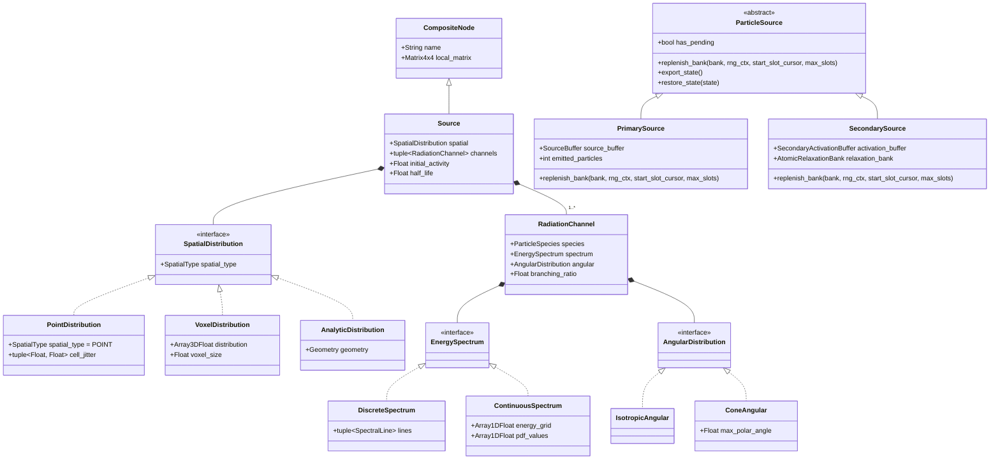
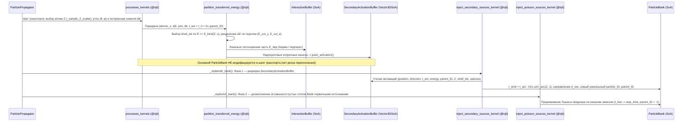

# Композиционная архитектура источников частиц, распределение переданной энергии и модель вторичного излучения (`SecondarySource`)

> **Статус:** Реализовано (Фазы 1–4 выполнены и верифицированы).
> **Связанные документы:** [`docs/architecture_backlog.md`](../architecture_backlog.md) (Раздел 31), [`docs/core_architecture.md`](../core_architecture.md), [`docs/plans/cross_sections_and_source_sampling_plan.md`](cross_sections_and_source_sampling_plan.md).

---

## 1. Мотивация и ограничения текущей модели

В текущей реализации пакета [`core/source/`](../../core/source/) класс [`Source`](../../core/source/sources.py) совмещает в одном монолитном объекте сразу четыре ортогональные ответственности:
1. **Узел 3D-сцены** (`CompositeNode`: локальная система координат, иерархия трансформаций, сериализация в дерево сцены);
2. **Пространственное распределение** (`distribution: Array3DFloat`, `voxel_size: Float`), из-за чего [`PointSource`](../../core/source/sources.py) вынужден наследовать `Source` и создавать фиктивный 3D-массив `np.ones((1, 1, 1))` с `voxel_size = 0.0`, а [`ConePointSource`](../../verification/common/sources.py) — достраивать поверх него третье колено наследования;
3. **Физику излучения** (дискретные $\gamma$-линии `energy`, изотропный/конусный вылет `cos_theta_min`, отсутствие типизированного `species` и непрерывных спектров для $\beta^\pm / \alpha$);
4. **Кинетику распада** (`initial_activity`, `half_life`).

При переходе к моделированию **вторичного излучения** (характеристический рентген $K_\alpha, K_\beta, L$ после фотоэффекта, а в перспективе — фотоэлектроны $e^-_{\text{pe}}$, Оже-электроны $e^-_{\text{Auger}}$, комптоновские электроны отдачи $e^-_{\text{comp}}$, тормозное излучение и аннигиляционные кванты $2 \times 511\text{ кэВ}$) монолитная архитектура обнаруживает фундаментальные ограничения:
* **Вторичный источник не является статическим узлом дерева 3D-сцены (`CompositeNode`)**: у него нет фиксированной матрицы трансформации в сцене — точки активации рождаются динамически в произвольных мировых координатах взаимодействий частиц.
* **Проблема переполнения `ParticleBank` при прямом рождении в `processes_kernels.py`**: если пытаться добавлять вторичные частицы (особенно при ветвлении $1 \to 2$ в комптоновском рассеянии $\gamma \to \gamma' + e^-$, фотоэффекте с электронами и флуоресценцией или аннигиляции позитрона) непосредственно в основной `ParticleBank` внутри шага транспорта, банк фиксированной ёмкости `batch_capacity` переполнится, либо потребует сложного резервирования слотов внутри горячего цикла трекинга.
* **Коллизия `particle_ID` при одновременном существовании родителя и потомков**: при комптоновском рассеянии рассеянный фотон продолжает движение в сцене одновременно с выбитым комптоновским электроном; при аннигиляции позитрона одновременно летят два кванта. Присвоение вторичной частице того же `particle_ID`, что и у родителя, приведёт к смешиванию их треков в `InteractionBuffer` и преждевременному закрытию истории в `DeadParticlesBuffer` при гибели первой из частиц.
* **Разделение переданной энергии (Керма vs Поглощённая доза)**: в текущем ядре вся потерянная фотоном энергия $\Delta E_\gamma$ записывается в локальный `energy_deposit` (`InteractionBuffer`), что соответствует приближению столкновительной кермы без радиационных потерь релаксации. При появлении трекуемых вторичных частиц ($\gamma_{\text{fluor}}$, а затем и $e^\pm$) унесённая ими кинетическая энергия должна вычитаться из локального `energy_deposit` вершины взаимодействия во избежание нарушения закона сохранения энергии.
* **Специфика времени жизни возбуждённых состояний**: время активации $t_{\text{act}} = t_{\text{emit, parent}} + l / v$ определяется моментом взаимодействия родительской частицы с учётом её времени пролёта, а время испускания вторичной частицы $t_{\text{emit}}$ подчиняется пуассоновскому (экспоненциальному) закону распада возбуждённого состояния с собственной постоянной распада $\lambda_{\text{sec}}$.

---

## 2. Ключевая архитектурная идея: композиция первичных источников и трёхуровневый конвейер вторичного излучения

По аналогии с тем, как физический объём в ядре строится композицией:
$$\text{Volume} = \text{CompositeNode (сцена)} + \text{Geometry (форма)} + \text{Material (физика среды)},$$
первичный источник в сцене декомпозируется на ортогональные компоненты (`SpatialDistribution` + `tuple[RadiationChannel, ...]`), а генерация вторичного излучения выделяется в трёхуровневый конвейер:
1. **Ядро процесса (`processes_kernels.py`)**: отвечает за уровень столкновения с атомом в среде — выбор элемента-мишени $Z$ по парциальным макроскопическим сечениям процесса, розыгрыш углов рассеяния $(\theta, \varphi)$ с учётом $S(x, Z)$ / $F(x, Z)$ и расчёт полной потерянной энергии $\Delta E$;
2. **Ядро распределения переданной энергии (`partition_transferred_energy_kernel`)**: отвечает за внутриатомный уровень — выбор ионизированной подоболочки `shell_idx` по $(Z, \Delta E)$, разделение $\Delta E$ по порогам рождения частиц (`production_cuts`) на локально поглощённую энергию `energy_deposit` (Керма / подпороговый остаток) и надпороговые вторичные каналы, записываемые в `SecondaryActivationBuffer`;
3. **Поставщики частиц (`ParticleSource`: `SecondarySource` и `PrimarySource`)**: на этапе пополнения банка `_replenish_bank` цепочка наследников абстрактного базового класса `ParticleSource` (`core/source/sources.py`) пополняет `ParticleBank` через единый полиморфный метод `replenish_bank(bank, rng_ctx, start_slot_cursor, max_slots)` с передачей эстафетного курсора слотов `slot_cursor`: сначала `SecondarySource` разряжает `SecondaryActivationBuffer` (`inject_secondary_sources_kernel`) с пуассоновским розыгрышем времени вылета $t_{\text{emit}}$, присвоением нового уникального `particle_ID` и сохранением ссылки на непосредственного родителя `parent_ID`, а затем `PrimarySource` дозаполняет оставшиеся слоты первичными частицами из `SourceBuffer` (`inject_poisson_sources_kernel`, `parent_ID = -1`).



---

## 3. Декомпозиция компонентов модели

### 3.1. Ось 1: Пространственная модель (`SpatialDistribution` — «ГДЕ рождается частица в локальной СК»)

Интерфейс `SpatialDistribution` описывает исключительно геометрический закон выбора локальной координаты $\vec{r}_{\text{local}}$ внутри узла `Source`:

1. **`PointDistribution(cell_jitter: tuple[Float, Float] = (0.0, 0.0))`**:
   * Не хранит воксельных массивов (`0 байт`);
   * При `cell_jitter == (0.0, 0.0)` не вызывает ГСЧ на выбор позиции: $\vec{r}_{\text{local}} = (0, 0, 0)$, а мировая координата в `@njit`-ядре читается напрямую из столбца сдвига `(m03, m13, m23)` матрицы `local_to_global` без матричного умножения;
   * При ненулевом `cell_jitter = (dx, dy)` равномерно разыгрывает смещение в прямоугольнике $[-dx/2, +dx/2] \times [-dy/2, +dy/2]$ плоскости $XY$ (заменяя наследование [`ConePointSource(PointSource)`](../../verification/common/sources.py));
   * Полностью устраняет класс-наследник `PointSource(Source)` и фиктивную сетку `(1, 1, 1)`.
2. **`VoxelDistribution(distribution: Array3DFloat, voxel_size: Float)`**:
   * Хранит нормированное 3D-распределение `distribution`, шаг `voxel_size`, сжатый список активных вокселей `voxel_indices` и таблицы Воза (`voxel_prob`, `voxel_alias`) для $\mathcal{O}(1)$ выбора активного вокселя;
   * Локальная координата внутри выбранного вокселя `(idx_x, idx_y, idx_z)` вычисляется по левому нижнему углу и равномерному смещению на `[0.0, voxel_size)`:
     `local_coord = idx * voxel_size - half_size + u * voxel_size` (строго согласовано с геометрией `WoodcockVoxelVolume` и [`_sample_voxel_position`](../../core/source/source_kernels.py) без сдвига на полвокселя).
3. **`AnalyticDistribution(geometry: Geometry)`** *(расширение без изменения контракта `Source`)*:
   * Позволяет задать однородный источник в аналитическом примитиве (`Box`, `Sphere`, `Cylinder`) без дискретизации в воксельную сетку и ступенчатых артефактов на границах.

---

### 3.2. Ось 2: Физическая модель излучения (`RadiationChannel` — «ЧТО, с какой ЭНЕРГИЕЙ и под каким УГЛОМ вылетает»)

Один радионуклид может испускать частицы разных типов и по разным ветвям распада (например, $^{131}\text{I} \to \beta^- + \gamma$, $^{18}\text{F} \to \beta^+$). Поэтому `Source` содержит кортеж каналов `channels: tuple[RadiationChannel, ...]`, где каждый канал определяется четвёркой `(species, spectrum, angular, branching_ratio)`:

#### А. Тип частицы (`ParticleSpecies`)
```python
class ParticleSpecies(IntEnum):
    PHOTON = 0     # Гамма-кванты, характеристический рентген, тормозное и аннигиляционное излучение
    ELECTRON = 1   # Бета-минус частицы, фотоэлектроны, электроны Оже и Комптона
    POSITRON = 2   # Бета-плюс частицы (с последующей аннигиляцией на 2 x 511 кэВ)
    ALPHA = 3      # Альфа-частицы (тераностика: Ac-225, Ra-223, Bi-213)
```

#### Б. Энергетический спектр (`EnergySpectrum`)
1. **`DiscreteSpectrum(lines: tuple[SpectralLine, ...])`**:
   * Линейчатый спектр для ядерных $\gamma$-переходов, моноэнергетических $\alpha$-линий и характеристических рентгеновских линий $K_{\alpha 1}, K_{\alpha 2}, K_{\beta 1}, L_\alpha, \dots$;
   * В `SourceBuffer` компилируется в таблицы Воза `line_energy`, `line_prob`, `line_alias` ($\mathcal{O}(1)$).
2. **`ContinuousSpectrum(energy_grid: Array1DFloat, pdf_values: Array1DFloat)`**:
   * Кусочно-линейная плотность вероятности $p(E)$ на сетке $[E_0, E_1, \dots, E_M]$ (для непрерывных $\beta^\pm$-спектров Ферми и тормозного спектра);
   * **Компиляция для $\mathcal{O}(1)$ выборки в `@njit` (Zero-Loop Sampling):**
     - На этапе `SourceCompiler` вычисляются площади трапеций каждого интервала $A_k = \frac{1}{2}(p_k + p_{k+1})(E_{k+1} - E_k)$ и по ним строится таблица Воза интервалов (`bin_prob`, `bin_alias`);
     - В `@njit`-ядре за $\mathcal{O}(1)$ по таблице Воза выбирается интервал $k$, после чего энергия внутри трапеции $[E_k, E_{k+1}]$ находится аналитическим обращением линейной плотности на интервале (либо разложением трапеции на прямоугольник и треугольник без вызовов `sqrt`).

#### В. Угловое распределение (`AngularDistribution` относительно опорного орта $\vec{n}_{\text{ref}}$)
Все угловые распределения параметризуются в полярных углах $(\theta, \varphi)$ относительно единичного опорного вектора $\vec{n}_{\text{ref}}$ и поворачиваются в мировую СК:
* Для первичного источника `Source` опорный вектор $\vec{n}_{\text{ref}}$ — это ось $+Z$ локальной СК узла, переведённая в мировую СК (`(m02, m12, m22)` матрицы `local_to_global`);
* Для вторичного источника `SecondarySource` опорный вектор $\vec{n}_{\text{ref}} = \vec{d}_{\text{parent}}$ — направление импульса родительской частицы в момент взаимодействия.

Поддерживаемые в Фазе 1 законы (принцип **Anti-Bloat**):
1. **`IsotropicAngular`**: $\cos\theta = 1 - 2u_1$, $\varphi = 2\pi u_2$ (для объёмных/точечных источников и изотропной флуоресценции);
2. **`ConeAngular(max_polar_angle: Float)`**: $\cos\theta \sim \mathcal{U}(\cos\theta_{\max}, 1)$ вокруг $\vec{n}_{\text{ref}}$ с аналитическим весовым множителем телесного угла $\Omega / 4\pi = (1 - \cos\theta_{\max}) / 2$.
*(Мультипольная угловая анизотропия `AnisotropicMultipoleAngular` с полиномами Лежандра $P_2, P_4$ для поляризационных и каскадных корреляций отложена до этапа расширения моделей угловых корреляций).*

---

### 3.3. Ось 3: Ядро распределения переданной энергии и архитектура `SecondarySource`



#### 1. Причинно-следственное разделение уровней: «Среда $\to$ Атом $Z$ $\to$ Оболочка `shell_idx`»
1. **Выбор атома-мишени $Z$ остаётся в [`processes_kernels.py`](../../core/physics/processes_kernels.py) до расчёта кинематики**:
   * В комптоновском рассеянии угол $\theta$ зависит от функции некогерентного рассеяния $S(x, Z)$ в [`g4compton.py`](../../core/physics/g4compton.py), и только из найденного $\theta$ вычисляется переданная энергия $\Delta E(\theta, E)$.
   * В когерентном рассеянии переданная энергия равна нулю ($\Delta E = 0$), но `atomic_z` необходим для розыгрыша угла $\theta$ через атомный формфактор $F(x, Z)$ в [`g4coherent.py`](../../core/physics/g4coherent.py) и записи в `InteractionBuffer.Z`.
2. **Выбор подоболочки `shell_idx` и разделение переданной энергии $\Delta E$ выполняются в `@njit(inline='always')`-ядре распределения переданной энергии (`partition_transferred_energy_kernel`)**:
   * Ядро принимает уже известный `(atomic_z, delta_energy)` и делит $\Delta E$ между локальным энерговыделением `energy_deposit` (записываемым в `InteractionBuffer`) и надпороговыми вторичными частицами (записываемыми в `SecondaryActivationBuffer`):
     $$\Delta E = E_{\text{dep}}^{\text{local}} + \sum E_{\text{sec}}^{\text{tracked}}.$$
   * В акте фотоэффекта по условию $E_\gamma \ge E_{\text{bind}}(Z, s)$ выбирается ионизированная подоболочка `shell_idx` ($K, L_1, L_2, L_3$), что сразу определяет кинетическую энергию фотоэлектрона $T_{\text{pe}} = E_\gamma - E_{\text{bind}}(Z, \text{shell\_idx})$ и энергию возбуждения вакансии $E_{\text{bind}}(Z, \text{shell\_idx})$.
   * Тут же проверяется исход релаксации вакансии $(Z, \text{shell\_idx})$: если произошёл безызлучательный Оже-переход с вероятностью $1 - \omega(Z, \text{shell\_idx})$ (при выключенном трекинге электронов) или энергия вторичного кванта ниже порога отсечки, вся энергия остаётся в локальном `energy_deposit`, а **в `SecondaryActivationBuffer` холостая запись не создаётся** (что отсекает $>99\%$ холостых обращений в мягких тканях).

#### 2. Унификация моделирования Кермы и Поглощённой дозы через пороги рождения (`production_cuts`)
Механизм распределения переданной энергии делает переход от моделирования **столкновительной Кермы** к моделированию **Поглощённой дозы** чисто конфигурационным (через пороги рождения вторичных фотонов $E_{\text{cut},\gamma}$ и заряженных частиц $E_{\text{cut},e}$):

| Режим моделирования | Порог $E_{\text{cut},\gamma}$ | Порог $E_{\text{cut},e}$ | Локальный `energy_deposit` в `InteractionBuffer` | Вторичные частицы в `SecondaryActivationBuffer` |
| :--- | :---: | :---: | :--- | :--- |
| **1. Полное локальное поглощение** | $+\infty$ | $+\infty$ | Вся потерянная фотоном энергия $\Delta E_\gamma$ | Не создаются (`0` записей) |
| **2. Столкновительная Керма ($K_{\text{col}}$) с релаксацией** | $E_{\text{cut},\gamma}$ (напр., $1\text{ кэВ}$) | $+\infty$ | Вся кинетическая энергия электронов ($T_{\text{pe}} + E_{\text{Auger}} = E_\gamma - E_{\text{line}}$ в фотоэффекте, $T_{\text{comp}}$ в Комптоне) + подпороговые фотоны | Надпороговые характеристические фотоны $\gamma_{\text{fluor}}$ ($E_{\text{line}} \ge E_{\text{cut},\gamma}$) |
| **3. Поглощённая доза ($D$, связанный $\gamma\text{–}e^\pm$ транспорт)** | $E_{\text{cut},\gamma}$ | $E_{\text{cut},e}$ | Только подпороговый остаток энергии ($< E_{\text{cut}}$), выделившийся на месте | Надпороговые $\gamma_{\text{fluor}}$, фотоэлектроны $e^-_{\text{pe}}$, Оже-электроны $e^-_{\text{Auger}}$, комптоновские электроны $e^-_{\text{comp}}$ |

#### 3. Буфер точек активации (`SecondaryActivationBuffer`) на базе `Vector3DSoA`
Предвыделенная SoA-структура фиксированной ёмкости `capacity = 2 * batch_capacity`, использующая канонический контейнер [`Vector3DSoA`](../../core/other/vectors.py) (единообразно с `KinematicState`, `InitialState` и `InteractionBuffer`):
```python
class SecondaryActivationBuffer(NamedTuple):
    position: Vector3DSoA          # Мировая координата точки взаимодействия (мм)
    direction: Vector3DSoA         # Опорное направление импульса родителя d_parent
    activation_time: NDArray[Time] # Время взаимодействия t_act = t_0 + l / v (нс)
    energy: NDArray[Energy]        # Энергия вторичной частицы / линии перехода (МэВ)
    parent_ID: NDArray[ID]         # Уникальный particle_ID непосредственного родителя
    species: NDArray[Species]      # Тип вторичной частицы (PHOTON, ELECTRON, POSITRON, ALPHA)
    target_z: NDArray[Charge]      # Атомный номер ионизированного элемента Z (1..100)
    shell_idx: NDArray[Index]      # Индекс ионизированной подоболочки (K, L1, L2, L3...)
    process_id: NDArray[ProcessID] # Код породившего процесса (PHOTOELECTRIC, COMPTON, ANNIHILATION...)
    cursor: NDArray[Index]         # Одноэлементный массив [count] текущего числа записей
    capacity: int
```
Время активации $t_{\text{act}}$ в точке взаимодействия рассчитывается с учётом пролётного времени родительской частицы от момента её собственного рождения:
$$t_{\text{act}} = \text{initial\_state.emission\_time}[p\_idx] + \frac{\text{state.distance\_traveled}[p\_idx]}{v(E, m_0)}.$$

#### 4. Генеалогия треков без коллизии `ID`: пара `(particle_ID, parent_ID)`
* Каждая вторичная частица при выгрузке из `SecondaryActivationBuffer` в `ParticleBank` получает **новый уникальный `particle_ID`** из монотонного счётчика `bank.count_array[0]`.
* В [`InitialState`](../../core/particles/initial_state.py) и [`InitialStateBuffer`](../../core/physics/interaction_buffers.py) добавляется единственное каноническое поле связности **`parent_ID: NDArray[ID]`**:
  - Для первичных частиц, рождённых в `inject_poisson_sources_kernel`: `parent_ID = ID(-1)`;
  - Для вторичных частиц, рождённых в `inject_secondary_sources_kernel`: `parent_ID = act_buffer.parent_ID[idx]` (указывает на `particle_ID` непосредственного родителя).
* **Преимущества:**
  1. Никогда не возникает двух частиц с одинаковым `particle_ID` в сцене (фотон и выбитый им комптоновский электрон имеют собственные независимые треки и собственные записи в `initial_states`).
  2. Гибель родительской частицы в фотоэффекте штатно регистрируется в `DeadParticlesBuffer` под её `particle_ID`, не конфликтуя с жизненным циклом дочерней частицы.
  3. Избыточное денормализованное поле `history_ID` в горячем контуре не хранится (Data Purity): полное дерево каскада и корневой первичный распад однозначно восстанавливаются по массиву `parent_ID` на этапе постобработки.
  4. Квота первичных историй `particles_number` в `SimulationManager` контролируется по счётчику сгенерированных первичных частиц `emitted_primaries`, не смешиваясь со сквозным счётчиком уникальных `particle_ID` (`bank.count_array[0]`).

#### 5. Предкомпилированный банк атомной релаксации (`AtomicRelaxationBank`), гибридный источник данных и пуассоновский розыгрыш времени вылета
Данные для `AtomicRelaxationBank` формируются в едином офлайн-генераторе [`tables/scripts/generate_nist_xcom_mac.py`](../../tables/scripts/generate_nist_xcom_mac.py) и сохраняются в подгруппе `/<Symbol>/Relaxation` файла `tables/NIST XCOM Elements MAC.h5` по самосогласованной гибридной схеме (**NIST XCOM Edges + ENDF/B-VIII.0 EADL**):
1. **Пороги ионизации подоболочек $E_{\text{bind}}(Z, s)$ ($K, L_1, L_2, L_3, \dots$) и скачки поглощения $J_s = \sigma_{\text{pe}}(E_s^+) / \sigma_{\text{pe}}(E_s^-)$** берутся напрямую из пар узлов краёв `/Edges/energy`, `/Edges/label` и сечений `Photoelectric absorption` самой таблицы `NIST XCOM`. Это гарантирует 100% побитовое совпадение порогов подоболочек `shell_idx` в ядре распределения переданной энергии со скачками сечений в `MaterialBank`.
2. **Параметры релаксации вакансий** для $Z = 1..100$ извлекаются из оцененной библиотеки **ENDF/B-VIII.0 Atomic Relaxation (EADL / EPICS2017)** (с сохранением локального эталонного архива в `tables/scripts/` без рантайм-зависимостей):
   * Выход флуоресценции $\omega(Z, s) \in [0, 1]$ (вероятность радиационного перехода против безызлучательного эффекта Оже / Костера–Кронига);
   * Постоянная распада возбуждённого состояния $\lambda_{\text{sec}}(Z, s) = 1 / \tau(Z, s) = \ln 2 / T_{1/2}(Z, s)$ ($\text{нс}^{-1}$, из ширины уровня $\Gamma(Z, s)$ в единицах `hepunits`);
   * Полные CSR-таблицы радиационных переходов $s \leftarrow s'$ ($K_{\alpha 1}, K_{\alpha 2}, K_{\beta 1}, K_{\beta 2}, K_{\beta 3}, L_\alpha, L_\beta, \dots$) и безызлучательных Оже-переходов $s \leftarrow s', s''$ с согласованием энергий переходов $E_{\text{line}} \le E_{\text{bind}}(Z, s)$ для точного соблюдения закона сохранения энергии;
   * В `PhysicsCompiler` эти таблицы компилируются в `AtomicRelaxationBank(NamedTuple)` с таблицами Воза (`line_energy`, `line_prob`, `line_alias`).

На этапе `_replenish_bank` ядро `inject_secondary_sources_kernel` первым забирает накопленные активации из `SecondaryActivationBuffer`, разыгрывает для каждой время испускания по экспоненциальному закону распада состояния за $\mathcal{O}(1)$:
$$t_{\text{emit}} = t_{\text{act}} - \frac{\ln(1 - u)}{\lambda_{\text{sec}}(Z, s)}, \quad u \sim \mathcal{U}[0, 1),$$
и при $t_{\text{emit}} < \text{stop\_time}$ записывает вторичную частицу в свободный слот `ParticleBank` с новым `particle_ID` и унаследованным `parent_ID`. Оставшиеся свободные слоты `ParticleBank` дозаполняются первичными источниками через `inject_poisson_sources_kernel`. Если в `SecondaryActivationBuffer` оказалось больше записей, чем свободных слотов в `ParticleBank`, необработанный хвост сдвигается в начало буфера и выгружается на следующем шаге.

---

## 4. Плоское SoA-представление в `SourceBuffer` (компиляция на уровне каналов эмиссии)

По теореме о суперпозиции пуассоновских потоков источник $s$ с начальной активностью $A_{0,s}$, постоянной распада $\lambda_s$ и каналами излучения $c$ (с выходами $y_{s,c} = \text{branching\_ratio}_{s,c}$) эквивалентен набору независимых пуассоновских каналов эмиссии с эффективной начальной интенсивностью:
$$I_{s,c}(0) = A_{0,s} \cdot \text{branching\_ratio}_{s,c}.$$

Поэтому при вызове `SourceCompiler.compile()` список источников уплощается в `SourceBuffer(NamedTuple)` **непосредственно на уровне каналов эмиссии** (`N_ch` записей), при этом все каналы одного воксельного источника ссылаются на **один и тот же срез `[voxel_start, voxel_end)`** в таблицах Воза вокселей без дублирования памяти! Это полностью устраняет второй уровень CSR-индексации (`channel_offsets`, `channel_counts`, `channel_branching`), а выбор канала происходит бесплатно прямо в цикле прореживания Льюиса–Шедлера:

| Поле `SourceBuffer` | Тип | Назначение |
| :--- | :--- | :--- |
| `spatial_type` | `NDArray[Index]` (`(N_ch,)`) | `0 = POINT`, `1 = VOXEL`, `2 = ANALYTIC` |
| `local_to_global` | `NDArray[Float]` (`(N_ch, 4, 4)`) | Матрицы трансформации источника в мировую СК |
| `voxel_range` | `NDArray[Index]` (`(N_ch, 2)`) | Диапазон `[vox_start, vox_end)` в плоских массивах вокселей (`[0, 0)` для `POINT`) |
| `voxel_index`, `voxel_prob`, `voxel_alias` | `NDArray[*]` (`(ΣK,)`) | Общие плоские таблицы Воза активных вокселей (без дублирования между каналами одного `Source`) |
| `grid_shape`, `voxel_size`, `half_size`, `cell_jitter` | `NDArray[*]` | Геометрические параметры сетки / ячейки (`0` для идеального `POINT`) |
| `initial_emission_rate` | `NDArray[Float]` (`(N_ch,)`) | Эффективная начальная интенсивность канала $I_{s,c}(0) = A_{0,s} \cdot y_{s,c}$ |
| `decay_constant` | `NDArray[Float]` (`(N_ch,)`) | Постоянная распада $\lambda_s = \ln 2 / T_{1/2,s}$ |
| `source_id` | `NDArray[Index]` (`(N_ch,)`) | Индекс родительского узла `Source` в сцене |
| `species` | `NDArray[Species]` (`(N_ch,)`) | Код частицы `ParticleSpecies` (`PHOTON`, `ELECTRON`, `POSITRON`, `ALPHA`) |
| `spectrum_type` | `NDArray[Index]` (`(N_ch,)`) | `0 = DISCRETE`, `1 = CONTINUOUS_TRAPEZOID` |
| `spectrum_offsets` | `NDArray[Index]` (`(N_ch + 1,)`) | CSR-смещения в таблицах Воза линий или трапеций непрерывного спектра |
| `line_energy`, `line_grid_high`, `line_pdf_ratio`, `line_prob`, `line_alias` | `NDArray[*]` | Таблицы Воза для $\mathcal{O}(1)$ выборки энергии |
| `cos_theta_min` | `NDArray[Float]` (`(N_ch,)`) | Параметр углового распределения (`-1.0` для `IsotropicAngular`, $\cos\theta_{\max}$ для `ConeAngular`) |

Для `PointDistribution` в `voxel_index`, `voxel_prob` и `voxel_alias` не выделяется **ни одного элемента** (`vox_start == vox_end`), а мировая координата в ядре при `cell_jitter == (0, 0)` берётся за одну ветку `px, py, pz = m[0, 3], m[1, 3], m[2, 3]`.

---

## 5. Сериализация и соблюдение инварианта `Roundtrip` (`export(build(config)) == config`)

В конфигурационном слое [`core/config/models.py`](../../core/config/models.py) узел `SourceConfig(CompositeNodeConfig)` встраивается в существующее дерево сцены `SceneConfig` (с сохранением стандартных `transformations`, `AnyDistributionConfig` и размерных строк `hepunits`), используя дискриминированные объединения для пространственной модели, спектра и углового распределения:

```yaml
scene:
  type: CompositeNode
  name: world
  children:
    - type: Source
      name: Tc99m_Point_Marker
      transformations:
        - { type: translate, x: 0.0 mm, y: 0.0 mm, z: 50.0 mm }
      activity: 1.0 MBq
      half_life: 6.0 hour
      spatial:
        type: point
      channels:
        - species: photon
          branching_ratio: 0.89
          spectrum:
            type: discrete
            lines:
              - [140.5 keV, 1.0]
          angular:
            type: isotropic

    - type: Source
      name: Phantom_Liver_Voxel
      activity: 50.0 MBq
      half_life: 6.0 hour
      spatial:
        type: voxel
        voxel_size: 2.0 mm
        distribution:
          format: numpy
          path: phantoms/liver_activity.npy
      channels:
        - species: photon
          branching_ratio: 0.89
          spectrum:
            type: discrete
            lines:
              - [140.5 keV, 1.0]
          angular:
            type: cone
            max_polar_angle: 0.52359878 rad
```

* Настройки вторичного излучения и порогов разделения переданной энергии (Керма vs Поглощённая доза) относятся не к дереву сцены, а к конфигурационной секции расчёта `simulation_manager` / `physics`:
  ```yaml
  simulation_manager:
    enable_atomic_relaxation: true
    photon_production_cut: 1.0 keV
    electron_production_cut: inf  # inf -> столкновительная Керма; конечный порог -> Поглощённая доза
  ```
* Это сохраняет 100% чистоту дерева сцены и строгий инвариант `export(build(config)) == config`.

---

## 6. Поэтапный план реализации

### Фаза 1: Композиционная модель первичного источника (`SpatialDistribution` + `RadiationChannel`) и `parent_ID`
1. Добавить каноническое поле `parent_ID: NDArray[ID]` в `InitialState`, `InitialStateBuffer` и выходную схему `initial_states` в `DirectStreamHandler` / `HistoryAssemblerHandler` (`-1` для первичных частиц).
2. Ввести в `core/source/` иммутабельные датаклассы:
   * `SpatialDistribution` (`PointDistribution`, `VoxelDistribution`);
   * `EnergySpectrum` (`DiscreteSpectrum`, `ContinuousSpectrum`);
   * `AngularDistribution` (`IsotropicAngular`, `ConeAngular`);
   * `RadiationChannel(species, spectrum, angular, branching_ratio)`.
3. Перевести `Source(CompositeNode)` на композицию `spatial: SpatialDistribution` и `channels: tuple[RadiationChannel, ...]`, удалив классы-наследники `PointSource(Source)` и `ConePointSource(PointSource)` (заменив компактными фабричными конструкторами `Source.from_point(...)` / `Source.from_voxels(...)`).
4. Обновить `SourceCompiler`, `SourceBuffer` (уплощение по каналам эмиссии с общим `voxel_range`) и `source_kernels.py` для прямой поддержки `SPATIAL_POINT` (0 элементов в воксельных таблицах) и `CONTINUOUS_TRAPEZOID`.
5. Обновить Pydantic-схемы `core/config/models.py`, `SceneBuilder`, `SceneExporter`, `SourceViewModel` и `SourceInspectorSection` в GUI с проверкой инварианта `Roundtrip`.

### Фаза 2: Таблицы атомной релаксации (NIST XCOM Edges + ENDF/B-VIII.0 EADL) и `AtomicRelaxationBank`
1. Расширить офлайн-скрипт [`tables/scripts/generate_nist_xcom_mac.py`](../../tables/scripts/generate_nist_xcom_mac.py) парсером библиотеки **ENDF/B-VIII.0 Atomic Relaxation (EADL)** и записью подгруппы `/<Symbol>/Relaxation` в `tables/NIST XCOM Elements MAC.h5` (пороги $E_{\text{bind}}(Z, s)$ и скачки $J_s$ напрямую из краёв `NIST XCOM`; выходы флуоресценции $\omega_s$, постоянные распада вакансий $\lambda_{\text{sec}}(Z, s)$ и CSR-таблицы радиационных/Оже-переходов из EADL).
2. Расширить `AttenuationDataBase`, `PhysicsCompiler` и `PhysicsBuffer` валидацией и компиляцией `AtomicRelaxationBank(NamedTuple)` с таблицами Воза для каждого ионизируемого уровня.

### Фаза 3: Ядро распределения переданной энергии, `SecondaryActivationBuffer` и интеграция в транспорт
1. Реализовать `SecondaryActivationBuffer` на базе `Vector3DSoA` и `@njit(inline='always')`-ядро распределения переданной энергии `partition_transferred_energy_kernel`:
   * выбор ионизированной оболочки `shell_idx` по $E_{\text{parent}} \ge E_{\text{bind}}(Z, s)$ в момент фотоэффекта;
   * разделение переданной энергии $\Delta E$ по порогам $(E_{\text{cut},\gamma}, E_{\text{cut},e})$ на локальный `energy_deposit` (`InteractionBuffer`) и надпороговые вторичные каналы в `SecondaryActivationBuffer` с точным расчётом времени активации $t_{\text{act}} = t_0 + l/v$.
2. Реализовать `@njit`-ядро `inject_secondary_sources_kernel`, выполняющее:
   * пуассоновский розыгрыш времени испускания $t_{\text{emit}} = t_{\text{act}} - \ln(1 - u) / \lambda_{\text{sec}}(Z, \text{shell\_idx})$ с отсечкой по `stop_time`;
   * розыгрыш направления вылета и запись вторичной частицы в свободный слот `ParticleBank` с выдачей нового уникального `particle_ID` и сохранением `parent_ID`.
3. Ввести единый абстрактный базовый класс `ParticleSource` (`PrimarySource` и `SecondarySource` с методами `replenish_bank`, `has_pending`, `export_state`, `restore_state`) и интегрировать двухфазное пополнение в `SimulationManager._replenish_bank` (сначала разрядка `SecondarySource`, затем дозаполнение через `PrimarySource` с передачей эстафетного курсора `slot_cursor` и контролем квоты `emitted_primaries`), обновив условие завершения симуляции и чекпоинта `Stateful Resume`.

### Фаза 4: Верификация и тесты
1. Юнит-тесты `PointDistribution` (0 байт воксельных массивов, точное совпадение со столбцом сдвига `local_to_global`), `ContinuousSpectrum` (согласие выборки с аналитической плотностью по критерию Колмогорова–Смирнова) и уплощённого по каналам `SourceBuffer` (суперпозиция каналов с разными `branching_ratio`).
2. Тесты сохранения энергии и генеалогии `(particle_ID, parent_ID)` в `partition_transferred_energy_kernel` и `SecondaryActivationBuffer`.
3. Физические тесты характеристического излучения на свинцовом коллиматоре (`Pb`, $K_\alpha \approx 75\text{ кэВ}$, $K_\beta \approx 85\text{ кэВ}$) и кристаллическом детекторе `NaI(Tl)` ($K$-escape пик иода при $E_\gamma - E_{K\alpha}(\text{I}) \approx 112\text{ кэВ}$ для $^{99\text{m}}\text{Tc}$).
4. Сквозной тест `Roundtrip` и `Stateful Resume` при активном `SecondarySource`.
