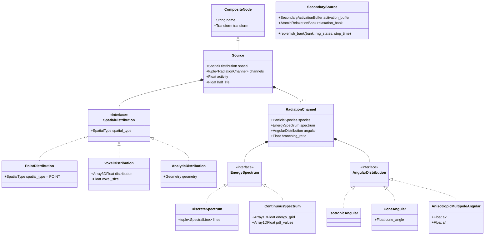
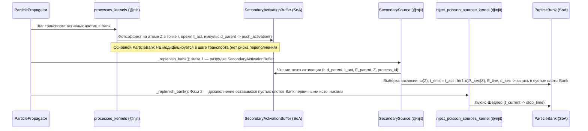

# Композиционная архитектура источников частиц и модель вторичного излучения (`SecondarySource`)

> **Статус:** Архитектурная спецификация и план реализации (согласовано, в бэклоге).
> **Связанные документы:** [`docs/architecture_backlog.md`](../architecture_backlog.md) (Раздел 31), [`docs/core_architecture.md`](../core_architecture.md), [`docs/plans/cross_sections_and_source_sampling_plan.md`](cross_sections_and_source_sampling_plan.md).

---

## 1. Мотивация и ограничения текущей модели

В текущей реализации пакета [`core/source/`](../../core/source/) класс [`Source`](../../core/source/sources.py) совмещает в одном монолитном объекте сразу четыре ортогональные ответственности:
1. **Узел 3D-сцены** (`CompositeNode`: локальная система координат, иерархия трансформаций, сериализация в дерево сцены);
2. **Пространственное распределение** (`distribution: Array3DFloat`, `voxel_size: Float`), из-за чего [`PointSource`](../../core/source/sources.py) вынужден наследовать `Source` и создавать фиктивный 3D-массив `np.ones((1, 1, 1))` с ненулевым `voxel_size`;
3. **Физику излучения** (дискретные $\gamma$-линии `lines`, изотропный/конусный вылет `cone_angle`, отсутствие явного типа частицы `species` и непрерывных спектров для $\beta^\pm / \alpha$);
4. **Кинетику распада** (`activity`, `half_life`).

При введении **вторичного излучения** (характеристический рентген $K_\alpha, K_\beta, L$ после фотоэффекта, тормозное излучение, аннигиляционные кванты $511\text{ кэВ}$, оже- и фотоэлектроны) монолитное наследование от `Source(CompositeNode)` обнаруживает фундаментальные противоречия:
* **Вторичный источник не является статическим узлом дерева 3D-сцены (`CompositeNode`)**: у него нет фиксированной матрицы трансформации в сцене — точки активации рождаются динамически в `processes_kernels.py` в произвольных мировых координатах взаимодействий первичных частиц.
* **Проблема переполнения `ParticleBank` при прямом рождении в `processes_kernels.py`**: если пытаться добавлять вторичные частицы непосредственно в основной `ParticleBank` внутри шага транспорта, банк фиксированной ёмкости `batch_capacity` переполнится при каскадах, либо потребует сложного резервирования пустых слотов и ветвлений внутри горячего цикла трекинга.
* **Специфика времени жизни и угловых распределений вторичного излучения**: время активации $t_{\text{act}}$ известно из трека родителя, время испускания $t_{\text{emit}}$ подчиняется пуассоновскому (экспоненциальному) закону распада возбуждённого уровня атома с собственной постоянной распада $\lambda_{\text{sec}}(Z) = \ln 2 / T_{1/2}(Z)$, а угловое распределение в общем случае зависит от типа процесса и импульса родительской частицы $\vec{d}_{\text{parent}}$ (например, дипольная/мультипольная анизотропия $L_3/M$-флуоресценции или угловое распределение фотоэлектронов).

---

## 2. Ключевая архитектурная идея: переход от наследования к композиции

По аналогии с тем, как физический объём в ядре строится композицией:
$$\text{Volume} = \text{CompositeNode (сцена)} + \text{Geometry (форма)} + \text{Material (физика среды)},$$
первичный источник в сцене декомпозируется на ортогональные компоненты, а вторичный источник выделяется в независимый динамический агрегат контура симуляции.



---

## 3. Декомпозиция компонентов модели

### 3.1. Ось 1: Пространственная модель (`SpatialDistribution` — «ГДЕ рождается частица в локальной СК»)

Интерфейс `SpatialDistribution` описывает исключительно геометрический закон выбора локальной координаты $\vec{r}_{\text{local}}$ внутри узла `Source`:

1. **`PointDistribution`**:
   * Не хранит массивов (`0 байт`) и не вызывает ГСЧ при генерации координаты;
   * Всегда возвращает $\vec{r}_{\text{local}} = (0, 0, 0)$, а мировая координата в `@njit`-ядре читается напрямую из столбца сдвига `(m03, m13, m23)` предвычисленной матрицы `local_to_world` без матричного умножения;
   * Полностью устраняет наследование `PointSource(VoxelSource)` и фиктивную сетку `(1, 1, 1)`.
2. **`VoxelDistribution`**:
   * Хранит `distribution: Array3DFloat` и `voxel_size: Float`;
   * При компиляции в `SourceCompiler` строит сжатый список активных вокселей `voxel_indices` и таблицы Воза (`voxel_prob`, `voxel_alias`) для $\mathcal{O}(1)$ выбора вокселя с последующим равномерным джиттерингом внутри шага `[-voxel_size/2, +voxel_size/2]`.
3. **`AnalyticDistribution(geometry: Geometry)`** *(расширение без изменения контракта `Source`)*:
   * Позволяет задать однородный источник в аналитическом примитиве (`Sphere`, `Cylinder`, `Box`) без дискретизации в воксельную сетку и связанных с ней ступенчатых артефактов на границах.

---

### 3.2. Ось 2: Физическая модель излучения (`RadiationChannel` — «ЧТО, с какой ЭНЕРГИЕЙ и под каким УГЛОМ вылетает»)

Один радионуклид может испускать частицы разных типов в рамках одного распада (например, $^{131}\text{I} \to \beta^- + \gamma$, $^{18}\text{F} \to \beta^+$). Поэтому `Source` содержит кортеж каналов `channels: tuple[RadiationChannel, ...]`, где каждый канал определяется четвёркой `(species, spectrum, angular, branching_ratio)`:

#### А. Тип частицы (`ParticleSpecies`)
```python
class ParticleSpecies(IntEnum):
    PHOTON = 0     # Гамма-кванты, характеристический рентген, тормозное излучение
    ELECTRON = 1   # Бета-минус частицы, фотоэлектроны, электроны Оже и Комптона
    POSITRON = 2   # Бета-плюс частицы (с последующей аннигиляцией на 2 x 511 кэВ)
    ALPHA = 3      # Альфа-частицы (тераностика: Ac-225, Ra-223, Lu-177 сопутств.)
```

#### Б. Энергетический спектр (`EnergySpectrum`)
1. **`DiscreteSpectrum(lines: tuple[SpectralLine, ...])`**:
   * Линейчатый спектр для ядерных $\gamma$-переходов, моноэнергетических $\alpha$-линий и характеристических рентгеновских линий $K_{\alpha 1}, K_{\alpha 2}, K_{\beta 1}, L_\alpha, \dots$;
   * В `SourceBuffer` компилируется в таблицы Воза `line_energies`, `line_prob`, `line_alias` ($\mathcal{O}(1)$).
2. **`ContinuousSpectrum(energy_grid: Array1DFloat, pdf_values: Array1DFloat)`**:
   * Кусочно-линейная плотность вероятности $p(E)$ на сетке $[E_0, E_1, \dots, E_M]$ (для $\beta^\pm$-спектров Ферми и тормозного спектра);
   * **Компиляция для $\mathcal{O}(1)$ выборки в `@njit` (Zero-Loop Sampling):**
     - На этапе `SourceCompiler` вычисляются площади трапеций каждого интервала $A_k = \frac{1}{2}(p_k + p_{k+1})(E_{k+1} - E_k)$ и по ним строится таблица Воза интервалов (`bin_prob`, `bin_alias`);
     - В `@njit`-ядре за $\mathcal{O}(1)$ по таблице Воза выбирается интервал $k$, после чего энергия внутри трапеции $[E_k, E_{k+1}]$ находится аналитическим обращением квадратичной функции распределения по одному случайному числу $u \sim \mathcal{U}(0, 1)$ (или методом разложения трапеции на прямоугольник и треугольник без единого `sqrt`).

#### В. Угловое распределение (`AngularDistribution` относительно опорного орта $\vec{n}_{\text{ref}}$)
Все угловые распределения параметризуются в полярных углах $(\theta, \varphi)$ относительно единичного опорного вектора $\vec{n}_{\text{ref}}$ и затем поворачиваются в мировую СК базисным преобразованием Родрига–Френе:
* Для первичного источника `Source` опорный вектор $\vec{n}_{\text{ref}}$ — это ось $OZ$ локальной СК узла, переведённая в мировую СК (`(m02, m12, m22)` матрицы `local_to_world`);
* Для вторичного источника `SecondarySource` опорный вектор $\vec{n}_{\text{ref}} = \vec{d}_{\text{parent}}$ — направление импульса родительской частицы в момент взаимодействия.

Поддерживаемые законы:
1. **`IsotropicAngular`**: $\cos\theta = 1 - 2u_1$, $\varphi = 2\pi u_2$ (для первичных объёмных источников и изотропной $K$-флуоресценции с $j = 1/2$);
2. **`ConeAngular(cone_angle: Float)`**: $\cos\theta \sim \mathcal{U}(\cos\theta_{\max}, 1)$ вокруг $\vec{n}_{\text{ref}}$;
3. **`AnisotropicMultipoleAngular(a2: Float, a4: Float = 0.0)`**:
   * Описывает угловую корреляцию вторичного излучения после фотоэффекта / ионизации оболочек с $j > 1/2$ ($L_3, M$-подоболочки) и ядерных каскадов через полиномы Лежандра:
     $$W(\cos\theta) = 1 + \mathcal{A}_2 P_2(\cos\theta) + \mathcal{A}_4 P_4(\cos\theta), \quad P_2(\mu) = \frac{3\mu^2 - 1}{2};$$
   * В `@njit`-ядре разыгрывается за 1–2 итерации метода Неймана с точной аналитической мажорантой $W_{\max} = \max_{\mu \in [-1, 1]} W(\mu)$.

---

### 3.3. Ось 3: Архитектура вторичного источника (`SecondarySource`)

`SecondarySource` **не наследует `CompositeNode`** и не входит в граф сцены. Он принадлежит контуру симуляции (`SimulationManager` / `ParticlePropagator`) и работает как буферизованный генератор между ядрами взаимодействий `processes_kernels.py` и этапом пополнения банка `_replenish_bank`.



#### 1. Буфер точек активации (`SecondaryActivationBuffer`)
Предвыделенная SoA-структура фиксированной ёмкости `capacity = 2 * batch_capacity`:
```python
class SecondaryActivationBuffer(NamedTuple):
    pos_x: Array1DFloat           # Мировая координата X точки взаимодействия (мм)
    pos_y: Array1DFloat           # Мировая координата Y точки взаимодействия (мм)
    pos_z: Array1DFloat           # Мировая координата Z точки взаимодействия (мм)
    dir_x: Array1DFloat           # Направление импульса родителя d_x
    dir_y: Array1DFloat           # Направление импульса родителя d_y
    dir_z: Array1DFloat           # Направление импульса родителя d_z
    activation_time: Array1DFloat # Время взаимодействия t_act (нс)
    parent_energy: Array1DFloat   # Энергия родителя до поглощения E_parent (МэВ)
    parent_id: Array1DInt         # Сквозной ID первичной истории (для привязки дерева треков)
    target_z: Array1DInt          # Атомный номер ионизированного элемента Z (1..100)
    process_id: Array1DInt        # Код процесса (PHOTOELECTRIC, POSITRON_ANNIHILATION и т.д.)
    cursor: Array1DInt            # Одноэлементный массив [count] текущего числа записей
```

#### 2. Предкомпилированный банк атомной релаксации (`AtomicRelaxationBank`)
Компилируется в `PhysicsCompiler` из таблиц EADL / NIST для $Z = 1..100$:
* Пороги ионизации подоболочек $E_{\text{bind}}(Z, s)$ ($K, L_1, L_2, L_3$);
* Вероятности образования вакансии на $s$-й подоболочке при $E_{\text{parent}} \ge E_{\text{bind}}(Z, s)$ (через скачки краёв поглощения $r_s - 1 / r_s$);
* Выход флуоресценции $\omega(Z, s) \in [0, 1]$ (вероятность радиационного перехода против безызлучательного эффекта Оже);
* Постоянная распада возбуждённого состояния атома $\lambda_{\text{sec}}(Z, s) = \ln 2 / T_{1/2}(Z, s)$ ($\text{нс}^{-1}$, в единицах `hepunits`);
* Коэффициент угловой анизотропии $\mathcal{A}_2(Z, s)$ для радиационных переходов на данную вакансию;
* Таблицы Воза энергий и вероятностей переходов (`line_energies`, `line_prob`, `line_alias`).

#### 3. Пуассоновский розыгрыш времени испускания и естественная приоритезация на этапе `_replenish_bank`
* Каждый возбуждённый ион в `SecondaryActivationBuffer` — это независимый микро-источник из **одного** возбуждённого атома с временем активации $t_{\text{act}}$ и интенсивностью распада $\lambda_{\text{sec}}(Z, s) \sim 10^{5}\text{–}10^{7}\text{ нс}^{-1}$ ($10^{14}\text{–}10^{16}\text{ с}^{-1}$).
* Время испускания вторичного кванта разыгрывается строго по пуассоновскому закону интервалов (экспоненциальному распределению времени жизни состояния) за $\mathcal{O}(1)$:
  $$t_{\text{emit}} = t_{\text{act}} - \frac{\ln(1 - u)}{\lambda_{\text{sec}}(Z, s)}, \quad u \sim \mathcal{U}[0, 1).$$
* **Почему вторичный источник не нужно включать в общую мажоранту Льюиса–Шедлера первичных источников и почему он естественным образом имеет наивысший приоритет:**
  - Активность одиночной атомной вакансии в момент её жизни $\lambda_{\text{sec}} \sim 10^{15}\text{ с}^{-1}$ на $5\text{–}8$ порядков превышает типичную макроскопическую активность медицинских фантомов ($10^7\text{–}10^9\text{ Бк}$), но длится всего $\tau = 1/\lambda_{\text{sec}} \sim 10^{-15}\text{ с}$ и завершается ровно **одним** актом испускания.
  - Поэтому в начале `_replenish_bank` ядро `inject_secondary_sources_kernel` первым забирает накопленные точки активации из `SecondaryActivationBuffer`, разыгрывает для каждой $t_{\text{emit}}$ и (если произошёл радиационный переход с вероятностью $\omega(Z, s)$ и $t_{\text{emit}} < \text{stop\_time}$) записывает рождённую вторичную частицу в свободный слот `ParticleBank`, наследуя `parent_id` первичной истории.
  - Все оставшиеся свободные слоты `ParticleBank` тут же дозаполняются первичными источниками через `inject_poisson_sources_kernel`.
  - В случае каскадного переполнения (если в `SecondaryActivationBuffer` оказалось больше событий, чем свободных слотов в `ParticleBank`), необработанные события остаются в хвосте `SecondaryActivationBuffer` (`cursor` сдвигается на число выгруженных частиц) и гарантированно выгружаются на следующей итерации `_replenish_bank`. Поскольку на один шаг фотоэффекта рождается не более одного характеристического кванта (с вероятностью $\omega(Z) < 1$), размер `SecondaryActivationBuffer` никогда не растёт лавинообразно и ограничен сверху $\mathcal{O}(\text{batch\_capacity})$.

---

## 4. Плоское SoA-представление в `SourceBuffer` для Numba JIT

Чтобы сохранить **Zero-Allocation** и отсутствие ООП-диспетчеризации в `@njit`-ядрах, композиционная модель `Source` при вызове `SourceCompiler.compile()` уплощается в единый `SourceBuffer(NamedTuple)`, где полиморфизм заменён компактными целочисленными тегами:

| Поле `SourceBuffer` | Тип | Назначение |
| :--- | :--- | :--- |
| `spatial_types` | `Array1DInt` (`(N_src,)`) | `0 = POINT`, `1 = VOXEL`, `2 = ANALYTIC_SPHERE`, ... |
| `transforms` | `Array3DFloat` (`(N_src, 4, 4)`) | Матрицы `local_to_world` |
| `voxel_sizes` | `Array1DFloat` (`(N_src,)`) | Размеры вокселей (`0.0` для `POINT`) |
| `voxel_offsets`, `voxel_counts`, `voxel_indices`, `voxel_prob`, `voxel_alias` | `Array1D*` | Плоские CSR-массивы Воза только для `VOXEL`-источников (`0` элементов для `POINT`) |
| `channel_offsets`, `channel_counts` | `Array1DInt` (`(N_src,)`) | CSR-диапазоны каналов излучения каждого источника |
| `channel_species` | `Array1DInt` (`(N_ch,)`) | Код частицы `ParticleSpecies` (`PHOTON`, `ELECTRON`, `POSITRON`, `ALPHA`) |
| `channel_branching` | `Array1DFloat` (`(N_ch,)`) | Коэффициенты ветвления каналов распада |
| `spectrum_types` | `Array1DInt` (`(N_ch,)`) | `0 = DISCRETE`, `1 = CONTINUOUS_TRAPEZOID` |
| `spectrum_offsets`, `spectrum_counts` | `Array1DInt` (`(N_ch,)`) | Смещения в таблицах Воза линий или трапеций непрерывного спектра |
| `angular_types` | `Array1DInt` (`(N_ch,)`) | `0 = ISOTROPIC`, `1 = CONE`, `2 = MULTIPOLE` |
| `angular_params` | `Array2DFloat` (`(N_ch, 2)`) | Параметры углового распределения (`[cos_cone, 0]` или `[a2, a4]`) |

При этом для `PointDistribution` в `voxel_indices`, `voxel_prob` и `voxel_alias` не выделяется **ни одного элемента** (`voxel_counts[s] == 0`), а координата в ядре вычисляется за одну ветку `if spatial_types[s] == SPATIAL_POINT: px, py, pz = m[0, 3], m[1, 3], m[2, 3]`.

---

## 5. Сериализация и соблюдение инварианта `Roundtrip` (`export(build(config)) == config`)

В конфигурационном слое [`core/config/schemas.py`](../../core/config/schemas.py) схема источника становится декларативной композицией дискриминированных объединений (`Annotated[Union[...], Field(discriminator="type")]`):

```yaml
sources:
  - name: "Tc99m_Point_Marker"
    transform: { position: [0.0, 0.0, 50.0], rotation: [0.0, 0.0, 0.0] }
    activity: 1.0e+6
    half_life: 2.1624e+13
    spatial:
      type: "point"
    channels:
      - species: "photon"
        branching_ratio: 0.89
        spectrum:
          type: "discrete"
          lines:
            - { energy: 0.1405, intensity: 1.0 }
        angular:
          type: "isotropic"

  - name: "Phantom_Liver_Voxel"
    transform: { position: [0.0, 0.0, 0.0], rotation: [0.0, 0.0, 0.0] }
    activity: 5.0e+7
    half_life: 2.1624e+13
    spatial:
      type: "voxel"
      voxel_size: 2.0
      distribution_dataset: "sources/Phantom_Liver_Voxel/distribution"
    channels:
      - species: "photon"
        branching_ratio: 0.89
        spectrum:
          type: "discrete"
          lines:
            - { energy: 0.1405, intensity: 1.0 }
        angular:
          type: "cone"
          cone_angle: 0.5235987756
```

* Настройки вторичного излучения относятся не к дереву сцены, а к секции физики `simulation.physics`:
  ```yaml
  simulation:
    physics:
      enable_atomic_relaxation: true
      fluorescence_energy_cutoff: 0.001 # 1 кэВ в МэВ (hepunits)
  ```
* Это сохраняет 100% чистоту дерева сцены и строгий инвариант `export(build(config)) == config`.

---

## 6. Поэтапный план реализации

### Фаза 1: Композиционная модель первичного источника (`SpatialDistribution` + `RadiationChannel`)
1. Ввести в `core/source/` иммутабельные датаклассы:
   * `SpatialDistribution` (`PointDistribution`, `VoxelDistribution`);
   * `EnergySpectrum` (`DiscreteSpectrum`, `ContinuousSpectrum`);
   * `AngularDistribution` (`IsotropicAngular`, `ConeAngular`, `AnisotropicMultipoleAngular`);
   * `RadiationChannel(species, spectrum, angular, branching_ratio)`.
2. Перевести `Source(CompositeNode)` на композицию `spatial: SpatialDistribution` и `channels: tuple[RadiationChannel, ...]`, удалив наследование `PointSource(Source)` (заменив при необходимости компактной фабричной функцией `Source.create_point(...)` / `Source.create_voxel(...)`).
3. Обновить `SourceCompiler`, `SourceBuffer` и `source_kernels.py` для прямой поддержки `SPATIAL_POINT` (без массивов вокселей), `CONTINUOUS_TRAPEZOID` и `ANGULAR_MULTIPOLE`.
4. Обновить Pydantic-схемы `core/config/schemas.py`, `SceneBuilder`, `SceneExporter` и ViewModel инспектора свойств GUI с проверкой инварианта `Roundtrip`.

### Фаза 2: Таблицы атомной релаксации и `AtomicRelaxationBank`
1. Сформировать компактную таблицу параметров атомной релаксации ($Z = 1..100$: энергии подоболочек $K, L_1, L_2, L_3$, скачки поглощения $r_s$, выходы флуоресценции $\omega_s$, времена полураспада вакансий $T_{1/2}(Z, s)$, коэффициенты анизотропии $\mathcal{A}_2$ и энергии/интенсивности переходов $K_{\alpha 1}, K_{\alpha 2}, K_{\beta 1}, K_{\beta 2}, L_\alpha, L_\beta$).
2. Расширить `PhysicsCompiler` компиляцией `AtomicRelaxationBank(NamedTuple)` с таблицами Воза для каждого ионизируемого уровня.

### Фаза 3: `SecondaryActivationBuffer`, `SecondarySource` и интеграция в транспорт
1. Реализовать `SecondaryActivationBuffer` и запись точек активации из `processes_kernels.py` при фотоэффекте (и при необходимости — аннигиляции позитронов).
2. Реализовать `@njit`-ядро `inject_secondary_sources_kernel`, выполняющее:
   * выбор ионизированной оболочки по $E_{\text{parent}} \ge E_{\text{bind}}(Z, s)$;
   * проверку выхода флуоресценции $u < \omega(Z, s)$;
   * пуассоновский розыгрыш времени испускания $t_{\text{emit}} = t_{\text{act}} - \ln(1 - u) / \lambda_{\text{sec}}(Z, s)$ с отсечкой по `stop_time`;
   * розыгрыш энергии линии по таблице Воза в `AtomicRelaxationBank` и направления вылета с учётом мультипольной анизотропии $\mathcal{A}_2$ относительно $\vec{d}_{\text{parent}}$;
   * укладку вторичного фотона в свободный слот `ParticleBank` с сохранением `parent_id` первичной истории.
3. Интегрировать двухфазное пополнение в `ParticlePropagator._replenish_bank` (сначала разрядка `SecondarySource`, затем дозаполнение первичными источниками) и обновить условие завершения симуляции (`_emission_finished and secondary_buffer.cursor[0] == 0 and active_in_bank == 0`) с поддержкой сохранения неразряженного хвоста `SecondaryActivationBuffer` при чекпоинте (`Stateful Resume`).

### Фаза 4: Верификация и тесты
1. Юнит-тесты `PointDistribution` (0 байт воксельных массивов, точное совпадение со столбцом сдвига `transform`), `ContinuousSpectrum` (согласие выборки с аналитической плотностью по критерию Колмогорова–Смирнова) и `AnisotropicMultipoleAngular` (воспроизведение второго момента $\langle P_2(\cos\theta)\rangle = \mathcal{A}_2 / 5$).
2. Физические тесты характеристического излучения на свинцовом коллиматоре (`Pb`, $K_\alpha \approx 75\text{ кэВ}$, $K_\beta \approx 85\text{ кэВ}$) и кристаллическом детекторе `NaI(Tl)` ($K$-escape пик иода при $E_\gamma - E_K(\text{I}) \approx E_\gamma - 33.17\text{ кэВ}$).
3. Сквозной тест `Roundtrip` и `Stateful Resume` при активном `SecondarySource`.
