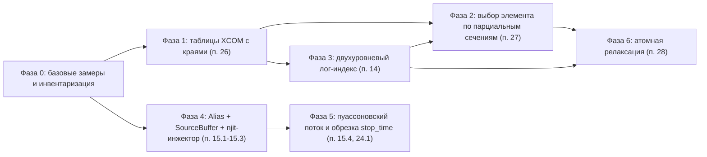

# План доработок: точные сечения с $\mathcal{O}(1)$ поиском, выбор элемента-мишени и генерация первичных частиц

Документ детализирует реализацию пунктов 14, 15, 24.1, 26, 27 и 28 архитектурного бэклога [`docs/architecture_backlog.md`](file:///d:/Python%20Projects/NMSimToolkit-Refactor/docs/architecture_backlog.md).

---

## 0. Исходные положения и принятые решения

### 0.1. Результаты аудита (основание для плана)

| Наблюдение | Источник | Следствие |
| :--- | :--- | :--- |
| Сетка NIST: шаг `1 кэВ` в `1–1000 кэВ`, `22–51 кэВ` в `1–10 МэВ`, верхняя граница `10 МэВ`, `~1110–1130` узлов на элемент | `tables/NIST XCOM Elements MAC.h5` | Пересэмплирование на равномерную лог-сетку $N \leq 2048$ ухудшает точность; сетка сама по себе плотная |
| Края поглощения не представлены парами узлов (Pb K: скачок `×4.6` размазан на `88–89 кэВ`; Pb L3: значение над краем отсутствует) | там же | Точность на краях ограничена данными; требуется перегенерация таблиц (Фаза 1) |
| Сдвиг дублей на `-1 эВ` в `AttenuationDataBase._add_material` не срабатывает | [`attenuation_database.py`](file:///d:/Python%20Projects/NMSimToolkit-Refactor/core/materials/attenuation_database.py#L82-L84) | Мертвый код, удаляется |
| `Process._energy_range = [1 кэВ, 20 МэВ]` при данных до `10 МэВ` | [`processes.py`](file:///d:/Python%20Projects/NMSimToolkit-Refactor/core/physics/processes.py#L48) | Молчаливая экстраполяция константой выше `10 МэВ` |
| Элемент-мишень выбирается по массовой доле | [`_sample_Z_scalar`](file:///d:/Python%20Projects/NMSimToolkit-Refactor/core/physics/processes_kernels.py#L82-L104) | ~15% неверных $Z$ для фотоэффекта в NaI (Фаза 2) |
| Таблица эмиссии источника уже разреженная; `meshgrid` только при инициализации | [`Source._generate_emission_table`](file:///d:/Python%20Projects/NMSimToolkit-Refactor/core/source/sources.py#L186-L211) | Оптимизация инициализации исключена из скоупа |
| `rng.choice(..., p=...)` пересчитывает CDF длины $K$ на каждом вызове | [`Source.generate_position`](file:///d:/Python%20Projects/NMSimToolkit-Refactor/core/source/sources.py#L252-L260) | Главная горячая цена источника (Фаза 4) |
| Время эмиссии разыгрывается внутри окна батча | [`Source.generate_emission_time`](file:///d:/Python%20Projects/NMSimToolkit-Refactor/core/source/sources.py#L262-L273) | Поток зависит от разбиения на батчи (Фаза 5) |

### 0.2. Принятые решения

1. **Совместимость потока ГСЧ с предыдущими версиями не сохраняется.** Побитовые эталоны, завязанные на старый поток, пересчитываются; корректность выборок подтверждается статистическими критериями.
2. **Инвариант независимости от разбиения внутри версии сохраняется и усиливается:** `[0, T1] + [T1, T2] ≡ [0, T2]` побитово (досчет `Stateful Resume`).
3. **Точные узлы таблиц сечений не пересэмплируются.** Ускорение поиска достигается вспомогательным индексом поверх точной сетки.
4. **Число распадов за интервал — пуассоновская случайная величина** (вместо детерминированного ожидания).
5. **No Legacy Crutches:** устаревшие методы и поля удаляются, а не сохраняются рядом с новыми.

### 0.3. Граф зависимостей фаз

Ветки «Сечения» (Фазы 1–3) и «Источник» (Фазы 4–5) независимы и могут выполняться параллельно. Фаза 2 опирается на поиск строки из Фазы 3 (допустима реализация до Фазы 3 на текущем `searchsorted` с последующей заменой).

---

## Фаза 0. Базовые замеры и инвентаризация

### Цель
Зафиксировать исходные метрики и все точки, затрагиваемые изменениями.

### Задачи
1. Прогнать `verification/profiling/micro_benchmarks.py` (`M1`, `M3`), `step_profiler.py` (фазы `P2_source_injection`, `P5_woodcock_transport`) и `transport_telemetry.py` на `W1–W3`; сохранить отчет в `verification/reports/profiling/`.
2. Снять пофазные дельты `psutil.Process().num_page_faults()` на стационарной фазе `W2`/`W3` (база для критерия Zero-Allocation инжектора).
3. Инвентаризация через `codebase-memory`:
   * вызывающие `Source.generate_position`, `generate_direction`, `generate_energy`, `generate_emission_time`, `Source.rng`, `Source.emission_table` (включая `gui/` и `verification/`);
   * владельцы генераторов ГСЧ в `SimulationManager` / `simulation_worker` и состав состояния досчета (`final_rng_state`, `particle_id_end`, `inspect_resume_state`);
   * тесты с побитовыми эталонами, зависящими от потока источника (`tests/source/`, `tests/transport/`, `tests/config/`);
   * потребители `ElementCSR.element_fraction` и `InteractionBuffer.Z`.

### Критерий приемки
Отчет с базовыми метриками и список затрагиваемых модулей и тестов приложен к PR Фазы 1 / Фазы 4.

---

## Фаза 1. Таблицы NIST XCOM с краями поглощения (п. 26)

### Цель
Точное представление разрывов сечения фотоэффекта и согласованный энергетический диапазон.

### 1.1. Скрипт генерации таблицы
* Воспроизводимый офлайн-скрипт (расположение согласовать: каталог утилит генерации данных рядом с `tables/`), формирующий `tables/NIST XCOM Elements MAC.h5` новой схемы:
  * `/<Element>/Energy` — монотонно неубывающая сетка, края поглощения — **пары одинаковых энергий**;
  * `/<Element>/<Process>` — значения; в паре края первый узел — значение ниже края, второй — выше;
  * `/<Element>/Edges/energy`, `/<Element>/Edges/label` (`K`, `L1`, `L2`, `L3`, `M1…M5`) — для Фазы 6;
  * атрибуты файла: версия схемы, источник данных, диапазон энергий.
* Диапазон: до `20 МэВ` (предпочтительно) либо фиксация `E_max = 10 МэВ` во всем ядре.
* Сетка вне краев — прежняя (шаг `1 кэВ` до `1 МэВ`), чтобы не менять интерполяционную точность в рабочем диапазоне ядерной медицины.

### 1.2. `AttenuationDataBase` (`core/materials/attenuation_database.py`)
* `_load_elements_MAC`: валидация схемы (монотонность, допустимы только пары дублей, наличие `Edges`); при нарушении — `ValueError` (Fail-Fast).
* `_add_material`: объединение сеток элементов **с сохранением пар узлов краев** (вместо `np.unique`); для каждого элемента — односторонняя интерполяция: в левом узле пары используется левый предел, в правом — правый. Для элемента без края в данной точке оба узла пары получают одно значение.
* Удаление сдвига `-1 эВ`.

### 1.3. `AttenuationFunction` и `PhysicsCompiler`
* [`AttenuationFunction.__init__`](file:///d:/Python%20Projects/NMSimToolkit-Refactor/core/materials/attenuation_functions.py#L28-L45): обрезка по `energy_range` не должна разрывать пару узлов края.
* `np.interp` в `AttenuationFunction.__call__` на сетке с дублями возвращает одно из значений в точке края — для компиляции `MaterialBank` значения брать **по индексам узлов**, а не повторной интерполяцией на той же сетке (в [`_build_material_bank`](file:///d:/Python%20Projects/NMSimToolkit-Refactor/core/physics/physics_compiler.py#L65-L69) сетка первого процесса совпадает с сетками остальных — контракт проверяется явно).
* Согласование `Process._energy_range` с диапазоном таблицы; предусловие в `PhysicsCompiler.compile_scene`: все линии спектров источников внутри `[E_min, E_max]`.

### 1.4. Тесты (новый доменный каталог `tests/materials/`, зеркальный `core/materials/`; `tests/physics/`)
* Пары узлов краев сохраняются после смешивания (NaI: края I K/L; ткань: без краев в рабочем диапазоне).
* Отношение $\mu_{pe}$ над/под K-краем Pb, I, W соответствует эталону NIST XCOM (допуск `0.1%`).
* Интерполяция по `_get_macroscopic_cross_sections` в точках $E_{edge} \pm 1$ эВ дает значения соответствующих сторон края.
* Нарушение схемы таблицы и линия источника вне диапазона приводят к исключению.

### Критерий приемки
Все тесты проходят; спектр поглощения Pb/NaI на краях совпадает с NIST; мертвый код удален.

---

## Фаза 2. Выбор элемента-мишени по парциальным сечениям (п. 27)

### Цель
Физически корректный выбор $Z$ для каждого процесса.

### 2.1. Данные
* В `AttenuationDataBase._add_material` сохранять, помимо суммы, парциальные вклады элементов $w_i (\mu/\rho)_{p,i}(E)$ на объединенной сетке материала.
* В [`PhysicsBuffer`](file:///d:/Python%20Projects/NMSimToolkit-Refactor/core/physics/physics_buffer.py) / [`ElementCSR`](file:///d:/Python%20Projects/NMSimToolkit-Refactor/core/physics/physics_buffer.py#L13-L20): поле `element_fraction` заменяется на `element_lac_table: NDArray[Float]` формы `(total_rows, max_elements, num_processes)` — строки совпадают со строками `physics_lac_table`, слоты элементов в порядке `element_Z` материала, недостающие слоты заполнены нулями. Плотность учитывается так же, как в `physics_lac_table`.
* Инвариант (проверяется в `PhysicsCompiler`): сумма по слотам равна `physics_lac_table[row, process]` с относительной погрешностью `≤ 1e-12`.

### 2.2. Ядро
* `_sample_Z_scalar(mat_id, process_idx, row, fraction, total_lac, physics_buffer, rng_ctx)`: порог $u \cdot \mu_p(E)$, кумулятивный проход по слотам с линейной интерполяцией каждого вклада теми же `row`/`fraction`, что и при вычислении полного сечения.
* Строка и доля интерполяции вычисляются функцией поиска интервала (Фаза 3), выделенной из `_get_macroscopic_cross_sections` в самостоятельный `@njit(inline='always')`-примитив.
* Применение: фотоэффект — сразу; комптоновское и когерентное рассеяние — при появлении зависимых от $Z$ моделей ($S(x, Z)$, $F(x, Z)$), таблица уже содержит их столбцы.

### 2.3. Тесты (`tests/physics/`)
* NaI при 140 кэВ: частота $Z = 53$ для фотоэффекта совпадает с $\mu_{pe,I}/\mu_{pe}$ (критерий $\chi^2$, $10^6$ выборок).
* Однокомпонентный материал: детерминированный $Z$ без потребления случайного числа.
* Обновление моков `ElementCSR` в `tests/physics/test_processes.py`, `tests/transport/conftest.py`, `tests/transport/test_step5_transport.py`.

### Критерий приемки
Статистические тесты проходят; `element_fraction` удален из кода и документации ([`docs/core_architecture.md`](file:///d:/Python%20Projects/NMSimToolkit-Refactor/docs/core_architecture.md)).

---

## Фаза 3. Двухуровневый лог-индекс поиска интервала (п. 14)

### Цель
$\mathcal{O}(1)$ поиск строки таблицы без изменения результата интерполяции.

### 3.1. Структуры (`core/materials/material_bank.py`)
* `MaterialPointerDType`: новое поле `lookup_offset: Index`.
* `MaterialBank`: новые поля `lookup_bin_start: NDArray[Index]` (плоский массив `num_scene_materials × num_bins`), `lookup_log_e_min: Float`, `lookup_inv_dlog_e: Float`, `lookup_num_bins: int`, `lookup_max_advance: int`.
* `MaterialBank._validate`: согласованность размеров, `lookup_bin_start` монотонен внутри материала.

### 3.2. Компиляция (`PhysicsCompiler._build_material_bank`)
* Общий диапазон корзин — `[E_min, E_max]` таблицы. Число корзин подбирается так, чтобы максимум узлов на корзину по всем материалам не превышал `3` (ориентир `4096`: ширина корзины `~2.25 кэВ` при 1 МэВ). Достигнутый максимум сохраняется в `lookup_max_advance` и проверяется предусловием.
* Для материала: `bin_start[b] = searchsorted(grid, E_b, side='right') - 1` с ограничением `[0, length - 2]`, где $E_b$ — левая граница корзины (вычисляется векторно один раз).

### 3.3. Ядро (`core/physics/physics_kernels.py`)
* `_compute_log_bin(energy, material_bank) -> Index` — один `log` и одно умножение, ограничение `[0, num_bins - 1]`.
* `_locate_row(energy, log_bin, material_id, material_bank) -> (row, fraction)` — `bin_start` и досмотр вперед `while idx + 1 < length - 1 and energy >= grid[idx + 1]` (не более `lookup_max_advance` итераций); на паре узлов края (`e1 == e0`) — переход на правую сторону; обработка `E < E_min` / `E > E_max` идентична текущей.
* `_get_macroscopic_cross_sections(energy, log_bin, material_id, material_bank, out_lacs_slice)` — интерполяция по `_locate_row`.

### 3.4. Транспортное ядро (`core/transport/transport_kernels.py`)
* В [`make_transport_kernel`](file:///d:/Python%20Projects/NMSimToolkit-Refactor/core/transport/transport_kernels.py#L202-L294): `log_bin` вычисляется один раз при входе частицы в цикл Вудкока (энергия неизменна до реального взаимодействия) и передается в оба вызова — для мажоранты и материала вокселя.
* Синхронно обновить `verification/profiling/transport_telemetry.py` и `micro_benchmarks.py` (`M1` сравнивает бинарный поиск и двухуровневый индекс на реальном `MaterialBank`).

### 3.5. Тесты (`tests/physics/`)
* **Побитовая эквивалентность:** для $10^6$ случайных энергий в `[E_min/2, 2·E_max]`, всех узлов сетки, точек краев и $E_{edge} \pm \varepsilon$ результат совпадает с эталонной реализацией на `np.searchsorted` (эталон хранится в тесте).
* Предусловие `lookup_max_advance` нарушается при искусственно малом числе корзин → исключение компиляции.

### Критерий приемки
Побитовая эквивалентность; ускорение `M1` и доля `P5_woodcock_transport` в `W3` зафиксированы в отчете профилирования.

---

## Фаза 4. Vose's Alias, `SourceBuffer` и `@njit`-инжектор (п. 15.1–15.3)

### Цель
Zero-Allocation генерация первичных частиц напрямую в `ParticleBank` с потоком ГСЧ, не зависящим от границ батчей.

### 4.1. Модули
* `core/source/alias_tables.py` (или в составе `source_compiler.py` — решить по SRP): `build_alias_tables(probabilities) -> (prob: float64, alias: int32)` за $\mathcal{O}(K)$ (алгоритм Воза с устойчивой обработкой остатков: финальные элементы обеих очередей получают `prob = 1.0`).
* `core/source/source_buffer.py`: `SourceBuffer(NamedTuple)`:
  * `voxel_offsets: Index[S+1]`, `voxel_index: int32[ΣK]` (плоские индексы вокселей), `voxel_prob: float64[ΣK]`, `voxel_alias: int32[ΣK]`;
  * `grid_shape: Index[S, 3]`, `voxel_size: Float[S]`, `half_size: Float[S, 3]`;
  * `line_offsets: Index[S+1]`, `line_energy`, `line_prob`, `line_alias`;
  * `local_to_global: Float[S, 4, 4]`;
  * `initial_activity: Float[S]`, `decay_constant: Float[S]`.
* `core/source/source_compiler.py`: `SourceCompiler.compile(active_sources) -> SourceBuffer` с предусловиями (непустые распределения, неотрицательные вероятности, нормировка).
* `core/source/source_kernels.py`: `@njit(cache=True)`-примитивы:
  * `_sample_alias(prob, alias, offset, count, rng_ctx) -> Index` — два равномерных числа (индекс корзины и сравнение с `prob`);
  * `_sample_voxel_position(...)` — индекс вокселя → `unravel` → центр минус `half_size` плюс равномерное смещение в пределах вокселя → преобразование `local_to_global`;
  * `_sample_isotropic_direction(rng_ctx)`;
  * `_write_primary(bank arrays, slot, ...)` — запись `KinematicState`, `InitialState`, обновление навигационного состояния (эквивалент `update_navigation_state_inject_kernel`).

### 4.2. Изменения `Source` (`core/source/sources.py`)
* `emission_table` заменяется на плоские индексы активных вокселей и вероятности; alias-таблицы строятся в сеттерах `distribution` / `energy` / `voxel_size`.
* Удаляются `generate_position`, `generate_direction`, `generate_energy`, `generate_emission_time`, `inject`, поле `rng` (после аудита Фазы 0; GUI-потребители, если есть, переводятся на `SourceCompiler` + ядра).
* `PointSource` — частный случай с `K = 1` и `voxel_size = 0` (без потребления случайных чисел на смещение — последовательность остается детерминированной функцией последовательности частиц).

### 4.3. Поиск свободных слотов
* Инжектор сканирует `state.is_active` с курсора внутри ядра; Python-вызов `np.where(~is_active)` из [`ParticleBank.inject_particles`](file:///d:/Python%20Projects/NMSimToolkit-Refactor/core/particles/particles.py#L53-L110) на горячем пути исключается. Метод `inject_particles` сохраняется только при наличии иных потребителей (аудит Фазы 0), иначе удаляется.

### 4.4. Тесты (`tests/source/`)
* Alias-таблицы: `prob ∈ [0, 1]`, `alias ∈ [0, K)`, восстановление вероятностей $p_i = \big(\text{prob}_i + \sum_{j:\,\text{alias}_j = i} (1 - \text{prob}_j)\big)/K$ с погрешностью `≤ 1e-12`; вырожденные случаи (`K = 1`, равные вероятности, одна доминирующая).
* $\chi^2$ частот вокселей и линий спектра ($10^6$ выборок); равномерность внутри вокселя (KS по каждой оси); изотропия направлений (KS по $\cos\theta$ и $\varphi$).
* Глобальные координаты при ненулевом `local_to_global` (сдвиг и поворот).
* Независимость от разбиения: инжекция $N$ частиц одним вызовом и вызовами $K_1 + K_2$ дает побитово одинаковые состояния банка.
* Переписывание `tests/source/test_sources.py` под новый контракт (без эталонов старого потока).

### Критерий приемки
`M3` `≥ 5x`; доля инжекции в шаге `W2`/`W3` `< 3%`; нулевой прирост page faults на стационарной фазе по сравнению с базой Фазы 0 в части источника.

---

## Фаза 5. Пуассоновский поток распадов и точная обрезка по `stop_time` (п. 15.4, 24.1)

### Цель
Физически корректная статистика счета, точная граница интервала и побитовый досчет.

### 5.1. Алгоритм (`core/source/source_kernels.py`)
Суперпозиция источников с прореживанием Льюиса–Шедлера:

1. Мажоранта $A_{\max} = \sum_s A_s(t_{\text{ref}})$, где $t_{\text{ref}}$ — начало первого сегмента расчета (для распадающихся источников $A_s(t) \leq A_s(t_{\text{ref}})$ при $t \geq t_{\text{ref}}$).
2. Цикл, пока есть свободный слот:
   * если задано `pending_arrival_time` — кандидат $t$ берется из него без розыгрыша; иначе $t \leftarrow t_{\text{last}} + (-\ln(1 - u_1)) / A_{\max}$;
   * если $t \geq$ `stop_time` — сохранить `pending_arrival_time = t`, завершить;
   * $x = u_2 \cdot A_{\max}$; проход по источникам с вычитанием $A_s(t)$; первый источник с $x < 0$ принимается, иначе кандидат отвергается (`t_last = t`, продолжить);
   * для принятого источника — генерация частицы примитивами Фазы 4 с `emission_time = t`.
3. Проверка свободного слота выполняется **до** розыгрыша очередного кандидата, чтобы остановка по заполнению банка не нарушала последовательность случайных чисел.

* Эффективность прореживания $\bar A(t)/A_{\max}$: для $^{99\text{m}}\text{Tc}$ при 30-минутной съемке `> 94%`. Для длительных съемок относительно периода полураспада — опционально кусочно-постоянная мажоранта на фиксированной **абсолютной** сетке времени (граница корзины — точка перезапуска потока; не зависит от батчей).

### 5.2. `SimulationManager` (`core/transport/simulation_managers.py`)
* `_replenish_bank` вызывает инжектор с `SourceBuffer`, `RNGContext` генератора эмиссии, `stop_time` и состоянием потока (`t_last`, `pending_arrival_time`, `t_ref`).
* `global_timer` = время последнего обработанного кандидата; критерий завершения пополнения — наличие `pending_arrival_time ≥ stop_time`.
* Удаляются `_calculate_time_step`, `_distribute_quotas`, `MAX_NEWTON_ITERATIONS`, `NEWTON_TARGET_PRECISION`, `MIN_TIME_STEP`.
* Генератор эмиссии — единственный (`emission_rng`), порождается от `SeedSequence` задачи отдельно от генератора транспорта.

### 5.3. Состояние досчета (`core/data/data_manager.py`, `core/data/metadata_collector.py`)
* В метаданные задачи добавляются: состояние `emission_rng`, `pending_arrival_time`, `t_ref`, `t_last`.
* `inspect_resume_state` восстанавливает поток эмиссии; отсутствие полей в файле — ошибка с явным сообщением (без молчаливых дефолтов).

### 5.4. Тесты (`tests/source/`, `tests/transport/`)
* Число распадов за $[0, T]$: среднее и дисперсия соответствуют $\Lambda(T) = A_0(1 - e^{-\lambda T})/\lambda$ (Пуассон, серия независимых seed).
* Распределение времен эмиссии ∝ $A(t)$ (критерий KS) для одного и нескольких источников с разными периодами полураспада; доли источников ∝ $\int A_s\,dt$.
* Все `emission_time < stop_time`.
* **Побитовый досчет:** `[0, T1] + [T1, T2]` против `[0, T2]` — идентичные `InitialState` и выходной HDF5 при разных `batch_capacity`.
* Источник с бесконечным периодом полураспада (`decay_constant = 0`).

### Критерий приемки
Статистические тесты и тест побитового досчета проходят; п. 24.1 закрыт; документация состояния досчета обновлена в [`docs/plans/simulation_resume_and_accumulation_plan.md`](file:///d:/Python%20Projects/NMSimToolkit-Refactor/docs/plans/simulation_resume_and_accumulation_plan.md) / `docs/core_architecture.md`.

---

## Фаза 6. Атомная релаксация после фотоэффекта (п. 28)

> Фаза требует отдельной проектной спецификации перед реализацией; ниже — согласованные рамки.

### 6.1. Данные
* Офлайн-скрипт дополняет HDF5: для элементов с $Z \geq$ порога — энергии краев, скачки $J_s$ (или сечения подоболочек EPDL97 / Scofield), выходы флуоресценции $\omega_s$, энергии линий и радиационные вероятности. Источник — EADL / `xraylib` только в скрипте генерации.

### 6.2. Физика
1. Выбор элемента — Фаза 2; выбор оболочки — метод скачков ($P_K = 1 - 1/J_K$, рекурсивно по L1/L2/L3) либо сечения подоболочек (решение спецификации).
2. С вероятностью $\omega_s$ — испускание характеристического фотона выбранной линии изотропно из точки взаимодействия; иначе Оже-переход с локальным депонированием.
3. Депонированная энергия = $E_\gamma - E_{\text{флуор}}$; опционально каскад вакансий K → L.

### 6.3. Архитектура
* Механизм инжекции вторичных частиц в `ParticleBank` во время переноса (резерв емкости, идентификатор родителя, `species`, запись в `InitialState`).
* Влияние на `HistoryAssemblerHandler`, `DirectStreamHandler`, схему HDF5 и `ResultsViewer` — описать в спецификации.

### 6.4. Верификация
* Пик вылета йода в спектре NaI для $^{99\text{m}}\text{Tc}$ (`~112 кэВ` и `~108 кэВ`, линии Kα / Kβ йода) и K-линии Pb в спектре за коллиматором — сравнение с GATE/Geant4 или литературными данными.

---

## Сводка изменяемых модулей

| Модуль | Фазы | Характер изменений |
| :--- | :---: | :--- |
| `tables/NIST XCOM Elements MAC.h5` + скрипт генерации | 1, 6 | Новая схема с парами узлов краев и атомными данными |
| `core/materials/attenuation_database.py` | 1, 2 | Смешивание с краями, парциальные вклады элементов, удаление сдвига `-1 эВ` |
| `core/materials/attenuation_functions.py` | 1 | Обрезка диапазона без разрыва пар краев |
| `core/materials/material_bank.py` | 3 | Поля двухуровневого индекса |
| `core/physics/physics_buffer.py` | 2 | `element_lac_table` вместо `element_fraction` |
| `core/physics/physics_compiler.py` | 1, 2, 3 | Индекс корзин, таблица элементов, предусловия диапазона |
| `core/physics/physics_kernels.py` | 3 | `_compute_log_bin`, `_locate_row`, новая сигнатура интерполяции |
| `core/physics/processes_kernels.py` | 2, 6 | Выбор $Z$ по парциальным сечениям, релаксация |
| `core/physics/processes.py` | 1 | Согласование `energy_range` |
| `core/transport/transport_kernels.py` | 3 | Однократный `log_bin` на шаг частицы |
| `core/source/sources.py` | 4 | Alias-таблицы, удаление блочной генерации и `rng` |
| `core/source/source_buffer.py`, `source_compiler.py`, `source_kernels.py` | 4, 5 | Новые модули |
| `core/particles/particles.py` | 4, 6 | Пересмотр `inject_particles`, вторичные частицы |
| `core/transport/simulation_managers.py` | 5 | Пуассоновский поток, удаление метода Ньютона и квот |
| `core/data/data_manager.py`, `core/data/metadata_collector.py` | 5 | Состояние потока эмиссии в метаданных досчета |
| `verification/profiling/*` | 0, 3, 4 | Обновление `M1`, `M3`, телеметрии |
| `docs/core_architecture.md`, `docs/architecture_backlog.md` | все | Консолидация по завершении фаз |

## Общие инварианты (чек-лист каждой фазы)
1. `core/` без импортов Qt/VTK; `@njit`-ядра без аллокаций и логирования; ГСЧ только через явные генераторы и `RNGContext`.
2. Без `hasattr`/`getattr`/`setattr`; предусловия проверяются до выполнения (LBYL), без широких `try...except`.
3. Единицы `hepunits` (МэВ, мм, нс), без суффиксов единиц в идентификаторах.
4. Тесты в доменных каталогах `tests/`, запуск `.venv\Scripts\pytest.exe`; после структурных изменений — `index_repository` в `codebase-memory`.
5. По завершении фазы — Result-Oriented коммит на русском языке и перенос статуса пункта бэклога в `[РЕАЛИЗОВАНО]`.
