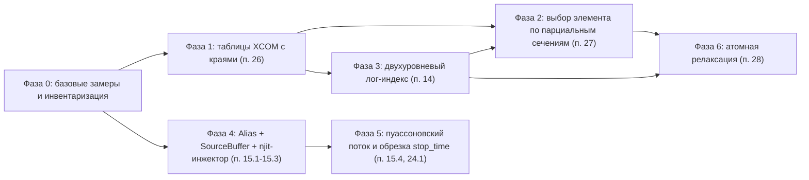

# План доработок: точные сечения с $\mathcal{O}(1)$ поиском, выбор элемента-мишени и генерация первичных частиц

Документ детализирует реализацию пунктов 14, 15, 24.1, 26, 27 и 28 архитектурного бэклога [`docs/architecture_backlog.md`](file:///d:/Python%20Projects/NMSimToolkit-Refactor/docs/architecture_backlog.md).

---

## 0. Исходные положения и принятые решения

### 0.1. Результаты аудита (основание для плана)

| Наблюдение | Источник | Следствие |
| :--- | :--- | :--- |
| Сетка в текущей HDF5-таблице искусственно раздута: линейный шаг `1 кэВ` в `1–1000 кэВ`, `22–51 кэВ` в `1–10 МэВ`, верхняя граница `10 МэВ`, `~1110–1130` узлов на элемент | `tables/NIST XCOM Elements MAC.h5` | Переход на родную стандартную сетку NIST XCOM (`46` базовых регулярных узлов + пары узлов краев поглощения, всего `46–76` узлов на элемент) с log-log интерполяцией сокращает объем таблиц в ~15 раз без потери точности |
| Края поглощения не представлены парами узлов (Pb K: скачок `×4.6` размазан на `88–89 кэВ`; Pb L3: значение над краем отсутствует) | там же | Точность на краях ограничена данными; требуется перегенерация таблиц с парами узлов краев (Фаза 1) |
| Сдвиг дублей на `-1 эВ` в `AttenuationDataBase._add_material` не срабатывает | [`attenuation_database.py`](file:///d:/Python%20Projects/NMSimToolkit-Refactor/core/materials/attenuation_database.py#L82-L84) | Мертвый код, удаляется |
| `Process._energy_range = [1 кэВ, 20 МэВ]` при данных до `10 МэВ` | [`processes.py`](file:///d:/Python%20Projects/NMSimToolkit-Refactor/core/physics/processes.py#L48) | Молчаливая экстраполяция константой выше `10 МэВ` |
| Элемент-мишень выбирается по массовой доле во всех процессах (включая уже зависящие от $Z$ модели $S(x, Z)$ в `g4compton.py` и $F(x, Z)$ в `g4coherent.py`) | [`_sample_Z_scalar`](file:///d:/Python%20Projects/NMSimToolkit-Refactor/core/physics/processes_kernels.py#L82-L104) | ~15% неверных $Z$ для фотоэффекта в NaI и искажение угловых распределений рассеяния в сложных средах (Фаза 2) |
| Таблица эмиссии источника уже разреженная; `meshgrid` только при инициализации | [`Source._generate_emission_table`](file:///d:/Python%20Projects/NMSimToolkit-Refactor/core/source/sources.py#L186-L211) | Оптимизация инициализации исключена из скоупа |
| `rng.choice(..., p=...)` пересчитывает CDF длины $K$ на каждом вызове | [`Source.generate_position`](file:///d:/Python%20Projects/NMSimToolkit-Refactor/core/source/sources.py#L252-L260) | Главная горячая цена источника (Фаза 4) |
| Время эмиссии разыгрывается внутри окна батча | [`Source.generate_emission_time`](file:///d:/Python%20Projects/NMSimToolkit-Refactor/core/source/sources.py#L262-L273) | Поток зависит от разбиения на батчи (Фаза 5) |

### 0.2. Принятые решения

1. **Совместимость потока ГСЧ с предыдущими версиями не сохраняется.** Побитовые эталоны, завязанные на старый поток, пересчитываются; корректность выборок подтверждается статистическими критериями.
2. **Инвариант независимости от разбиения внутри версии сохраняется и усиливается:** поток эмиссии первичных частиц (`InitialState`) побитово независим от `batch_capacity` и разбиения `[0, T1] + [T1, T2] ≡ [0, T2]` (досчет `Stateful Resume`).
3. **Родная сетка NIST XCOM и логарифмическая (log-log) интерполяция:** отказ от искусственного шага `1 кэВ` в пользу стандартной сетки NIST XCOM (единые регулярные узлы для всех элементов + пары узлов на краях поглощения) с кусочной log-log интерполяцией между краями и вспомогательным лог-индексом поверх нее.
4. **Число распадов за интервал — пуассоновская случайная величина** (вместо детерминированного ожидания).
5. **Вторичные излучения (характеристическое, а в перспективе $\alpha$, $\beta$ и др.) проектируются как специализированный вид источника**, переиспользующий инфраструктуру `SourceBuffer` и таблиц Воза.
6. **No Legacy Crutches:** устаревшие методы и поля удаляются, а не сохраняются рядом с новыми.

### 0.3. Граф зависимостей фаз

Ветки «Сечения» (Фазы 1–3) и «Источник» (Фазы 4–5) независимы и могут выполняться параллельно. Фаза 2 опирается на поиск строки из Фазы 3 (допустима реализация до Фазы 3 на текущем `searchsorted` с последующей заменой).

---

## Фаза 0. Базовые замеры и инвентаризация

### Цель
Зафиксировать исходные метрики производительности (включая стоимость log-log интерполяции на компактной сетке NIST) и все точки кодовой базы, затрагиваемые изменениями Фаз 1–5.

### Задачи
1. Прогнать `verification/profiling/micro_benchmarks.py` (`M1`, `M3`), `step_profiler.py` (фазы `P2_source_injection`, `P5_woodcock_transport`) и `transport_telemetry.py` на `W1–W3`; дополнить `M1` сравнением линейной и кусочной log-log интерполяции (`math.exp`) на компактной сетке NIST (`~70` узлов) с двухуровневым лог-индексом против текущего `np.searchsorted` на сетке `~1130` узлов; сохранить отчет в `verification/reports/profiling/`.
2. Снять пофазные дельты `psutil.Process().num_page_faults()` на стационарной фазе `W2`/`W3` (база для критерия Zero-Allocation инжектора).
3. Инвентаризация через `codebase-memory`:
   * прямые потребители `AttenuationDataBase`, `AttenuationFunction` и вызовов `np.interp` по энергетической сетке материалов (включая [`gui/viewport_3d/material_palette.py`](file:///d:/Python%20Projects/NMSimToolkit-Refactor/gui/viewport_3d/material_palette.py) и [`verification/common/presets.py`](file:///d:/Python%20Projects/NMSimToolkit-Refactor/verification/common/presets.py));
   * потребители `ElementCSR.element_fraction`, `InteractionBuffer.Z` и точки маппинга индексов процессов (`Process.process_id` против индекса столбца `process_col_idx` в `PhysicsCompiler` / `ParticlePropagator`);
   * вызывающие `Source.generate_position`, `generate_direction`, `generate_energy`, `generate_emission_time`, `Source.rng`, `Source.emission_table` (включая `gui/` и `verification/`);
   * владельцы генераторов ГСЧ в `SimulationManager` / `simulation_worker` и состав состояния досчета (`final_rng_state`, `particle_id_end`, `inspect_resume_state`);
   * тесты с побитовыми эталонами, зависящими от таблиц сечений и потока источника (`tests/materials/`, `tests/physics/`, `tests/source/`, `tests/transport/`, `tests/config/`).

### Критерий приемки
Отчет с базовыми метриками (включая замер цены log-log интерполяции в `M1`) и полный список затрагиваемых модулей и тестов приложен к PR Фазы 1 / Фазы 4.

---

## Фаза 1. Таблицы NIST XCOM с краями поглощения (п. 26)

### Цель
Точное представление разрывов сечения фотоэффекта на компактной родной сетке NIST XCOM с логарифмической (log-log) интерполяцией и согласованным энергетическим диапазоном.

### 1.1. Скрипт генерации таблицы
* Воспроизводимый офлайн-скрипт (`tables/scripts/generate_nist_xcom_mac.py`), формирующий `tables/NIST XCOM Elements MAC.h5` новой схемы:
  * `/<Element>/Energy` — монотонно неубывающая **родная стандартная сетка NIST XCOM** (`46` базовых регулярных узлов без искусственного шага `1 кэВ` + **пары одинаковых энергий** на краях поглощения, всего `46–76` узлов на элемент);
  * `/<Element>/<Process>` — значения; в паре края первый узел — значение ниже края, второй — выше;
  * `/<Element>/Edges/energy`, `/<Element>/Edges/label` (`K`, `L1`, `L2`, `L3`, `M1…M5`, `N1…N3`) — для Фазы 6;
  * атрибуты файла: версия схемы, источник данных, диапазон энергий.
* Диапазон: до `20 МэВ` (предпочтительно) либо фиксация `E_max = 10 МэВ` во всем ядре.

### 1.2. `AttenuationDataBase` (`core/materials/attenuation_database.py`)
* `_load_elements_MAC`: валидация схемы (монотонность, согласованность дублирующихся узлов краев с `Edges/energy`, строгий скачок фотоэффекта вверх между левым и правым пределами края, наличие `Edges`); при нарушении — `ValueError` (Fail-Fast).
* `_add_material`: объединение сеток элементов — совпадающие регулярные узлы базовой сетки дедуплицируются, а **узлы краев поглощения каждого элемента сохраняются** (кратность узла $E$ в сетке материала равна максимуму кратностей $E$ по элементам материала). Для каждого элемента на гладких участках между краями выполняется **кусочная log-log интерполяция** ($\ln(\mu/\rho)$ от $\ln E$) с учетом односторонних пределов: в левом узле края используется левый предел (`left_pos`), в правых — правый (`right_pos - 1`). Для элемента без края в данной точке все узлы края получают одно и то же интерполированное значение.
* Удаление мертвого кода со сдвигом `-1 эВ`.

### 1.3. `AttenuationFunction` и `PhysicsCompiler`
* [`AttenuationFunction.__init__`](file:///d:/Python%20Projects/NMSimToolkit-Refactor/core/materials/attenuation_functions.py#L28-L45): обрезка по `energy_range` через `searchsorted(..., side='left')` / `side='right'` не разрывает пару узлов края; интерполяция внутри `AttenuationFunction` переводится на кусочную log-log схему между краями (при $\mu > 0$).
* Для компиляции `MaterialBank` в [`_build_material_bank`](file:///d:/Python%20Projects/NMSimToolkit-Refactor/core/physics/physics_compiler.py#L65-L69) значения таблиц процессов брать **напрямую по индексам узлов** `attenuation_function[material]`, а не повторным вызовом интерполятора на той же сетке (совпадение энергетических сеток всех процессов проверяется явным предусловием).
* Согласование `Process._energy_range` с диапазоном таблицы; предусловие в `PhysicsCompiler.compile_scene`: все линии спектров источников внутри `[E_min, E_max]`.

### 1.4. Тесты (новый доменный каталог `tests/materials/`, зеркальный `core/materials/`; `tests/physics/`)
* При комбинировании элементов совпадающие регулярные узлы NIST не дублируются, а пары узлов краев сохраняются (NaI: края I K/L и Na K; ткань: компактная сетка без раздувания).
* Отношение $\mu_{pe}$ над/под K-краем Pb, I, W и значения между узлами стандартной сетки при log-log интерполяции соответствуют эталону NIST XCOM (допуск `0.1%`).
* Интерполяция по `_get_macroscopic_cross_sections` в точках $E_{edge} \pm 1$ эВ дает значения соответствующих сторон края.
* Нарушение схемы таблицы и линия источника вне диапазона приводят к исключению.

### Критерий приемки
Все тесты проходят; спектр поглощения Pb/NaI на краях и между узлами совпадает с NIST XCOM; мертвый код удален.

---

## Фаза 2. Выбор элемента-мишени по парциальным сечениям (п. 27)

### Цель
Физически корректный выбор $Z$ для всех активных процессов взаимодействия.

### 2.1. Данные
* Вычисление парциальных вкладов элементов выполнять в `PhysicsCompiler` непосредственно на финальной энергетической сетке материала в `MaterialBank` (после обрезки по `energy_range`), чтобы исключить расхождение индексов строк `row` между `AttenuationDataBase` и `AttenuationFunction`.
* Для согласованности с log-log интерполяцией полного сечения $\mu_p(E)$ и исключения трансцендентных вызовов `exp` в цикле по элементам внутри `@njit`-ядра, в [`PhysicsBuffer`](file:///d:/Python%20Projects/NMSimToolkit-Refactor/core/physics/physics_buffer.py) / [`ElementCSR`](file:///d:/Python%20Projects/NMSimToolkit-Refactor/core/physics/physics_buffer.py#L13-L20) хранить предрассчитанные в узлах сетки парциальные/кумулятивные доли элементов $w_{p,i}(E_k) = \mu_{p,i}(E_k) / \mu_p(E_k)$ (в порядке `element_Z` материала).
* Инвариант (проверяется в `PhysicsCompiler`): сумма парциальных вкладов элементов равна полному сечению `physics_lac_table[row, process_col_idx]` (сумма нормированных долей равна `1.0`) с относительной погрешностью `≤ 1e-12`.

### 2.2. Ядро
* `_sample_Z_scalar(mat_id, process_col_idx, row, fraction, physics_buffer, rng_ctx)`: кумулятивный проход по элементам материала с линейной интерполяцией нормированных долей элементов по тем же `row`/`fraction`, что и в поиске интервала (сумма гарантированно равна `1.0` без вызовов `exp` и без передачи `total_lac`).
* **Индексация столбца процесса:** в ядра процессов передается/запекается именно индекс столбца процесса `process_col_idx` в таблицах `PhysicsBuffer` (соответствующий позиции процесса в `propagator.processes`), а не глобальный `ProcessID`.
* **Порядок операций в фотоэффекте:** в [`_photoelectric_device_func`](file:///d:/Python%20Projects/NMSimToolkit-Refactor/core/physics/processes_kernels.py#L114-L148) вызов поиска строки и `_sample_Z_scalar` выполняется по энергии фотона **до** её обнуления (`energy_deposit = state.energy[p_idx]`), чтобы исключить выбор $Z$ при $E = 0$.
* **Применение:** сразу во всех трех процессах — `PhotoelectricEffect`, `ComptonScattering` и `CoherentScattering` (поскольку зависимые от $Z$ модели $S(x, Z)$ в [`g4compton.py`](file:///d:/Python%20Projects/NMSimToolkit-Refactor/core/physics/g4compton.py) и $F(x, Z)$ в [`g4coherent.py`](file:///d:/Python%20Projects/NMSimToolkit-Refactor/core/physics/g4coherent.py) уже активно используют `atomic_z`).

### 2.3. Тесты (`tests/physics/`)
* NaI при 140 кэВ: частота выбора $Z = 53$ для фотоэффекта, комптоновского и когерентного рассеяния совпадает с $\mu_{p,\text{I}}(E)/\mu_p(E)$ (критерий $\chi^2$, $10^6$ выборок).
* Однокомпонентный материал: детерминированный $Z$ без потребления случайного числа.
* Независимость корректности индексации от порядка процессов в `ParticlePropagator`.
* Обновление моков `ElementCSR` в `tests/physics/test_processes.py`, `tests/transport/conftest.py`, `tests/transport/test_step5_transport.py`.

### Критерий приемки
Статистические тесты проходят для всех процессов; `element_fraction` удален из кода и документации ([`docs/core_architecture.md`](file:///d:/Python%20Projects/NMSimToolkit-Refactor/docs/core_architecture.md)).

---

## Фаза 3. Двухуровневый лог-индекс поиска интервала и log-log интерполяция в ядре (п. 14)

### Цель
$\mathcal{O}(1)$ поиск строки компактной таблицы NIST XCOM и быстрая кусочная log-log интерполяция в `@njit`-ядре.

### 3.1. Структуры (`core/materials/material_bank.py`)
* `MaterialPointerDType`: новое поле `lookup_offset: Index`.
* `MaterialBank`: предвычисленные логарифмы узлов сетки `physics_log_energy_grid: NDArray[Float]` (и предвычисленные логарифмы сечений / наклоны сегментов для log-log интерполяции), а также поля индекса корзин `lookup_bin_start: NDArray[Index]` (плоский массив `num_scene_materials × num_bins`), `lookup_log_e_min: Float`, `lookup_inv_dlog_e: Float`, `lookup_num_bins: int`, `lookup_max_advance: int`.
* `MaterialBank._validate`: согласованность размеров, `lookup_bin_start` монотонен внутри материала.

### 3.2. Компиляция (`PhysicsCompiler._build_material_bank`)
* Общий диапазон корзин — `[E_min, E_max]` таблицы. На компактной родной сетке NIST (`~60–80` узлов на материал) достаточно `lookup_num_bins = 256–512` корзин. Достигнутый максимум шагов досмотра сохраняется в `lookup_max_advance` (с учетом возможных близких краев разных элементов в одной корзине).
* Для материала: `bin_start[b] = searchsorted(grid, E_b, side='right') - 1` с ограничением `[0, length - 2]`, где $E_b$ — левая граница корзины (вычисляется векторно один раз).

### 3.3. Ядро (`core/physics/physics_kernels.py`)
* `_compute_log_energy_and_bin(energy, material_bank) -> (log_e, log_bin)` — один вызов `np.log(energy)` на шаг частицы, вычисление корзины в `[0, num_bins - 1]`.
* `_locate_row(energy, log_e, log_bin, material_id, material_bank) -> (row, log_fraction)` — старт с `bin_start` и досмотр вперед `while idx + 1 < length - 1 and energy >= grid[idx + 1]`; на паре узлов края (`e1 == e0`) — автоматический переход на правую сторону (`side='right'`, право-непрерывность на пороге ионизации); доля `log_fraction = (log_e - log_e0) / (log_e1 - log_e0)` использует уже найденный `log_e` без повторного логарифмирования.
* `_get_macroscopic_cross_sections(energy, log_e, log_bin, material_id, material_bank, out_lacs_slice)` — кусочная log-log интерполяция по `_locate_row`.

### 3.4. Транспортное ядро (`core/transport/transport_kernels.py`)
* В [`make_transport_kernel`](file:///d:/Python%20Projects/NMSimToolkit-Refactor/core/transport/transport_kernels.py#L202-L294): `log_e` и `log_bin` вычисляются один раз при входе частицы в цикл Вудкока (энергия неизменна до реального взаимодействия) и передаются в оба вызова — для мажоранты и материала вокселя.
* Синхронно обновить `verification/profiling/transport_telemetry.py` и `micro_benchmarks.py` (`M1` сравнивает бинарный поиск и двухуровневый индекс на реальном `MaterialBank`).

### 3.5. Тесты (`tests/physics/`)
* **Побитовая эквивалентность поиска интервала:** для $10^6$ случайных энергий в `[E_min/2, 2·E_max]`, всех узлов сетки, точек краев и $E_{edge} \pm \varepsilon$ найденный интервал `(row, log_fraction)` и сечения побитово совпадают с эталонной реализацией на `np.searchsorted(..., side='right')`.
* Предусловие `lookup_max_advance` нарушается при искусственно вырожденном числе корзин → исключение компиляции.

### Критерий приемки
Побитовая эквивалентность с эталоном `searchsorted(..., side='right')`; ускорение `M1` и доля `P5_woodcock_transport` в `W3` зафиксированы в отчете профилирования.

---

## Фаза 4. Vose's Alias, `SourceBuffer` и `@njit`-инжектор (п. 15.1–15.3)

### Цель
Zero-Allocation генерация первичных частиц напрямую в `ParticleBank` с потоком ГСЧ, не зависящим от границ батчей.

### 4.1. Модули
* `core/source/alias_tables.py` (или в составе `source_compiler.py` — решить по SRP): `build_alias_tables(probabilities) -> (prob: float64, alias: int32)` за $\mathcal{O}(K)$ (алгоритм Воза с устойчивой обработкой остатков: финальные элементы обеих очередей получают `prob = 1.0`).
* `core/source/source_buffer.py`: `SourceBuffer(NamedTuple)`:
  * `voxel_offsets: Index[S+1]`, `voxel_index: int32[ΣK]` (плоские индексы вокселей), `voxel_prob: float64[ΣK]`, `voxel_alias: int32[ΣK]`;
  * `grid_shape: Index[S, 3]`, `voxel_size: Float[S]`, `half_size: Float[S, 3]`;
  * `line_offsets: Index[S+1]`, `line_energy`, `line_prob`, `line_alias`;
  * `local_to_global: Float[S, 4, 4]`;
  * `initial_activity: Float[S]`, `decay_constant: Float[S]`.
* `core/source/source_compiler.py`: `SourceCompiler.compile(active_sources) -> SourceBuffer` с предусловиями (непустые распределения, неотрицательные вероятности, нормировка).
* `core/source/source_kernels.py`: `@njit(cache=True)`-примитивы:
  * `_sample_alias(prob, alias, offset, count, rng_ctx) -> Index` — два равномерных числа (индекс корзины и сравнение с `prob`);
  * `_sample_voxel_position(...)` — индекс вокселя → `unravel` `(ix, iy, iz)` → левый нижний угол вокселя `idx * voxel_size - half_size` плюс равномерное смещение `uniform(0.0, voxel_size)` в пределах вокселя (строго согласовано с геометрией `WoodcockVoxelVolume` без сдвига на полвокселя) → преобразование `local_to_global`;
  * `_sample_isotropic_direction(rng_ctx)`;
  * `_write_primary(bank arrays, slot, ...)` — запись `KinematicState`, `InitialState`, обновление навигационного состояния (эквивалент `update_navigation_state_inject_kernel`).

### 4.2. Изменения `Source` (`core/source/sources.py`)
* `emission_table` заменяется на плоские индексы активных вокселей и вероятности; alias-таблицы строятся в сеттерах `distribution` / `energy`.
* Удаляются `generate_position`, `generate_direction`, `generate_energy`, `generate_emission_time`, `inject`, поле `rng` (после аудита Фазы 0; GUI-потребители, если есть, переводятся на `SourceCompiler` + ядра).
* `PointSource` — частный случай с `K = 1` и `voxel_size = 0` (без потребления случайных чисел на смещение — последовательность остается детерминированной функцией последовательности частиц).

### 4.3. Поиск свободных слотов
* Инжектор сканирует `state.is_active` с курсора внутри ядра; Python-вызов `np.where(~is_active)` из [`ParticleBank.inject_particles`](file:///d:/Python%20Projects/NMSimToolkit-Refactor/core/particles/particles.py#L53-L110) на горячем пути исключается. Метод `inject_particles` сохраняется только при наличии иных потребителей (аудит Фазы 0), иначе удаляется.

### 4.4. Тесты (`tests/source/`)
* Alias-таблицы: `prob ∈ [0, 1]`, `alias ∈ [0, K)`, восстановление вероятностей $p_i = \big(\text{prob}_i + \sum_{j:\,\text{alias}_j = i} (1 - \text{prob}_j)\big)/K$ с погрешностью `≤ 1e-12`; вырожденные случаи (`K = 1`, равные вероятности, одна доминирующая).
* $\chi^2$ частот вокселей и линий спектра ($10^6$ выборок); равномерность внутри вокселя (KS по каждой оси); изотропия направлений (KS по $\cos\theta$ и $\varphi$).
* Глобальные координаты при ненулевом `local_to_global` (сдвиг и поворот).
* Независимость от разбиения: инжекция $N$ частиц одним вызовом и вызовами $K_1 + K_2$ дает побитово одинаковые состояния банка.
* Переписывание `tests/source/test_sources.py` под новый контракт (без эталонов старого потока).

### Критерий приемки
`M3` `≥ 5x`; доля инжекции в шаге `W2`/`W3` `< 3%`; нулевой прирост page faults на стационарной фазе по сравнению с базой Фазы 0 в части источника.

---

## Фаза 5. Пуассоновский поток распадов и точная обрезка по `stop_time` (п. 15.4, 24.1)

### Цель
Физически корректная статистика счета, точная граница интервала и побитовый досчет.

### 5.1. Алгоритм (`core/source/source_kernels.py`)
Суперпозиция источников с прореживанием Льюиса–Шедлера:

1. Мажоранта $A_{\max} = \sum_s A_s(t_{\text{ref}})$, где $t_{\text{ref}}$ — начало первого сегмента расчета (для распадающихся источников $A_s(t) \leq A_s(t_{\text{ref}})$ при $t \geq t_{\text{ref}}$).
2. Цикл, пока есть свободный слот:
   * если задано `pending_arrival_time` — кандидат $t$ берется из него без розыгрыша; иначе $t \leftarrow t_{\text{last}} + (-\ln(1 - u_1)) / A_{\max}$;
   * если $t \geq$ `stop_time` — сохранить `pending_arrival_time = t`, завершить;
   * $x = u_2 \cdot A_{\max}$; проход по источникам с вычитанием $A_s(t)$; первый источник с $x < 0$ принимается, иначе кандидат отвергается (`t_last = t`, продолжить);
   * для принятого источника — генерация частицы примитивами Фазы 4 с `emission_time = t`.
3. Проверка свободного слота выполняется **до** розыгрыша очередного кандидата, чтобы остановка по заполнению банка не нарушала последовательность случайных чисел.

* Эффективность прореживания $\bar A(t)/A_{\max}$: для $^{99\text{m}}\text{Tc}$ при 30-минутной съемке `> 94%`. Для длительных съемок относительно периода полураспада — опционально кусочно-постоянная мажоранта на фиксированной **абсолютной** сетке времени (граница корзины — точка перезапуска потока; не зависит от батчей).

### 5.2. `SimulationManager` (`core/transport/simulation_managers.py`)
* `_replenish_bank` вызывает инжектор с `SourceBuffer`, `RNGContext` единого генератора `self.rng_ctx`, `stop_time` и состоянием потока (`t_last`, `pending_arrival_time`, `t_ref`).
* `global_timer` = время последнего обработанного кандидата; критерий завершения пополнения — наличие `pending_arrival_time ≥ stop_time`.
* Удаляются `_calculate_time_step`, `_distribute_quotas`, `MAX_NEWTON_ITERATIONS`, `NEWTON_TARGET_PRECISION`, `MIN_TIME_STEP`.
* Генератор случайных чисел — единый (`self.rng` и `self.rng_ctx = RNGContext.from_numpy_rng(self.rng)`), передается и в `inject_poisson_sources_kernel`, и в `propagator.step`.

### 5.3. Состояние досчета (`core/data/data_manager.py`, `core/data/metadata_collector.py`, `core/config/simulation_worker.py`)
* В метаданные задачи сохраняются: единое состояние `rng_state`, `pending_arrival_time`, `t_ref`, `t_last`, `batch_capacity`.
* `inspect_resume_state` и `simulation_worker_task` восстанавливают единый поток ГСЧ (`rng_state`) и состояние потока эмиссии; отсутствие полей в файле — ошибка с явным сообщением (без молчаливых дефолтов).

### 5.4. Тесты (`tests/source/`, `tests/transport/`)
* Число распадов за $[0, T]$: среднее и дисперсия соответствуют $\Lambda(T) = A_0(1 - e^{-\lambda T})/\lambda$ (Пуассон, серия независимых seed).
* Распределение времен эмиссии ∝ $A(t)$ (критерий KS) для одного и нескольких источников с разными периодами полураспада; доли источников ∝ $\int A_s\,dt$.
* Все `emission_time < stop_time`.
* **Побитовая независимость потока эмиссии и досчет:**
  * на прямом цикле `inject_poisson_sources_kernel` (без чередования транспорта между батчами) при разных `batch_capacity` на интервале `[0, T]` генерируются побитово идентичные состояния частиц;
  * двухэтапный расчет `[0, T1] + [T1, T2]` против непрерывного `[0, T2]` в `SimulationManager` с полным циклом эмиссии и транспорта дает побитово идентичные `InitialState` и `InteractionBuffer` при фиксированном `batch_capacity`.
* Источник с бесконечным периодом полураспада (`decay_constant = 0`).

### Критерий приемки
Статистические тесты и тесты побитового досчета проходят; п. 24.1 закрыт; документация состояния досчета обновлена в [`docs/plans/simulation_resume_and_accumulation_plan.md`](file:///d:/Python%20Projects/NMSimToolkit-Refactor/docs/plans/simulation_resume_and_accumulation_plan.md) / `docs/core_architecture.md`.

---

## Фаза 6. Атомная релаксация после фотоэффекта и вторичные источники излучения (п. 28)

> Фаза требует отдельной проектной спецификации перед реализацией; ниже — согласованные рамки.

### 6.1. Данные
* Офлайн-скрипт дополняет HDF5: для элементов с $Z \geq$ порога — энергии краев, скачки $J_s$ (или сечения подоболочек EPDL97 / Scofield), выходы флуоресценции $\omega_s$, энергии линий и радиационные вероятности. Источник — EADL / `xraylib` только в скрипте генерации.

### 6.2. Физика
1. Выбор элемента — Фаза 2; выбор оболочки — метод скачков ($P_K = 1 - 1/J_K$, рекурсивно по L1/L2/L3) либо сечения подоболочек (решение спецификации).
2. С вероятностью $\omega_s$ — генерация характеристического фотона выбранной линии изотропно из точки взаимодействия через вторичный источник; иначе Оже-переход с локальным депонированием.
3. Локально депонированная в акте фотоэффекта энергия корректируется на унесенную вторичным квантом величину: $E_{\text{dep}} = E_\gamma - E_{\text{флуор}}$ (во избежание задвоения полной выделенной энергии в истории); опционально каскад вакансий K → L.

### 6.3. Архитектура: специализированный вторичный источник
* Введение **нового вида источника для вторичных излучений** (характеристического рентгеновского излучения, а в будущем — $\alpha$-, $\beta$-, тормозного, аннигиляционного и других вторичных излучений).
* Переиспользование инфраструктуры `SourceBuffer`, таблиц Воза (`line_energy`, `line_prob`, `line_alias`) и `@njit`-примитивов из Фазы 4 для выборки линий спектра релаксации и изотропных направлений.
* Контракт передачи событий ионизации во вторичный источник (координаты точки взаимодействия, `emission_time`, выбранный $Z$ и оболочка, наследование `particle_ID` / `parent_ID`, `species`) и его согласование с `HistoryAssemblerHandler`, `DirectStreamHandler`, схемой HDF5 и `ResultsViewer` — детально фиксируются в спецификации Фазы 6.

### 6.4. Верификация
* Пик вылета йода в спектре NaI для $^{99\text{m}}\text{Tc}$ (`~112 кэВ` и `~108 кэВ`, линии Kα / Kβ йода) и K-линии Pb в спектре за коллиматором — сравнение с GATE/Geant4 или литературными данными.

---

## Сводка изменяемых модулей

| Модуль | Фазы | Характер изменений |
| :--- | :---: | :--- |
| `tables/NIST XCOM Elements MAC.h5` + скрипт генерации | 1, 6 | Родная сетка NIST XCOM с парами узлов краев и атомными данными |
| `core/materials/attenuation_database.py` | 1 | Смешивание с сохранением пар краев, кусочная log-log интерполяция, удаление сдвига `-1 эВ` |
| `core/materials/attenuation_functions.py` | 1 | Обрезка диапазона без разрыва пар краев, кусочная log-log интерполяция |
| `core/materials/material_bank.py` | 3 | Предвычисленные логарифмы сеток/сечений и поля двухуровневого лог-индекса |
| `core/physics/physics_buffer.py` | 2 | Таблица нормированных парциальных/кумулятивных долей элементов вместо `element_fraction` |
| `core/physics/physics_compiler.py` | 1, 2, 3 | Индекс корзин, таблица долей элементов на сетке `MaterialBank`, предусловия диапазона |
| `core/physics/physics_kernels.py` | 3 | `_compute_log_energy_and_bin`, `_locate_row`, кусочная log-log интерполяция |
| `core/physics/processes_kernels.py` | 2, 6 | Выбор $Z$ по парциальным сечениям во всех процессах (до обнуления энергии в фотоэффекте), релаксация |
| `core/physics/processes.py` | 1, 2 | Согласование `energy_range`, передача индекса столбца процесса `process_col_idx` |
| `core/transport/transport_kernels.py` | 3 | Однократный расчет `log_e` и `log_bin` на шаг частицы |
| `core/source/sources.py` | 4, 6 | Alias-таблицы, удаление блочной генерации и `rng`, базовый контракт для вторичных источников |
| `core/source/source_buffer.py`, `source_compiler.py`, `source_kernels.py` | 4, 5, 6 | Новые модули (с учетом расширяемости на вторичные источники) |
| `core/particles/particles.py` | 4, 6 | Пересмотр `inject_particles`, поддержка вторичных частиц |
| `core/transport/simulation_managers.py` | 5 | Пуассоновский поток, единый `self.rng` (`self.rng_ctx`), удаление метода Ньютона и квот |
| `core/data/data_manager.py`, `core/data/metadata_collector.py`, `core/config/simulation_worker.py` | 5 | Состояние потока эмиссии и единого `rng_state` в метаданных досчета |
| `verification/profiling/*` | 0, 3, 4 | Обновление `M1`, `M3`, телеметрии |
| `docs/core_architecture.md`, `docs/architecture_backlog.md` | все | Консолидация по завершении фаз |

## Общие инварианты (чек-лист каждой фазы)
1. `core/` без импортов Qt/VTK; `@njit`-ядра без аллокаций и логирования; ГСЧ только через явные генераторы и `RNGContext`.
2. Без `hasattr`/`getattr`/`setattr`; предусловия проверяются до выполнения (LBYL), без широких `try...except`.
3. Единицы `hepunits` (МэВ, мм, нс), без суффиксов единиц в идентификаторах.
4. Тесты в доменных каталогах `tests/`, запуск `.venv\Scripts\pytest.exe`; после структурных изменений — `index_repository` в `codebase-memory`.
5. По завершении фазы — Result-Oriented коммит на русском языке и перенос статуса пункта бэклога в `[РЕАЛИЗОВАНО]`.
