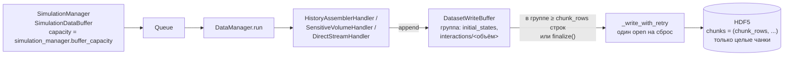

# Выходной буфер записи `data_manager.buffer_size`

> **Статус: Реализовано (этапы 1–4).**

## Контекст

- Сейчас `data_manager.buffer_capacity` потребляется только `SimulationManager` как ёмкость каналов телеметрии ([simulation_worker.py](../../core/config/simulation_worker.py), вызов `SimulationManager(..., buffer_capacity=final_config.data_manager.buffer_capacity)`); у обработчиков выходного буфера нет.
- `HistoryAssemblerHandler` пишет каждую отфильтрованную порцию (~8 историй) сразу: ≈ 67 000 сеансов «лок → open → `resize` → запись → `flush` → close» на файл (`DataManager._write_with_retry` в [data_manager.py](../../core/data/data_manager.py)).
- Чанк HDF5 определяется первой порцией (`chunks=True` в `DirectStreamHandler._write_initial_states` / `_write_interactions`) → 1–34 строки на чанк, служебные данные до 73 % файла, gzip не сжимает (хранимый объём до 1,9× сырого), разброс размеров по углам tb161 — 221–787 МБ при плавно меняющемся объёме полезных данных 115–143 МБ.

## Целевая схема



## 1. Конфигурация

| Секция | Поле | Тип / формат | Смысл | Потребитель |
|---|---|---|---|---|
| `simulation_manager` | `buffer_capacity` | `Optional[CountConfig] = None` | ёмкость каналов телеметрии в элементах; `None` → `particles_number` (текущая семантика `SimulationManager`) | `SimulationManager` |
| `data_manager` | `buffer_size` | `DataSizeConfig = "3 MiB"` | объём буфера **на группу** датасетов; задаёт и порог сброса, и размер чанка | `DatasetWriteBuffer` |

Поле `data_manager.buffer_capacity` удаляется (без костылей обратной совместимости).

### Обоснование значения по умолчанию `3 MiB`

Стандартный кэш чанков HDF5 (`rdcc_nbytes`) — 1 МиБ на датасет. Чанк больше кэша при частичном чтении (`ds[i:j]`, выборка по маске) каждый раз читается и распаковывается целиком. Рекомендация HDF Group — чанки 10 КиБ – 1 МиБ.

При `3 MiB` самый крупный чанк любого датасета не превышает 1 МиБ как для `float32`, так и для `float64`, а самый мелкий (однобайтовые поля) остаётся ≥ 31 КиБ — достаточно для эффективного gzip (окно 32 КиБ) и пренебрежимых служебных данных на чанк (~45 Б в индексе).

| Точность | Группа | Байт на строку | `chunk_rows` | Крупнейший чанк | Мельчайший чанк |
|---|---|---|---|---|---|
| `float32` | `interactions/<объём>` | 59 | 53 317 | `global_position`: 0,61 МиБ | `Z`/`process_code`/`species_code`: 52 КиБ |
| `float32` | `initial_states` | 40 | 78 643 | `emission_position`: 0,90 МиБ | `emission_energy`/`emission_time`: 0,30 МиБ |
| `float64` | `interactions/<объём>` | 99 | 31 775 | `global_position`: 0,73 МиБ | однобайтовые поля: 31 КиБ |
| `float64` | `initial_states` | 72 | 43 690 | `emission_position`: 1,00 МиБ (1 048 560 Б) | `emission_energy`/`emission_time`: 0,33 МиБ |

Память: ≈ `buffer_size` (+ одна входящая порция) на группу → для 4 групп ≈ 12 МиБ на воркер, ≈ 360 МиБ на 30 воркеров.

### `DataSizeConfig` в [units.py](../../core/config/units.py)

```python
def data_size_validator(input_value: Any) -> Any:
    """
    Pydantic-валидатор объёма данных. Внутреннее представление — целое число байт.
    - int > 0 — уже в байтах;
    - str с единицей ('3 MiB', '512 KiB', '1 GiB', '4 MB') — перевод через Pint в байты,
      результат обязан быть целым положительным числом;
    - строгий макрос ${var} пропускается для отложенной подстановки оркестратором.
    """

DataSizeConfig = Annotated[Any, BeforeValidator(data_size_validator)]
```

Pint уже поддерживает двоичные префиксы (`ureg('4 MiB').to('byte')` → `4194304`). Для YAML-экспорта — `field_serializer` в `DataManagerConfig`, выдающий `"3 MiB"` при кратности двоичному префиксу, иначе `"<N> B"`; roundtrip `export(build(config)) == config` сохраняется (внутри всегда `int` байт).

### Связывание в `simulation_worker_task` ([simulation_worker.py](../../core/config/simulation_worker.py))

- `SimulationManager(..., buffer_capacity=sim_config.buffer_capacity, ...)`.
- `DirectStreamHandler` / `SensitiveVolumeHandler` / `HistoryAssemblerHandler` получают `buffer_size=dm_cfg.buffer_size`.

## 2. Новый компонент `core/data/dataset_write_buffer.py`

Самостоятельный класс с единственной ответственностью — накопление дозаписей в группы датасетов HDF5 и их пакетный сброс целыми чанками. Обработчики владеют им через композицию (не `*_helper`, без `parent: Any`).

```python
@dataclass(frozen=True)
class DatasetLayout:
    """Неизменяемая схема датасета, фиксируемая при первой порции группы."""
    dtype: np.dtype
    row_shape: Tuple[int, ...]
    attrs: Mapping[str, str]


class DatasetWriteBuffer:
    """
    Буфер дозаписи строк в группы датасетов HDF5 ('initial_states', 'interactions/<объём>').
    Для каждой группы: chunk_rows = max(1, buffer_size // row_bytes), где row_bytes —
    суммарный размер одной строки по всем полям группы. Сбрасываются только целые чанки,
    неполный хвост дописывается в finalize.
    """

    def __init__(self, buffer_size: int, compression: Optional[str], compression_opts: int) -> None: ...

    def append(self, group_path: str, fields: Mapping[str, np.ndarray], attrs: Mapping[str, Mapping[str, str]]) -> None:
        """
        Предусловия (Fail-Fast): все массивы одной длины; набор полей, dtype и row_shape
        совпадают со схемой группы, зафиксированной первой порцией.
        """

    @property
    def has_full_chunks(self) -> bool:
        """Истина, если хотя бы в одной группе накоплено ≥ chunk_rows строк."""

    def write_full_chunks(self, h5_file: h5py.File) -> None:
        """Сбрасывает во всех группах максимальное число строк, завершающих целые чанки."""

    def write_all(self, h5_file: h5py.File) -> None:
        """Сбрасывает всё накопленное, включая неполные хвосты (используется в finalize)."""
```

### Правило выравнивания (учитывает досчёт в существующий файл)

Для группы с текущей длиной датасетов в файле $L$ и накопленными строками $P$:

$$
n = \left\lfloor \frac{L + P}{\text{chunk\_rows}} \right\rfloor \cdot \text{chunk\_rows} - L
$$

Записываются первые $n$ строк (если $n > 0$), остаток остаётся в буфере. При $L = 0$ это ровно целые чанки; при досчёте (resume), когда $L$ не кратно `chunk_rows`, первый сброс дозаполняет хвостовой чанк предыдущего запуска и далее снова идёт по границам чанков. Хвостовой чанк переписывается не более одного раза за запуск.

Если датасет уже существует с другим `chunk_rows` (изменили `buffer_size` между запусками) — используется `chunks[0]` существующего датасета.

## 3. Интеграция в обработчики ([data_handlers.py](../../core/data/data_handlers.py))

`DirectStreamHandler` (база для `SensitiveVolumeHandler` и `HistoryAssemblerHandler`):

```python
def __init__(self, ..., buffer_size: int) -> None:
    ...
    self._write_buffer = DatasetWriteBuffer(buffer_size, compression, compression_opts)

def _write_initial_states(self, initial_states) -> None:
    # подготовка массивов как сейчас
    self._write_buffer.append("initial_states", prepared_states, _INITIAL_STATES_ATTRS)
    self._flush_full_chunks()

def _write_interactions(self, volume_data_map) -> None:
    for volume_name, volume_data in volume_data_map.items():
        self._write_buffer.append(f"interactions/{volume_name}", volume_data, _INTERACTIONS_ATTRS)
    self._flush_full_chunks()

def _flush_full_chunks(self) -> None:
    if self._write_buffer.has_full_chunks:
        self.writer_callback(self._write_buffer.write_full_chunks)

def finalize(self) -> None:
    self.writer_callback(self._write_buffer.write_all)
```

- `HistoryAssemblerHandler.finalize()` — после досброса оставшихся историй вызывает `super().finalize()`.
- Удаляются `chunks=True` и создание датасетов «по первой порции» из `_write_initial_states` / `_write_interactions`.
- `DoseMapHandler` не затрагивается (однократная запись в `finalize`).

Инварианты:
- **Поля одной группы всегда одной длины** (сброс по группе, а не по датасету).
- **Каждый чанк пишется один раз и целиком** (кроме хвоста в `finalize` и однократного дозаполнения при resume).
- **Порядок завершения:** `DataManager.run` вызывает `handler.finalize()` до `finalize_metadata()` → статус `completed` и чекпоинт досчёта фиксируются только после записи всех данных; механизм resume не меняется.
- **Кооперативная остановка:** `flush_all` менеджера → `"stop"` → `finalize()` → `write_all`.

## 4. GUI

- `DataManagerViewModel` ([data_handler_viewmodel.py](../../gui/viewmodels/data_handler_viewmodel.py)): `buffer_capacity` / `min_buffer_capacity` → `buffer_size` (байты, отображение строкой `"3 MiB"`).
- Ограничение «ёмкость телеметрии ≥ `particles_number`» (`min_buffer_capacity`, [data_manager_section.py](../../gui/views/inspectors/data_manager_section.py), [main_window.py](../../gui/views/main_window.py) `_init_components` / `_on_open_simulation_settings` / `_on_open_yaml`) переносится в настройки `simulation_manager`.
- Обновить `test_data_manager_buffer_capacity_gui_constraints` (`tests/views/test_gui_integration.py`) и `test_11_13_procedure_and_stream_settings` (`tests/views/test_gui_controls.py`).

## 5. Примеры и документация

- YAML (`examples/tb161_nema_protocol.yaml`, `examples/nema_1_cam.yaml`): `data_manager.buffer_capacity: 100000` → `simulation_manager.buffer_capacity: 100000` + `data_manager.buffer_size: 3 MiB`.
- Python-примеры (`tb161_nema_simulation.py`, `lung_cancer_main.py`, `heart_main.py`, `heart_32_main.py`, `brain_main.py`) — передача параметров по новой схеме.
- `docs/gui_architecture.md` — описание полей; после завершения задачи план консолидируется в `docs/core_architecture.md` либо переносится в `docs/archive_drafts/`.
- Переиндексация `codebase-memory` после изменений.

## 6. Тесты

| Файл | Проверка |
|---|---|
| `tests/data/test_dataset_write_buffer.py` (новый) | порции < `chunk_rows` → запись не вызывается; данные после `write_all` равны конкатенации в исходном порядке; нарушение длины / dtype / набора полей → исключение |
| там же | `chunks[0]` == `buffer_size // row_bytes` и не зависит от размера первой порции (первая порция 3 строки) |
| там же | при $L$ не кратном `chunk_rows` первый сброс дозаполняет хвост, далее длина датасета кратна `chunk_rows` |
| там же | после каждого `write_full_chunks` все поля группы одной длины |
| `tests/data/test_data_handlers.py` | `HistoryAssemblerHandler`: после `finalize()` все `particle_ID` из `interactions` есть в `initial_states`; число сеансов записи ≪ числа порций |
| `tests/config/` | `DataSizeConfig`: `"3 MiB"` → 3145728, `"4 MB"` → 4000000, `"0 B"` / `"1.5 B"` / `"4 s"` → ошибка, `${var}` пропускается; roundtrip `data_manager.buffer_size` и `simulation_manager.buffer_capacity` |
| `tests/config/` | воркер передаёт `sim_config.buffer_capacity` в `SimulationManager`, `dm_cfg.buffer_size` — в обработчики |
| существующие | `test_stateful_resume_bitwise_identity`, `tests/transport/test_step5_transport.py` проходят |

## 7. Этапы реализации

| Этап | Содержание | Контроль |
|---|---|---|
| 1 | Конфиг: `simulation_manager.buffer_capacity`, `DataSizeConfig`, `data_manager.buffer_size`, связывание в воркере | тесты `tests/config/` |
| 2 | `DatasetWriteBuffer` + модульные тесты | `tests/data/test_dataset_write_buffer.py` |
| 3 | Интеграция в обработчики | `tests/data/`, тест resume |
| 4 | GUI, примеры, документация, переиндексация графа | `tests/views/`, полный прогон `pytest` |

## 8. Ожидаемый эффект (по замерам `0.0_deg.hdf`)

| Метрика | Сейчас | После |
|---|---|---|
| Сеансов записи (лок + open/close) на файл | ≈ 67 000 | ≈ 40 (≈ 2,1 млн строк / 53–79 тыс. строк на чанк) |
| Строк в чанке | 1–5 | 53 317 / 78 643 |
| Размер файла | 787 МБ | ≈ 73 МБ (проверено перечанкованием) |
| Разброс размеров по углам | 221–787 МБ | плавная зависимость от угла (≈ ±10 %) |
