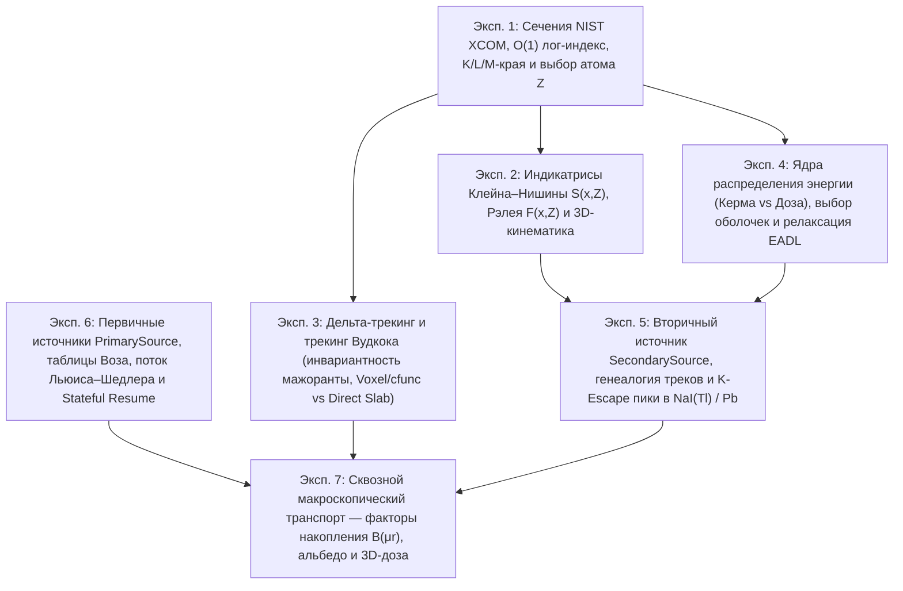

# План комплексной верификации физического ядра NMSimToolkit (`verification/physics/`)

## 1. Контекст и архитектурное назначение

Настоящий документ определяет программу сквозной физико-математической и статистической верификации всего расчетного физического ядра **NMSimToolkit** (подсистемы [`core/materials/`](file:///d:/Python%20Projects/NMSimToolkit-Refactor/core/materials/), [`core/physics/`](file:///d:/Python%20Projects/NMSimToolkit-Refactor/core/physics/), [`core/transport/`](file:///d:/Python%20Projects/NMSimToolkit-Refactor/core/transport/), [`core/source/`](file:///d:/Python%20Projects/NMSimToolkit-Refactor/core/source/), [`core/particles/`](file:///d:/Python%20Projects/NMSimToolkit-Refactor/core/particles/), [`core/geometry/`](file:///d:/Python%20Projects/NMSimToolkit-Refactor/core/geometry/) и [`core/data/`](file:///d:/Python%20Projects/NMSimToolkit-Refactor/core/data/)).

В отличие от модульных unit-тестов в `tests/`, проверяющих контракты API и граничные условия на малых выборках, пакет `verification/physics/` выполняет полномасштабные Монте-Карло и детерминированные эксперименты ($10^6\text{–}10^7$ испытаний), сопоставляет результаты с аналитическими законами радиационной физики, оцененными базами данных **NIST XCOM** и **ENDF/B-VIII.0 (EADL)**, и генерирует самодостаточные отчеты (`SUMMARY_REPORT.md`, `.json`, `.png`).

---

## 2. Матрица покрытия физического ядра (7 уровней / 7 экспериментов)

Программа верификации декомпозирована по принципу «снизу вверх» — от атомарных констант, таблиц сечений и ядер элементарных взаимодействий до дельта-трекинга Вудкока, каскадов вторичного излучения и макроскопической 3D-дозиметрии:



| Код | Модуль эксперимента | Верифицируемые ядра и классы `core/` | Физические эталоны и критерии |
| :--- | :--- | :--- | :--- |
| **`exp01`** | `exp01_cross_sections_and_target_sampling.py` | [`AttenuationDataBase`](file:///d:/Python%20Projects/NMSimToolkit-Refactor/core/materials/attenuation_database.py), [`MaterialBank`](file:///d:/Python%20Projects/NMSimToolkit-Refactor/core/materials/material_bank.py), [`PhysicsCompiler`](file:///d:/Python%20Projects/NMSimToolkit-Refactor/core/physics/physics_compiler.py), [`_compute_log_energy_and_bin`](file:///d:/Python%20Projects/NMSimToolkit-Refactor/core/physics/physics_kernels.py#L46-L68), [`_locate_row_with_linear`](file:///d:/Python%20Projects/NMSimToolkit-Refactor/core/physics/physics_kernels.py#L72-L129), [`_get_macroscopic_cross_sections`](file:///d:/Python%20Projects/NMSimToolkit-Refactor/core/physics/physics_kernels.py#L172-L250), [`_sample_Z_scalar`](file:///d:/Python%20Projects/NMSimToolkit-Refactor/core/physics/processes_kernels.py#L98-L138) | Побитовый паритет $\mathcal{O}(1)$ индекса с `searchsorted`, скачки $J_s$ на краях `Pb`/`I`/`W`, правило смешения Брэгга ($\le 10^{-12}$), $\chi^2/\text{ndf}$ выбора $Z$ по парциальным сечениям |
| **`exp02`** | `exp02_scattering_indicatrices_and_kinematics.py` | [`_compute_scattering_function_scalar`](file:///d:/Python%20Projects/NMSimToolkit-Refactor/core/physics/g4compton.py#L19-L54), [`_generate_compton_theta_scalar`](file:///d:/Python%20Projects/NMSimToolkit-Refactor/core/physics/g4compton.py#L58-L97), [`_calculate_compton_energy_deposit_scalar`](file:///d:/Python%20Projects/NMSimToolkit-Refactor/core/physics/g4compton.py#L101-L108), [`_generate_coherent_theta_scalar`](file:///d:/Python%20Projects/NMSimToolkit-Refactor/core/physics/g4coherent.py#L19-L109), [`_rotate_particle`](file:///d:/Python%20Projects/NMSimToolkit-Refactor/core/particles/particles_kernels.py#L27-L51) | Дифференциальное сечение Клейна–Нишины $\times S(x, Z)$, сечение Томсона $\times F^2(x, Z)$, край Комптона, сохранение $\|\mathbf{d}\|=1$ и $\mathbf{d}_0\cdot\mathbf{d}_1=\cos\theta$ |
| **`exp03`** | `exp03_woodcock_and_delta_tracking.py` | [`_generate_free_path`](file:///d:/Python%20Projects/NMSimToolkit-Refactor/core/transport/transport_kernels.py#L60-L65), [`_sample_process_id`](file:///d:/Python%20Projects/NMSimToolkit-Refactor/core/transport/transport_kernels.py#L207-L222), [`_transport_kernel_impl`](file:///d:/Python%20Projects/NMSimToolkit-Refactor/core/transport/transport_kernels.py#L226-L313), [`WoodcockVoxelVolume`](file:///d:/Python%20Projects/NMSimToolkit-Refactor/core/geometry/voxel_volumes.py#L28-L145), [`WoodcockParametricVolume`](file:///d:/Python%20Projects/NMSimToolkit-Refactor/core/geometry/woodcock_volumes.py#L22-L88), [`call_cfunc_ptr`](file:///d:/Python%20Projects/NMSimToolkit-Refactor/core/transport/transport_kernels.py#L50) | Закон Бугера $e^{-\mu L}$, инвариантность реальных столкновений при масштабировании мажоранты $\kappa \in [1, 100]$, паритет 3D-воксельного/параметрического Вудкока и пограничного RayCasting в слоистом фантоме |
| **`exp04`** | `exp04_energy_partition_and_atomic_relaxation.py` | [`partition_compton_energy_kernel`](file:///d:/Python%20Projects/NMSimToolkit-Refactor/core/physics/processes_kernels.py#L310-L342), [`partition_photoelectric_energy_kernel`](file:///d:/Python%20Projects/NMSimToolkit-Refactor/core/physics/processes_kernels.py#L346-L448), [`_sample_ionized_subshell_scalar`](file:///d:/Python%20Projects/NMSimToolkit-Refactor/core/physics/processes_kernels.py#L209-L257), [`_sample_vacancy_relaxation_emission`](file:///d:/Python%20Projects/NMSimToolkit-Refactor/core/physics/processes_kernels.py#L261-L306), [`AtomicRelaxationBank`](file:///d:/Python%20Projects/NMSimToolkit-Refactor/core/physics/physics_buffer.py#L29-L53) | Пособытийный баланс энергии $|\Delta E - (E_{\text{dep}} + \sum E_{\text{sec}})| < 10^{-14}$, 3 режима порогов (`Local`, `Kerma`, `Coupled`), закрытие $K$-оболочки при $E < E_K$, выходы $\omega_s$ и линии EADL |
| **`exp05`** | `exp05_secondary_source_and_escape_peaks.py` | [`SecondarySource`](file:///d:/Python%20Projects/NMSimToolkit-Refactor/core/source/secondary_source.py#L21-L125), [`SecondaryActivationBuffer`](file:///d:/Python%20Projects/NMSimToolkit-Refactor/core/physics/interaction_buffers.py), [`_compute_activation_time`](file:///d:/Python%20Projects/NMSimToolkit-Refactor/core/physics/processes_kernels.py#L142-L167), [`_sample_secondary_emission_time`](file:///d:/Python%20Projects/NMSimToolkit-Refactor/core/source/source_kernels.py#L510-L542), [`inject_secondary_sources_kernel`](file:///d:/Python%20Projects/NMSimToolkit-Refactor/core/source/source_kernels.py#L575-L650) | Время пролета $l/v(E,m_0)$ ($\gamma$ vs $e^-$), экспонента задержки $\lambda_{\text{sec}}$, уникальность `particle_ID` и связность `parent_ID`, уплотнение хвоста буфера, пик вылета иода $111.9\text{ кэВ}$ в $\text{NaI(Tl)}$ и $K$-линии $\text{Pb}$ |
| **`exp06`** | `exp06_primary_sources_and_poisson_stream.py` | [`PrimarySource`](file:///d:/Python%20Projects/NMSimToolkit-Refactor/core/source/primary_source.py#L21-L124), [`SourceCompiler`](file:///d:/Python%20Projects/NMSimToolkit-Refactor/core/source/source_compiler.py#L27-L224), [`build_alias_tables`](file:///d:/Python%20Projects/NMSimToolkit-Refactor/core/source/alias_tables.py#L81-L114), [`_sample_channel_energy`](file:///d:/Python%20Projects/NMSimToolkit-Refactor/core/source/source_kernels.py#L57-L89), [`_sample_channel_position`](file:///d:/Python%20Projects/NMSimToolkit-Refactor/core/source/source_kernels.py#L160-L183), [`inject_poisson_sources_kernel`](file:///d:/Python%20Projects/NMSimToolkit-Refactor/core/source/source_kernels.py#L397-L506) | Точность таблиц Воза, обращение трапеций `ContinuousSpectrum`, 3D-выборка вокселей и конуса с поворотом, прореживание Льюиса–Шедлера ($\text{Fano}\approx 1$), побитовая независимость от `batch_capacity` и `Stateful Resume` |
| **`exp07`** | `exp07_macroscopic_transport_and_dosimetry.py` | [`SimulationManager`](file:///d:/Python%20Projects/NMSimToolkit-Refactor/core/transport/simulation_managers.py#L62-L493), [`ParticlePropagator`](file:///d:/Python%20Projects/NMSimToolkit-Refactor/core/transport/propagator.py#L30-L130), [`DoseGridNode`](file:///d:/Python%20Projects/NMSimToolkit-Refactor/core/scene/dose_grid_node.py), [`DoseMapHandler`](file:///d:/Python%20Projects/NMSimToolkit-Refactor/core/data/dose_map_handler.py), [`HistoryAssemblerHandler`](file:///d:/Python%20Projects/NMSimToolkit-Refactor/core/data/data_handlers.py) | Факторы накопления $B(\mu r)$ в воде (сверка с аналитикой Тейлора/Бергера), альбедо и пик обратного рассеяния $180^\circ$, глобальный баланс энергии сцены и 100% паритет суммы `DoseGrid` с `InteractionBuffer` |

---

## 3. Детальная спецификация экспериментов (`verification/physics/`)

### Эксперимент 1: Таблицы сечений NIST XCOM, $\mathcal{O}(1)$ лог-индекс, края поглощения и выбор атома $Z$ (`exp01_cross_sections_and_target_sampling.py`)

1. **Аудит $\mathcal{O}(1)$ логарифмического индекса и кусочной log-log интерполяции (`MaterialBank`):**
   * Набор тестовых материалов: `Water`, `Air`, `Bone, Cortical (ICRP)`, `Sodium Iodide`, `Lead`, `Glass, Borosilicate (Pyrex)`.
   * Сетка проверочных энергий: $10^5$ логарифмически распределенных точек в $[1\text{ кэВ}, 20\text{ МэВ}]$ плюс все табличные узлы и точки $E_{\text{edge}} \cdot (1 \pm 10^{-12})$ вокруг всех $K, L_1, L_2, L_3, M$-краев поглощения.
   * **Проверяемый инвариант:** полное совпадение $\mu_{\text{pe}}(E), \mu_{\text{comp}}(E), \mu_{\text{coh}}(E)$ из `@njit`-ядра `_get_macroscopic_cross_sections` (с двухуровневым индексом `lookup_bin_start`) и эталонной функции `AttenuationFunction` (`fast_interp_scalar` на базе `np.searchsorted(..., side='right')`). Максимальная относительная погрешность $< 10^{-14}$.
2. **Проверка скачков поглощения (`Edge Jump Ratios`) и право-непрерывности:**
   * Для `Pb` ($K = 88.0045\text{ кэВ}$, $L_3 = 13.0352\text{ кэВ}$), `I` ($K = 33.1694\text{ кэВ}$) и `W` ($K = 69.525\text{ кэВ}$) проверяется:
     - строгая право-непрерывность в точке края: $\mu_{\text{pe}}(E_{\text{edge}}) == \lim_{\varepsilon \to +0} \mu_{\text{pe}}(E_{\text{edge}} + \varepsilon)$;
     - совпадение отношения $\mu_{\text{pe}}(E_{\text{edge}}^+) / \mu_{\text{pe}}(E_{\text{edge}}^-)$ с табличным `jump_ratio` из `ElementRelaxationData` (погрешность $< 10^{-12}$).
3. **Инвариант правила смешения Брэгга и стохастический аудит выбора атома-мишени (`_sample_Z_scalar`):**
   * Проверка нормировки `ElementCSR.element_partial_fractions`: для всех строк сетки `MaterialBank` и всех процессов сумма парциальных весов элементов равна $1.0$ с точностью $\le 10^{-12}$.
   * Монте-Карло розыгрыш `_sample_Z_scalar` ($N = 10^6$ выборок на точку) для сложных сред (`Sodium Iodide`, `Water`, `Bone, Cortical (ICRP)`, `Glass, Borosilicate (Pyrex)`) при энергиях $30, 80, 140.5, 364.5, 511\text{ кэВ}$ по каждому из 3 процессов (`PhotoelectricEffect`, `ComptonScattering`, `CoherentScattering`).
   * **Критерий успеха:** $|Z\text{-score}| \le 3.0$ для каждого химического элемента и $\chi^2/\text{ndf} \le 2.0$; для одноэлементного материала (`Lead`) — 0 обращений к ГСЧ и 100% детерминированный возврат $Z = 82$.
4. **Графики (`exp01_cross_sections_and_target_sampling.png`):**
   * Панель A: Сечения $\mu_{\text{pe}}, \mu_{\text{comp}}, \mu_{\text{coh}}, \mu_{\text{tot}}$ для $\text{NaI}$ и $\text{Pb}$ с увеличенной врезкой $K/L$-краев поглощения;
   * Панель B: Относительная невязка $\mathcal{O}(1)$ индекса `MaterialBank` относительно бинарного поиска во всем диапазоне $[1\text{ кэВ}, 20\text{ МэВ}]$;
   * Панель C: Энергетическая зависимость парциальных вероятностей выбора элемента $P(Z \mid E)$ в $\text{NaI}$ и костной ткани (теория vs Монте-Карло по 3 процессам).

---

### Эксперимент 2: Индикатрисы рассеяния (Комптон с $S(x, Z)$, Рэлей с $F(x, Z)$) и 3D-кинематика (`exp02_scattering_indicatrices_and_kinematics.py`)

1. **Верификация некогерентной функции рассеяния $S(x, Z)$ и угловой индикатрисы Комптона (`g4compton.py`):**
   * Проверка граничных свойств `_compute_scattering_function_scalar(x, Z)` для $Z \in \{1, 6, 8, 20, 53, 82\}$: монотонное стремление $S(x \to 0, Z) \to 0$ и насыщение $S(x \to \infty, Z) = Z$.
   * Генерация $N = 1.5 \cdot 10^6$ углов $\theta$ ядром `_generate_compton_theta_scalar` для комбинаций энергий $E_0 \in \{30, 74.6, 140.5, 364.5, 511, 1250\}\text{ кэВ}$ и элементов $Z \in \{1\ (\text{H}), 8\ (\text{O}), 53\ (\text{I}), 82\ (\text{Pb})\}$.
   * Сравнение эмпирической гистограммы $p_{\text{MC}}(\cos\theta)$ с теоретическим дифференциальным сечением:
     $$p_{\text{th}}(\cos\theta) = \frac{1}{\sigma_{\text{inc}}(E_0, Z)} \cdot \pi r_e^2 \varepsilon^2 \left(\varepsilon + \frac{1}{\varepsilon} - \sin^2\theta\right) S(x(\theta, E_0), Z),$$
     интегрируемым квадратурой Гаусса–Лежандра на каждом угловом бине.
   * Количественная оценка эффекта связывания электронов (отношение сечения с $S(x, Z)$ к свободному Клейну–Нишине $Z \cdot d\sigma_{\text{KN}}/d\Omega$ при малых углах $\theta < 20^\circ$).
   * Проверка кинематического тождества комптоновской отдачи `_calculate_compton_energy_deposit_scalar(theta, E_0)` и резкого обрыва спектра электронов отдачи строго на комптоновском крае $T_{\max} = E_0 \frac{2\alpha}{1 + 2\alpha}$.
2. **Верификация когерентного (рэлеевского) рассеяния (`g4coherent.py`):**
   * Генерация $N = 1.5 \cdot 10^6$ углов $\theta$ ядром `_generate_coherent_theta_scalar` для $E_0 \in \{30, 74.6, 140.5, 364.5\}\text{ кэВ}$ и $Z \in \{8\ (\text{O}), 53\ (\text{I}), 82\ (\text{Pb})\}$.
   * Сверка распределения $p_{\text{MC}}(\cos\theta)$ с теоретической плотностью Geant4:
     $$p_{\text{th}}(\cos\theta) \propto (1 + \cos^2\theta) \sum_{k=0}^2 \frac{\text{PP}_k[Z]}{(1 + b_k x^2)^{n_k + 1}}, \quad x^2 = f_{\text{factor}} E_0^2 (1 - \cos\theta).$$
   * Проверка строгого сохранения энергии фотона ($\Delta E = 0$) в `_coherent_kernel_impl`.
3. **Аудит 3D-поворота (`_rotate_particle`) и азимутальной симметрии (`_generate_scattering_phi_scalar`):**
   * Тест сохранения нормы $\|\mathbf{d}\| = 1$ и скалярного произведения $\mathbf{d}_{\text{before}} \cdot \mathbf{d}_{\text{after}} = \cos\theta$ на $10^5$ случайных исходных направлениях (включая сингулярные точки $\mathbf{d}_0 = (0, 0, \pm 1)$) и после цепочки из $10^3$ последовательных поворотов.
   * Проверка равномерности $\varphi \in [-\pi, \pi]$ (приведенный $\chi^2/\text{ndf}$ и амплитуды гармоник Фурье $c_1, c_2$).
4. **Графики (`exp02_scattering_indicatrices_and_kinematics.png`):**
   * Панель A: Полярные диаграммы индикатрис комптоновского рассеяния в $\text{Pb}$ и $\text{H}_2\text{O}$ (MC vs теория с $S(x,Z)$ vs чистый Клейн–Нишина);
   * Панель B: Спектры энергии рассеянного фотона $E'$ и электрона отдачи $\Delta E$ с отметками пика $180^\circ$ и комптоновского края;
   * Панель C: Угловые распределения когерентного рассеяния $p(\theta)$ для $Z = 8, 53, 82$ (MC vs аналитическая кривая форм-фактора);
   * Панель D: Побитовая точность инвариантов 3D-поворота $\|\mathbf{d}\| - 1$ и $|\mathbf{d}_0 \cdot \mathbf{d}_1 - \cos\theta|$.

---

### Эксперимент 3: Дельта-трекинг и трекинг Вудкока (`exp03_woodcock_and_delta_tracking.py`)

1. **Закон Бугера–Ламберта–Бера и распределение длины пробега в однородном поглотителе:**
   * Мононаправленный пучок фотонов ($140.5\text{ кэВ}$ и $364.5\text{ кэВ}$) проходит через пластины `Water`, `Sodium Iodide` и `Lead` оптической толщиной $\tau = \mu_{\text{tot}}(E) L \in \{0.5, 1.0, 2.0, 4.0\}$.
   * Сверка коэффициента пропускания нерассеянного пучка $T_{\text{MC}} = N_{\text{uncollided}} / N_0$ с аналитическим законом $e^{-\tau}$ ($|Z\text{-score}| \le 3.0$), сверка средней длины пробега $\langle l \rangle$ с $1/\mu_{\text{tot}}(E)$ и долей сработавших процессов с $\mu_p(E)/\mu_{\text{tot}}(E)$.
2. **Теорема инвариантности дельта-трекинга при масштабировании мажоранты (`Null-Collision Invariance`):**
   * В объеме `Water` с фиксированной геометрией искусственно задается мажорантный материал с коэффициентом ослабления $\mu_{\text{maj}} = \kappa \cdot \mu_{\text{Water}}$ для $\kappa \in \{1.0, 2.5, 10.0, 50.0\}$ (где до $98\%$ шагов внутри `_transport_kernel_impl` являются фиктивными дельта-столкновениями `selected_process == -1`).
   * **Проверяемый инвариант:** распределения глубин первого взаимодействия $z_1$, суммарного энерговыделения и доли вылетевших частиц статистически неразличимы между $\kappa = 1$ и $\kappa = 50$ ($p_{\text{KS}} > 0.05$, $|Z\text{-score}| \le 3.0$), а среднее число виртуальных шагов на одно реальное столкновение растет строго линейно как $\kappa$.
3. **Перекрестная верификация в кусочно-слоистом гетерогенном фантоме (`Direct Boundary Ray-Casting` vs `WoodcockVoxelVolume` vs `WoodcockParametricVolume`):**
   * Собирается 5-слойный гетерогенный барьер вдоль оси $Z$ (общая толщина $100\text{ мм}$):
     $$\text{Water } (25\text{ мм}) \to \text{Bone } (15\text{ мм}) \to \text{Air gap } (20\text{ мм}) \to \text{Lead } (5\text{ мм}) \to \text{NaI } (35\text{ мм}).$$
   * Три независимые реализации одной и той же физической сцены:
     1. **`Direct Slabs`:** 5 отдельных примитивов `Volume(Box)`, где переход между средами осуществляется геометрическим рейкастингом `cast_path_kernel` со сдвигом `BOUNDARY_PUSH_EPSILON`;
     2. **`Woodcock Voxel`:** единый `WoodcockVoxelVolume` (сетка $1 \times 1 \times 100$ вокселей по $1\text{ мм}$), где мажорантой служит `Lead`, а локальный материал определяется через скомпилированный `@cfunc` по 3D-массиву вокселей;
     3. **`Woodcock Parametric`:** единый `WoodcockParametricVolume` с аналитической `@cfunc`-функцией ступенчатых границ по $z$.
   * **Сравниваемые метрики ($N = 2 \cdot 10^6$ историй):**
     - Аналитическое пропускание $\exp\!\left(-\sum_{k=1}^5 \mu_k L_k\right)$ против MC во всех 3 моделях;
     - Послойная гистограмма координат взаимодействий $dN/dz$ с шагом $1\text{ мм}$ (включая проверку строго нулевого поглощения в воздушной/вакуумной щели при свинцовой мажоранте и резких скачков плотности столкновений на границах `Bone/Air/Pb/NaI`);
     - Послойное энерговыделение $E_{\text{dep}}(z)$ и спектр прошедших фотонов ($\chi^2/\text{ndf}$ и KS-тест между 3 моделями).
4. **Графики (`exp03_woodcock_and_delta_tracking.png`):**
   * Панель A: Закон Бугера $T(\tau) = e^{-\tau}$ и PDF длины свободного пробега в $\text{H}_2\text{O}$, $\text{NaI}$, $\text{Pb}$;
   * Панель B: Инвариантность профиля глубины взаимодействий при увеличении мажоранты $\kappa = 1 \dots 50$;
   * Панель C: Профиль плотности столкновений $dN/dz$ в 5-слойном гетерогенном фантоме (`Direct Slabs` vs `Woodcock Voxel` vs `Woodcock Parametric` vs аналитическая кусочно-экспоненциальная кривая);
   * Панель D: Послойная невязка $Z$-score между граничной трассировкой и дельта-трекингом Вудкока.

---

### Эксперимент 4: Ядра распределения переданной энергии, выбор подоболочек и атомная релаксация EADL (`exp04_energy_partition_and_atomic_relaxation.py`)

1. **Пособытийный аудит закона сохранения энергии в `partition_compton_energy_kernel` и `partition_photoelectric_energy_kernel`:**
   * Прогон $10^6$ актов фотоэффекта и комптоновского рассеяния в $\text{NaI}$, $\text{Pb}$ и $\text{H}_2\text{O}$ в 3 канонических конфигурациях порогов:
     1. **Полное локальное поглощение (`Local Absorption`):** `enable_atomic_relaxation=False`, `electron_production_cut=inf` $\implies E_{\text{dep}} \equiv \Delta E$, `act_buffer.cursor == 0`, `0` вызовов ГСЧ (проверка побитового сохранения состояния `rng_ctx`);
     2. **Столкновительная Керма с релаксацией (`Collision Kerma`):** `enable_atomic_relaxation=True`, `photon_production_cut=1 keV`, `electron_production_cut=inf` $\implies$ в `act_buffer` попадают только надпороговые флуоресцентные фотоны $\gamma_{\text{fluor}}$, а $E_{\text{dep}} = \Delta E - E_{\gamma,\text{fluor}}$;
     3. **Связанный $\gamma\text{–}e^-$ баланс (`Coupled Dose Partition`):** `enable_atomic_relaxation=True`, `photon_production_cut=1 keV`, `electron_production_cut=1 keV` $\implies$ в `act_buffer` записываются фотоэлектроны ($T_{\text{pe}} = E_\gamma - E_{\text{bind}}$), комптоновские электроны ($T_{\text{comp}} = \Delta E$), Оже-электроны ($E_{\text{Auger}}$) и характеристические фотоны ($E_{\text{line}}$), а в `energy_deposit` остается исключительно неразрешенный подпороговый остаток дефекта энергии связи $E_{\text{bind}} - E_{\text{relax}}$.
   * **Инвариант:** для каждого из $10^6$ событий максимальный дисбаланс $|\Delta E - (E_{\text{dep}} + \sum E_{\text{sec}})| < 10^{-14}\text{ МэВ}$.
2. **Верификация выбора ионизированной подоболочки (`_sample_ionized_subshell_scalar`) вокруг краев поглощения:**
   * Испытание для свинца ($Z = 82$: $E_K = 88.0045\text{ кэВ}$, $E_{L1} = 15.861\text{ кэВ}$, $E_{L2} = 15.200\text{ кэВ}$, $E_{L3} = 13.035\text{ кэВ}$) при 3 энергиях:
     - $E_1 = 14.0\text{ кэВ}$ (открыта только $L_3$ и $M/N$-оболочки; $K, L_1, L_2$ строго закрыты);
     - $E_2 = 80.0\text{ кэВ}$ (ниже $K$-края: открыты $L_1, L_2, L_3$, доля $K$-оболочки строго $0.0$);
     - $E_3 = 140.5\text{ кэВ}$ (выше $K$-края: доминирует $K$-оболочка с вероятностью $(J_K - 1)/J_K \approx 78.3\%$).
   * Сверка эмпирических частот подоболочек с аналитическими весами из `jump_cumulative_weight` ($\chi^2/\text{ndf} \le 2.0$).
3. **Верификация выходов флуоресценции $\omega_s$ и спектров радиационных/Оже-переходов (`_sample_vacancy_relaxation_emission` vs EADL):**
   * Для элементов $Z \in \{29\ (\text{Cu}), 53\ (\text{I}), 74\ (\text{W}), 82\ (\text{Pb})\}$ ($N = 10^6$ вакансий на уровень) сверяются:
     - эмпирическая доля радиационных переходов $N_\gamma / N_{\text{tot}}$ с табличным выходом флуоресценции $\omega_s$;
     - эмпирическая доля Оже-электронов $N_{e^-} / N_{\text{tot}}$ с $1 - \omega_s$;
     - дискретный спектр характеристических линий $K_{\alpha 1}, K_{\alpha 2}, K_{\beta 1}, K_{\beta 2}, K_{\beta 3}, L_\alpha, L_\beta$ и Оже-линий (выборка Воза `_sample_alias`) с исходными вероятностями `rad_probability` и `auger_probability` из базы `AttenuationDataBase.get_element_relaxation(Z)`.
4. **Графики (`exp04_energy_partition_and_atomic_relaxation.png`):**
   * Панель A: Диаграмма распределения переданной энергии между локальным депозитом, фотоэлектронами, Оже-электронами и флуоресценцией в 3 режимах порогов;
   * Панель B: Ступенчатое открытие подоболочек $L_3 \to L_2 \to L_1 \to K$ в $\text{Pb}$ при сканировании энергии фотона $E_\gamma \in [10, 150]\text{ кэВ}$;
   * Панель C: Спектр характеристических рентгеновских линий и Оже-электронов $\text{I}$ ($Z=53$) и $\text{Pb}$ ($Z=82$) в сравнении с таблицами EADL.

---

### Эксперимент 5: Вторичный источник (`SecondarySource`), генеалогия каскадов и Escape-пики в детекторах (`exp05_secondary_source_and_escape_peaks.py`)

1. **Верификация релятивистского пролетного времени (`_compute_activation_time`) и кинетики распада вакансий (`_sample_secondary_emission_time`):**
   * Сверка времени активации $t_{\text{act}} = t_0 + l / v(E, m_0)$ для фотонов ($v = c$) и электронов с кинетической энергией $T_e \in \{10, 100, 500, 2000\}\text{ кэВ}$ против точной релятивистской формулы Лоренца $\beta = \sqrt{1 - \gamma^{-2}}$ (погрешность $< 10^{-15}\text{ нс}$).
   * Проверка экспоненциального закона времени задержки релаксации $\Delta t = t_{\text{emit}} - t_{\text{act}} \sim \text{Exp}(\lambda_{\text{sec}})$ (KS-тест) и фильтрации событий с $t_{\text{emit}} \ge \text{stop\_time}$.
2. **Аудит двухфазного пополнения банка, уплотнения хвоста `SecondaryActivationBuffer` и генеалогии `(particle_ID, parent_ID)`:**
   * Запуск `SimulationManager` с включенной атомной релаксацией при намеренно малом размере батча (`batch_capacity = 64`), когда число рожденных вторичных частиц превышает число свободных слотов банка и активирует сдвиг хвоста `_compact_activation_buffer_tail`.
   * Проверка инвариантов генеалогии по выходным таблицам `initial_states`, `interactions` и `dead_particles`:
     - все `particle_ID` уникальны;
     - у всех первичных частиц `parent_ID == -1` и число первичных историй в точности равно `particles_number`;
     - у каждой вторичной частицы (`parent_ID >= 0`) координата рождения $\mathbf{r}_{\text{emit}}$ в `initial_states` совпадает с координатой акта взаимодействия родителя `parent_ID` в `interactions` с точностью до $10^{-12}\text{ мм}$, а направление вылета изотропно на $4\pi$.
3. **Физический бенчмарк сцинтилляционной спектроскопии: пик вылета иода (`Iodine K-Escape Peak`) в тонком кристалле $\text{NaI(Tl)}$ и флуоресценция свинца (`Pb K-X-rays`):**
   * **Сценарий А ($\text{NaI(Tl)}$ толщиной $2\text{ мм}$ и $9.5\text{ мм}$, облучение пучком $^{99\text{m}}\text{Tc}$ $140.5\text{ кэВ}$, $N = 10^6$ историй):**
     - Для каждого первичного распада суммируется полная поглощенная в кристалле энергия по всему дереву потомков (первичный фотон + все его вторичные флуоресцентные фотоны с `parent_ID == primary_ID`);
     - При `enable_atomic_relaxation=False` фотоэффект дает единый узкий пик полного поглощения на $140.5\text{ кэВ}$;
     - При `enable_atomic_relaxation=True` часть вторичных $K_\alpha/K_\beta$ фотонов иода ($28.6\text{ кэВ}$ и $32.3\text{ кэВ}$) вылетает через переднюю/заднюю грань кристалла, формируя классический дублет **K-escape пика иода** на энергиях $\sim 111.9\text{ кэВ}$ и $\sim 108.2\text{ кэВ}$!
     - Теоретическая сверка отношения площади K-escape пика к фотопику для полубесконечного/плоского слоя $\text{NaI}$ при нормальном падении по аналитической формуле переноса излучения:
       $$R_{\text{escape}} \approx \frac{p_K \, \omega_K}{2} \left[1 - \frac{\mu_{\text{tot}}(E_{K})}{\mu_{\text{tot}}(E_0)} \ln\!\left(1 + \frac{\mu_{\text{tot}}(E_0)}{\mu_{\text{tot}}(E_K)}\right)\right].$$
   * **Сценарий Б (Свинцовая фольга $\text{Pb}$ толщиной $0.5\text{ мм}$, облучение фотонами $140.5\text{ кэВ}$):**
     - Регистрация спектра вторичных фотонов (`parent_ID >= 0`), вылетевших из свинца: четкая идентификация характеристических линий $K_{\alpha 2} = 72.80\text{ кэВ}$, $K_{\alpha 1} = 74.97\text{ кэВ}$, $K_{\beta 1} = 84.94\text{ кэВ}$, $K_{\beta 2} = 87.30\text{ кэВ}$.
4. **Графики (`exp05_secondary_source_and_escape_peaks.png`):**
   * Панель A: Амплитудный спектр энерговыделения в кристалле $\text{NaI(Tl)}$ для $^{99\text{m}}\text{Tc}$ (`Relaxation ON` vs `Relaxation OFF`) с выделением дублета K-escape пика ($108.2 / 111.9\text{ кэВ}$) и комптоновского континуума;
   * Панель B: Спектр характеристического рентгеновского излучения свинца ($\text{Pb } K_\alpha, K_\beta$), вылетевшего из свинцового фильтра;
   * Панель C: Распределение времен задержки релаксации и пространственная корреляция вершин `parent -> child`.

---

### Эксперимент 6: Первичные источники (`PrimarySource`), метод Воза, поток Льюиса–Шедлера и побитовый досчет (`exp06_primary_sources_and_poisson_stream.py`)

1. **Верификация таблиц Воза (`build_alias_tables`) и генераторов энергетических спектров (`DiscreteSpectrum`, `ContinuousSpectrum`):**
   * Проверка точного восстановления вероятностей $\hat{p}_k = \frac{1}{K}\big(\text{prob}_k + \sum_{j: \text{alias}_j = k}(1 - \text{prob}_j)\big)$ с погрешностью $\le 10^{-14}$ на сильно скошенных распределениях (динамический диапазон весов $10^6$).
   * Выборка $N = 10^6$ энергий из многолинейчатого спектра $^{161}\text{Tb}$ / $^{177}\text{Lu}$ (`DiscreteSpectrum`) и кусочно-линейного бета-подобного/тормозного спектра (`ContinuousSpectrum`, аналитическое обращение трапеций в `_sample_channel_energy`): сверка по критериям $\chi^2/\text{ndf}$ и Колмогорова–Смирнова.
2. **Пространственно-угловая верификация (`PointDistribution`, `VoxelDistribution`, `IsotropicAngular`, `ConeAngular`):**
   * Проверка 3D-воксельного источника с нетривиальным 3D-распределением активности и повернутой/смещенной матрицей `local_to_global`:
     - повоксельное согласие числа рожденных частиц с матрицей активности ($\chi^2/\text{ndf} \le 2.0$);
     - равномерность распределения локальных координат внутри вокселя по осям $X, Y, Z$ (KS-тест) и точное попадание $100\%$ точек в геометрические границы соответствующих вокселей `WoodcockVoxelVolume`.
   * Проверка `ConeAngular(max_polar_angle)` при произвольной ориентации оси источника: $100\%$ векторов удовлетворяют $\mathbf{d} \cdot \mathbf{n}_{\text{axis}} \ge \cos\theta_{\max}$, распределение $\mathbf{d} \cdot \mathbf{n}_{\text{axis}}$ равномерно на $[\cos\theta_{\max}, 1]$.
3. **Нестационарный пуассоновский поток с прореживанием Льюиса–Шедлера (`inject_poisson_sources_kernel`):**
   * Двухнуклидный источник с существенно разными периодами полураспада ($T_{1/2}^{(1)} = 1.0\text{ с}$, $T_{1/2}^{(2)} = 4.0\text{ с}$) на интервале $[0, 3.0\text{ с}]$:
     - Серия из $500$ независимых прогонов: проверка среднего числа распадов $\langle N \rangle$ против интеграла $\Lambda(T) = \sum_c \frac{I_{0,c}}{\lambda_c}(1 - e^{-\lambda_c T})$ и индекса дисперсии Пуассона $\text{Var}(N) / \langle N \rangle \approx 1.0$;
     - Проверка формы временного распределения $f(t) \propto I_1(0)e^{-\lambda_1 t} + I_2(0)e^{-\lambda_2 t}$ по критерию Колмогорова–Смирнова и отношения числа частиц между каналами $N_1 / N_2 \approx \Lambda_1(T) / \Lambda_2(T)$.
4. **Инвариант побитовой независимости от `batch_capacity` и двухэтапного досчета (`Stateful Resume`):**
   * Прямой прогон `PrimarySource.replenish_bank` на квоту $50\,000$ частиц с `batch_capacity = 127` и `batch_capacity = 2048` при одном `seed`: **100% побитовое совпадение** всех массивов `InitialState` (`np.array_equal` без допусков!).
   * Сквозной прогон `SimulationManager` на интервале $[0, T_2]$ против двухэтапного прогона $[0, T_1]$ с сохранением чекпоинта и продолжением $[T_1, T_2]$ (включая активный `SecondarySource`): **100% побитовое совпадение** всех записей `initial_states`, `interactions` и `dead_particles`.
5. **Графики (`exp06_primary_sources_and_poisson_stream.png`):**
   * Панель A: Непрерывный кусочно-линейный спектр (`ContinuousSpectrum`) и многолинейчатый спектр (`DiscreteSpectrum`) — аналитическая PDF vs гистограмма выборки;
   * Панель B: Кривая распада нестационарного двухкомпонентного пуассоновского потока $dN/dt$ (прореживание Льюиса–Шедлера vs аналитическая сумма экспонент);
   * Панель C: Распределение общего числа распадов $P(N)$ по ансамблю симуляций в сравнении с теоретическим распределением Пуассона;
   * Панель D: Диаграмма побитового паритета `batch_capacity` и `Stateful Resume` (разность координат и энергий $\equiv 0.0$).

---

### Эксперимент 7: Сквозной макроскопический транспорт — факторы накопления (`Buildup Factors`), альбедо и 3D-дозиметрия (`exp07_macroscopic_transport_and_dosimetry.py`)

1. **Факторы накопления фотонов $B(\mu r)$ и глубинный профиль энерговыделения в водном фантоме:**
   * Точечный изотропный источник ($E_0 = 140.5\text{ кэВ}$ $^{99\text{m}}\text{Tc}$ и $E_0 = 364.5\text{ кэВ}$ $^{131}\text{I}$) в центре сферического/кубического водного фантома радиусом $R = 300\text{ мм}$ ($\sim 4.5$ длин свободного пробега).
   * Поток и энерговыделение анализируются в концентрических сферических слоях $r \in [10, 250]\text{ мм}$ с разделением на:
     - **нерассеянную компоненту (`Uncollided`):** сверка с аналитическим законом $\Phi_0(r) = \frac{e^{-\mu_{\text{tot}}(E_0) r}}{4\pi r^2}$ и локальным энерговыделением первого столкновения;
     - **полное энерговыделение (`Total = Uncollided + Multi-Scatter`):** вычисление дозового фактора накопления $B_{\text{MC}}(\mu r) = D_{\text{total}}(r) / D_{\text{uncollided}}(r)$, монотонно растущего с глубиной $\mu r$ за счет многократного комптоновского рассеяния в воде, и сопоставление с классической параметризацией Бергера $B(\mu r) = 1 + a \mu r \exp(b \mu r)$ для воды.
2. **Альбедо обратного рассеяния (`Backscatter Albedo`) и спектр отражения от полубесконечной среды (`Water`, `Pyrex`, `Lead`):**
   * Узкий пучок фотонов ($140.5\text{ кэВ}$ и $511.0\text{ кэВ}$) падает по нормали на плоский барьер (`Water`, `Glass, Borosilicate (Pyrex)` и `Lead`).
   * Измерение числового альбедо $A_N = N_{\text{back}} / N_0$, энергетического альбедо $A_E = \sum E_{\text{back}} / (N_0 E_0)$ и энергетического спектра обратно рассеянных фотонов ($d_z < 0$):
     - демонстрация высокого комптоновского альбедо от воды и стекла Pyrex с резким пиком однократного обратного рассеяния вблизи $E(180^\circ) = \frac{E_0}{1 + 2E_0/(m_e c^2)}$ ($90.7\text{ кэВ}$ для $^{99\text{m}}\text{Tc}$ и $170.3\text{ кэВ}$ для $511\text{ кэВ}$) против подавленного комптоновского альбедо и доминирования характеристического $K$-рентгена ($75\text{–}85\text{ кэВ}$) от свинца!
3. **Глобальный баланс энергии сцены и сквозная верификация 3D-воксельной дозиметрии (`DoseGridNode` + `DoseMapHandler`):**
   * Внутри водного фантома размещается [`DoseGridNode`](file:///d:/Python%20Projects/NMSimToolkit-Refactor/core/scene/dose_grid_node.py), подключенный к потоковому обработчику [`DoseMapHandler`](file:///d:/Python%20Projects/NMSimToolkit-Refactor/core/data/dose_map_handler.py) (запись в HDF5).
   * Проверяются два строгих балансовых тождества:
     1. **Глобальный закон сохранения энергии в симуляции:**
        $$E_{\text{emitted}}^{\text{primaries}} = E_{\text{deposited}}^{\text{interactions}} + E_{\text{escaped}}^{\text{world}} + E_{\text{sub\_cutoff\_stopped}},$$
        с относительной погрешностью $< 10^{-12}$;
     2. **Абсолютный паритет 3D-карты дозы и буфера взаимодействий:** интегральная поглощенная энергия в выходном HDF5-массиве `DoseMapHandler` ($\sum_{i,j,k} \text{dose\_energy}_{i,j,k}$) и повоксельное распределение на 100% совпадают с прямой агрегацией `InteractionBuffer.energy_deposit` по мировым координатам внутри `DoseGridNode` (погрешность $< 10^{-12}$).
4. **Графики (`exp07_macroscopic_transport_and_dosimetry.png`):**
   * Панель A: Радиальное ослабление $4\pi r^2 D(r)$ (нерассеянная экспонента $e^{-\mu r}$ vs полное энерговыделение с накоплением);
   * Панель B: Фактор накопления $B(\mu r)$ в воде для $^{99\text{m}}\text{Tc}$ ($140.5\text{ кэВ}$) и $^{131}\text{I}$ ($364.5\text{ кэВ}$) в сравнении с параметризацией Бергера;
   * Панель C: Спектры обратного рассеяния (альбедо) от `Water`, `Pyrex` и `Lead` с отметкой комптоновского пика $180^\circ$ и $K$-линий свинца;
   * Панель D: Центральный 2D-срез и 1D-профиль 3D-карты поглощенной дозы из `DoseMapHandler` в сравнении с эталонной выборкой `InteractionBuffer`.

---

## 4. Архитектура файлов и интеграция в CLI

```text
verification/
├── README.md                                                  # Обновление описания доменов collimators и physics
├── run_verification.py                                        # Поддержка --domain physics | collimators | all
├── physics/                                                   # Новый домен: комплексная верификация физического ядра
│   ├── __init__.py
│   ├── exp01_cross_sections_and_target_sampling.py            # Сечения NIST XCOM, O(1) лог-индекс, края и выбор Z
│   ├── exp02_scattering_indicatrices_and_kinematics.py        # Индикатрисы Комптона S(x,Z), Рэлея F(x,Z) и 3D-поворот
│   ├── exp03_woodcock_and_delta_tracking.py                   # Дельта-трекинг, инвариантность мажоранты и слоистый фантом
│   ├── exp04_energy_partition_and_atomic_relaxation.py        # Ядра разделения энергии, подоболочки и релаксация EADL
│   ├── exp05_secondary_source_and_escape_peaks.py             # SecondarySource, генеалогия, K-Escape пик в NaI и Pb X-rays
│   ├── exp06_primary_sources_and_poisson_stream.py            # Таблицы Воза, спектры, поток Льюиса–Шедлера и Stateful Resume
│   ├── exp07_macroscopic_transport_and_dosimetry.py           # Факторы накопления B(μr), альбедо и 3D-доза DoseMapHandler
│   └── plotting.py                                            # Отрисовка многопанельных графиков для exp01..exp07 (Agg)
└── reports/
    └── physics/                                               # Автогенерируемые артефакты прогона
        ├── SUMMARY_REPORT.md
        ├── exp01_cross_sections_and_target_sampling.json / .png
        ├── exp02_scattering_indicatrices_and_kinematics.json / .png
        ├── exp03_woodcock_and_delta_tracking.json / .png
        ├── exp04_energy_partition_and_atomic_relaxation.json / .png
        ├── exp05_secondary_source_and_escape_peaks.json / .png
        ├── exp06_primary_sources_and_poisson_stream.json / .png
        └── exp07_macroscopic_transport_and_dosimetry.json / .png
```

---

## 5. Поэтапный план реализации

1. **Этап 1: Визуализационное ядро домена физики (`verification/physics/plotting.py` и `verification/physics/__init__.py`)**
   * Реализация функций построения 3–4-панельных диагностических графиков (Headless `matplotlib.use("Agg")`) для всех 7 экспериментов в едином стиле с `verification/common/plotting.py`.
2. **Этап 2: Микроскопическая физика и ядра процессов (`exp01` и `exp02`)**
   * Реализация `exp01_cross_sections_and_target_sampling.py` и `exp02_scattering_indicatrices_and_kinematics.py`;
   * Запуск и проверка критериев `PASS` на таблицах NIST XCOM, $\mathcal{O}(1)$ индексе, парциальном выборе $Z$ и индикатрисах Geant4 ($S(x, Z)$, $F(x, Z)$).
3. **Этап 3: Навигация Вудкока, распределение переданной энергии и вторичный источник (`exp03`, `exp04`, `exp05`)**
   * Реализация `exp03_woodcock_and_delta_tracking.py`, `exp04_energy_partition_and_atomic_relaxation.py` и `exp05_secondary_source_and_escape_peaks.py`;
   * Проверка инвариантности дельта-трекинга, паритета `Direct Slabs` vs `Woodcock Voxel` vs `Woodcock Parametric`, пособытийного баланса энергии, каскадов EADL и пика вылета иода в $\text{NaI(Tl)}$.
4. **Этап 4: Первичные источники, нестационарный поток и сквозная макроскопическая дозиметрия (`exp06` и `exp07`)**
   * Реализация `exp06_primary_sources_and_poisson_stream.py` и `exp07_macroscopic_transport_and_dosimetry.py`;
   * Проверка таблиц Воза, прореживания Льюиса–Шедлера, побитового `Stateful Resume`, факторов накопления $B(\mu r)$, альбедо и `DoseMapHandler`.
5. **Этап 5: Интеграция в `verification/run_verification.py`, полный прогон и генерация `SUMMARY_REPORT.md`**
   * Подключение `--domain physics` (и `--domain all`) в `verification/run_verification.py` с генератором сводного аналитического отчета `verification/reports/physics/SUMMARY_REPORT.md`, обновление `verification/README.md`;
   * Выполнение полного прогона всех 7 экспериментов через `.venv\Scripts\python.exe -m verification.run_verification --domain physics --experiments all`;
   * Переиндексация графа знаний `codebase-memory` (`index_repository`).

---

## 6. Чек-лист соблюдения инвариантов проекта
* **Единицы `hepunits`:** все энергии, длины, времена и активности внутри экспериментов рассчитываются строго в канонических единицах `hepunits` (`mm`, `MeV`, `ns`, `rad`), без суффиксов единиц в именах переменных (`energy`, `thickness`, `distance`, но не `energy_kev` или `thickness_mm`).
* **Детерминированность ГСЧ:** каждый эксперимент использует явно инициализированный `np.random.default_rng(seed)` и `RNGContext.from_numpy_rng(rng)` для 100% воспроизводимости метрик и отчетов.
* **Контракты и типизация:** полная статическая типизация (`mypy`), отсутствие `hasattr`/`getattr`, соблюдение принципа LBYL и русскоязычные docstrings/комментарии.
