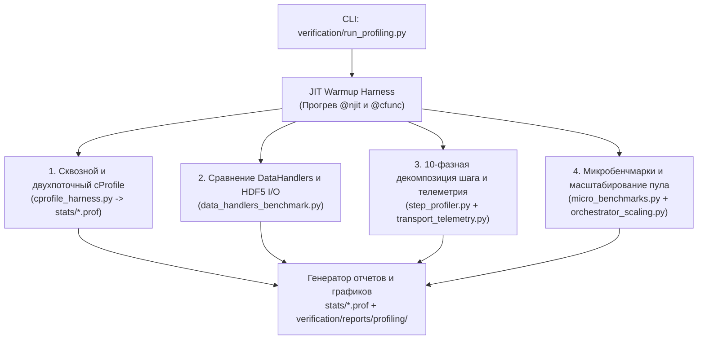

# План комплексного профилирования и выявления узких мест NMSimToolkit

Данный документ описывает архитектуру профилировочного стенда, методику измерений, состав необходимых инструментальных доработок и матрицу тестовых сценариев для выявления вычислительных и архитектурных узких мест в `NMSimToolkit`.

---

## 1. Контекст и ключевые вызовы профилирования

Расчетное ядро проекта построено на гибридной архитектуре **Python SoA Orchestration + Numba LLVM (`@njit` / `@cfunc`) + Multithreading/Multiprocessing I/O**. Стандартное профилирование через `cProfile` «в лоб» на полном прогоне симуляции дает искаженную картину по четырем причинам:

1. **Шум JIT-компиляции (Cold Start vs Steady-State):**
   При первом вызове ядер транспорта ([`make_transport_kernel`](file:///d:/Python%20Projects/NMSimToolkit-Refactor/core/transport/transport_kernels.py#L89-L181), [`cast_path_kernel`](file:///d:/Python%20Projects/NMSimToolkit-Refactor/core/geometry/geometry_kernels.py#L457-L498)) и компиляции замыканий `@cfunc` для воксельных фантомов ([`WoodcockVoxelVolume`](file:///d:/Python%20Projects/NMSimToolkit-Refactor/core/geometry/voxel_volumes.py)) и параметрических коллиматоров ([`ParametricParallelCollimator`](file:///d:/Python%20Projects/NMSimToolkit-Refactor/core/geometry/parametric_collimators.py)) компилятор LLVM тратит от 5 до 25 секунд. Без предварительного прогрева (`warmup`) стек вызовов `numba.core.compiler` доминирует в профиле.
2. **Непрозрачность инлайновых `@njit`-ядер для Python-профайлера:**
   Внутри [`transport_kernel`](file:///d:/Python%20Projects/NMSimToolkit-Refactor/core/transport/transport_kernels.py#L105-L180) вызываются инлайновые функции [`_get_macroscopic_cross_sections`](file:///d:/Python%20Projects/NMSimToolkit-Refactor/core/physics/physics_kernels.py#L14-L54) (с бинарным поиском `np.searchsorted`), [`_transform_to_local`](file:///d:/Python%20Projects/NMSimToolkit-Refactor/core/geometry/geometry_kernels.py#L85-L123) и LLVM-интринсик [`call_cfunc_ptr`](file:///d:/Python%20Projects/NMSimToolkit-Refactor/core/transport/transport_kernels.py#L42). Python-профайлер видит только суммарное время `transport_kernel`, не разделяя затраты на поиск сечений, трансформацию координат, вызов `@cfunc` и генерацию случайных чисел.
3. **Межпоточная синхронизация `SimulationManager` ↔ `DataManager`:**
   В штатном режиме [`SimulationManager`](file:///d:/Python%20Projects/NMSimToolkit-Refactor/core/transport/simulation_managers.py#L46-L453) и [`DataManager`](file:///d:/Python%20Projects/NMSimToolkit-Refactor/core/data/data_manager.py#L25-L588) работают в разных потоках `threading.Thread`, обмениваясь чанками через `queue.Queue(maxsize=64)`. При этом [`HistoryAssemblerHandler._flush_dead_particles`](file:///d:/Python%20Projects/NMSimToolkit-Refactor/core/data/data_handlers.py#L550-L608) выполняет тяжелые операции над массивами (`np.concatenate`, `np.intersect1d`, `np.isin`, `np.argsort`) в фоновом потоке, конкурируя за кэш CPU, пропускную способность памяти и GIL, а при заполнении очереди блокирует поток транспорта на `queue.put()`.
4. **Строгий контракт Zero-Overhead в `core/`:**
   Согласно архитектурным правилам проекта, добавление таймеров, словарей метрик или логирования внутрь боевых модулей `core/transport/`, `core/physics/` и `core/geometry/` категорически запрещено.

---

### 2. Архитектура доработок (Изолированный профилировочный пакет)

Все доработки размещаются в изолированном пакете `verification/profiling/` (с сохранением стандартных дампов `cProfile` `.prof` в каталог [`stats/`](file:///d:/Python%20Projects/NMSimToolkit-Refactor/stats/README.md) и аналитических отчетов/графиков в `verification/reports/profiling/`). Боевой код `core/` остается на 100% свободным от накладных расходов профилирования.

### 2.1. Стандартный профилировщик CPython (`cProfile` / `pstats`) на весь конвейер (`verification/profiling/cprofile_harness.py`)

Стандартный `cProfile` идеально подходит для макро-оценки всего конвейера на уровне Python/NumPy/HDF5, где каждое `@njit`-ядро (`cast_path_kernel`, `transport_kernel`, `_photoelectric_kernel`, `_compton_kernel`, `_coherent_kernel`) выступает как атомарный вызов с точным временем выполнения (`tottime`).

Чтобы устранить слепые зоны многопоточности (`threading.Thread`), `cProfile` запускается в **двух взаимодополняющих режимах** (после предварительного прогрева JIT):

1. **Штатный двухпоточный режим с раздельными профилями потоков (`Dual-Thread cProfile`):**
   * В потоке [`SimulationManager`](file:///d:/Python%20Projects/NMSimToolkit-Refactor/core/transport/simulation_managers.py#L46) активируется `sim_profiler = cProfile.Profile()`, а в потоке [`DataManager`](file:///d:/Python%20Projects/NMSimToolkit-Refactor/core/data/data_manager.py#L25) — `data_profiler = cProfile.Profile()`.
   * Позволяет в `pstats` напрямую увидеть:
     - не простаивает ли `SimulationManager` на `queue.put()` (ожидание освобождения очереди `maxsize=64`);
     - сколько времени `DataManager` проводит в ожидании `queue.get()` (когда транспорт является узким местом), а сколько — в `process_chunk`, `finalize` и записи `h5py` (когда обработка данных тормозит симуляцию);
     - **Tail Drain Lag** ($\Delta t_{\text{tail}} = t_{\text{data\_join}} - t_{\text{sim\_join}}$) — сколько секунд `DataManager` продолжает перерабатывать хвост очереди и сбрасывать HDF5 после того, как `SimulationManager` уже завершил перенос всех частиц.
2. **Синхронный однопоточный сквозной режим (`Single-Thread End-to-End cProfile`):**
   * Чанки из `SimulationManager` передаются напрямую в `DataManager` / `BaseDataHandler.process_chunk()` в том же потоке под единым `cProfile.Profile()`.
   * Дает единую сквозную таблицу `pstats` (Топ-30 функций по `tottime` и `cumtime`), где на одной шкале видны:
     - суммарная доля всех `@njit`-ядер транспорта и физики;
     - доля генерации частиц в [`Source.inject`](file:///d:/Python%20Projects/NMSimToolkit-Refactor/core/source/sources.py#L286-L321);
     - доля упаковки чанков и [`_collect_escaped_particles`](file:///d:/Python%20Projects/NMSimToolkit-Refactor/core/transport/simulation_managers.py#L373-L407);
     - доля фильтрации/конкатенации/сортировки в `DataHandler`-ах и физических вызовов `h5py`.
   * Все бинарные дампы сохраняются в `stats/<workload>_<collimator>_<handler>.prof` (доступны для `snakeviz` / `pstats`), а текстовые выжимки автоматически включаются в итоговый Markdown-отчет.

---

### 2.2. Сравнительный бенчмарк обработчиков данных (`verification/profiling/data_handlers_benchmark.py`)

Для прямой проверки того, **не упирается ли симуляция в обработку данных и дисковый ввод-вывод**, проводится серия прогонов идентичной физической сцены (как для `ParametricParallelCollimator`, так и для `DirectParallelCollimator`) с поочередной подстановкой всех типов обработчиков данных:

| № | Конфигурация обработчика | Что делает с потоком чанков | Назначение в бенчмарке |
| :-: | :--- | :--- | :--- |
| **H0** | **`NullDrainHandler` (Baseline без I/O)** | Мгновенно забирает чанки из `manager.queue` и отбрасывает их без обработки и без обращения к `h5py`. | Показывает **чистый потолок скорости `SimulationManager`** (`100%` эталон пропускной способности транспорта). |
| **H1** | **[`SensitiveVolumeHandler`](file:///d:/Python%20Projects/NMSimToolkit-Refactor/core/data/data_handlers.py#L260)** | Отбирает на лету только взаимодействия в кристаллах (`np.isin(volume_ids, target_volumes)`), форматирует и сразу пишет их в HDF5 без хранения историй в RAM. | Оценка стоимости потоковой фильтрации, цикла маппинга имен объемов и прямой записи в HDF5. |
| **H2** | **[`HistoryAssemblerHandler`](file:///d:/Python%20Projects/NMSimToolkit-Refactor/core/data/data_handlers.py#L491) (`save_initial_states=False`)** | Накапливает `interactions_chunks` в памяти до гибели частиц (`dead_particles`), фильтрует по `scored_particles`, сортирует по `particle_ID` (`np.argsort`) и пишет в HDF5. | Оценка стоимости сборки и сортировки цепочек взаимодействий (`mega_inter`, `np.intersect1d`, `np.isin`) без нагрузки на `initial_states`. |
| **H3** | **[`HistoryAssemblerHandler`](file:///d:/Python%20Projects/NMSimToolkit-Refactor/core/data/data_handlers.py#L491) (`save_initial_states=True`)** | Штатный режим протоколов ОФЭКТ: накапливает и `initial_states_chunks`, и `interactions_chunks`, фильтрует и сбрасывает оба массива при `dead_particles`. | Проверка главного кандидата на узкое место по памяти и CPU в `DataManager`. |
| **H4** | **[`DirectStreamHandler`](file:///d:/Python%20Projects/NMSimToolkit-Refactor/core/data/data_handlers.py#L70)** | Форматирует и записывает в HDF5 **все** `initial_states` и **все** `interactions` во всех объемах сцены (`All_Volumes`). | Стресс-тест дисковой подсистемы HDF5 на максимальном объеме записываемых событий. |
| **H5** | **[`DoseMapHandler`](file:///d:/Python%20Projects/NMSimToolkit-Refactor/core/data/dose_map_handler.py#L142)** (и связка `H3 + H5`) | Переводит координаты в локальную систему `DoseGridNode` (`np.matmul`) и аккумулирует дозу в 3D-вокселях через `np.add.at` в `SharedMemory` с записью `/dose` при финализации. | Оценка стоимости матричного преобразования координат и небуферизованного `np.add.at` на каждом чанке. |

**Дополнительные оси исследования в бенчмарке `DataHandlers`:**
* **Влияние сжатия HDF5:** сравнение `compression="gzip"` (`compression_opts=4`) против `compression=None` (без сжатия) и частоты открытия/закрытия `h5py.File(self.filename, "a")` на каждый чанк в [`DataManager._write_with_retry`](file:///d:/Python%20Projects/NMSimToolkit-Refactor/core/data/data_manager.py#L558-L587).
* **Влияние размера буфера (`buffer_capacity`):** замер при `buffer_capacity` $\in \{10\,000, 100\,000, 500\,000\}$ — проверка того, как частота сброса `dead_particles` влияет на квадратичную стоимость `np.concatenate` и `np.isin` в `HistoryAssemblerHandler`.
* **Влияние холостой генерации `escaped_particles`:** замер `SimulationManager` со штатным вызовом [`_collect_escaped_particles`](file:///d:/Python%20Projects/NMSimToolkit-Refactor/core/transport/simulation_managers.py#L373-L407) и без него (поскольку $>99\%$ фотонов вылетают из сцены, создавая 8 копий массивов на каждом шаге, которые затем просто игнорируются всеми хэндлерами `H1–H5`).

---

### 2.3. Синхронный 10-фазный профилировщик шага (`verification/profiling/step_profiler.py`)

В дополнение к `cProfile`, `InstrumentedStepProfiler` замеряет через `time.perf_counter_ns()` **10 логических стадий** внутри итерации (включая внутренние блоки `SimulationManager.next_step`, `ParticlePropagator.step` и `DataHandler.process_chunk`):

| № | Фаза конвейера | Измеряемые операции и функции ядра | Проверяемая гипотеза / узкое место |
| :-: | :--- | :--- | :--- |
| **P1** | `scene_compilation` | [`SceneBuilder.build_scene`](file:///d:/Python%20Projects/NMSimToolkit-Refactor/core/config/builder.py), [`GeometryCompiler.compile_scene`](file:///d:/Python%20Projects/NMSimToolkit-Refactor/core/geometry/geometry_compiler.py), [`PhysicsCompiler.compile_scene`](file:///d:/Python%20Projects/NMSimToolkit-Refactor/core/physics/physics_compiler.py), [`Source._generate_emission_table`](file:///d:/Python%20Projects/NMSimToolkit-Refactor/core/source/sources.py#L186-L211) | Стоимость `np.meshgrid` на 3D-фантомах, компиляция `@cfunc` и `np.linalg.inv` матриц трансформации. |
| **P2** | `source_injection` | [`SimulationManager._replenish_bank`](file:///d:/Python%20Projects/NMSimToolkit-Refactor/core/transport/simulation_managers.py#L328-L340), [`Source.inject`](file:///d:/Python%20Projects/NMSimToolkit-Refactor/core/source/sources.py#L286-L321) (`generate_position`, `generate_energy`, `generate_direction`, `generate_emission_time`, `bank.inject_particles`) | Стоимость `self.rng.choice(voxel_origins, count, p=probability)` ($\mathcal{O}(M \log M)$) и промежуточных аллокаций `(N, 3)` массивов перед записью в `Vector3DSoA`. |
| **P3** | `active_indices_query` | `bank.active_indices` (`np.flatnonzero(self.state.is_active)`) | Накладные расходы на сканирование булева массива банка на каждом шаге. |
| **P4** | `geometry_raycasting` | [`cast_path_kernel`](file:///d:/Python%20Projects/NMSimToolkit-Refactor/core/geometry/geometry_kernels.py#L457-L498) (`_trace_single_ray`, `_box_intersect`, `_hex_prism_intersect`) | Сравнение аналитического пересечения в `DirectParallelCollimator` против простой коробки в `ParametricParallelCollimator`. |
| **P5** | `woodcock_transport` | [`transport_kernel`](file:///d:/Python%20Projects/NMSimToolkit-Refactor/core/transport/transport_kernels.py#L105-L180) | Время дельта-трекинга Вудкока в `WoodcockVoxelVolume` и `ParametricParallelCollimator` (вызовы `call_cfunc_ptr` и `_get_macroscopic_cross_sections`). |
| **P6** | `initial_states_record` | Маска `interacting_mask` + [`_push_to_initial_state_kernel`](file:///d:/Python%20Projects/NMSimToolkit-Refactor/core/transport/transport_kernels.py#L61-L87) | Стоимость булевой индексации в Python и копирования в `InitialStateBuffer`. |
| **P7** | `stream_compaction` | Формирование `target_indices = active_indices[mask]` для каждого процесса в [`ParticlePropagator.step`](file:///d:/Python%20Projects/NMSimToolkit-Refactor/core/transport/propagator.py#L106-L109) | Оценка накладных расходов NumPy на создание индексных подмассивов на каждом шаге. |
| **P8** | `physics_processes` | Раздельный замер [`PhotoelectricEffect.apply`](file:///d:/Python%20Projects/NMSimToolkit-Refactor/core/physics/processes.py), [`ComptonScattering.apply`](file:///d:/Python%20Projects/NMSimToolkit-Refactor/core/physics/processes.py), [`CoherentScattering.apply`](file:///d:/Python%20Projects/NMSimToolkit-Refactor/core/physics/processes.py) | Относительная тяжесть сэмплирования угла Клейна-Нишины/Доплера, рэлеевского рассеяния и выбора $Z$ элемента (`_sample_Z_scalar`). |
| **P9** | `invalidation_and_flush` | [`_apply_invalidators`](file:///d:/Python%20Projects/NMSimToolkit-Refactor/core/transport/simulation_managers.py#L254-L263), [`_collect_escaped_particles`](file:///d:/Python%20Projects/NMSimToolkit-Refactor/core/transport/simulation_managers.py#L373-L407), [`_handle_dead_particles`](file:///d:/Python%20Projects/NMSimToolkit-Refactor/core/transport/simulation_managers.py#L409-L425), `flush_to_dict` | Затраты на копирование массивов вылетевших частиц (`escaped_particles`) и упаковку чанков буфера. |
| **P10** | `data_handling_and_hdf5` | Раздельный замер CPU-обработки в `BaseDataHandler.process_chunk` / `finalize` и дискового I/O в `h5py.File` | Выявление точной доли времени между CPU-подготовкой массивов в хэндлере и физическим `h5py` I/O. |

---

### 2.4. Диагностическая телеметрия счетчиков переноса и микробенчмарки (`transport_telemetry.py`, `micro_benchmarks.py`, `orchestrator_scaling.py`)

1. **Счетчики событий переноса (`transport_telemetry.py`):**
   * Среднее число вызовов `_trace_single_ray`, проверок примитивов, шагов Вудкока (`woodcock_steps_per_history`), холостых дельта-рассеяний (`null_collisions_per_real_interaction`), вызовов `@cfunc` и `np.searchsorted` на 1 историю для `Parametric` vs `Direct`.
2. **Микробенчмарки горячих узлов (`micro_benchmarks.py`):**
   * **M1 (Сечения, п. 14 бэклога):** `np.searchsorted` $\mathcal{O}(\log K)$ против $\mathcal{O}(1)$ равномерной логарифмической сетки.
   * **M2 (Инжекция источника в фантоме, п. 15 бэклога):** `np.meshgrid` + `rng.choice(..., p=probability)` против разреженной индексации и метода алиасов Воза (`Vose's Alias`) $\mathcal{O}(1)$.
   * **M3–M4 (Геометрия и физика):** изолированная скорость `_box_intersect`, `_hex_prism_intersect`, `@cfunc` и ядер фотоэффекта/Комптона/Рэлея.
3. **Масштабируемость параллельного оркестратора (`orchestrator_scaling.py`):**
   * Оценка [`Orchestrator`](file:///d:/Python%20Projects/NMSimToolkit-Refactor/core/config/orchestrator.py#L28-L144) при `pool_size` $\in \{1, 2, 4, 8\}$ и сравнение записи в раздельные файлы против общего файла с межпроцессным `Lock()`.

---

## 3. Матрица эталонных сценариев нагрузки (Workloads)

Все сценарии тестируются парно для двух видов коллиматоров (**`ParametricParallelCollimator`** и **`DirectParallelCollimator`**):

| Код | Сценарий | Геометрия и источник | Тип коллиматора | Режимы профилирования |
| :---: | :--- | :--- | :---: | :--- |
| **W1-P / W1-D** | Точечный источник + Гамма-камера GE Discovery | `PointSource` ($^{99\text{m}}\text{Tc}$, 140.5 кэВ) + головка GE Discovery (`Pb` корпус, коллиматор LEHR, кристалл `NaI`, световод `Pyrex`) | `Parametric` vs `Direct` | `cProfile`, сравнение всех 6 `DataHandlers` (`H0–H5`), 10-фазная разбивка, телеметрия шагов. |
| **W2-P / W2-D** | Клинический ОФЭКТ: Воксельный фантом NEMA $^{161}\text{Tb}$ + 2-головочный Гантри | `WoodcockVoxelVolume` ($128 \times 128 \times 92$, `anema_voxel_size_4.2_mm.dat`) + воксельный `Source` (`nema_voxel_size_4.2_mm.dat`, 10 линий $^{161}\text{Tb}$) + 2 камеры GE LEHR | `Parametric` vs `Direct` | Полный `cProfile` (двухпоточный и сквозной), сравнение `DataHandlers` (`H0–H5`), влияние `gzip` и `buffer_capacity`, 10-фазная разбивка. |
| **W3-P / W3-D** | Перфузионная ОФЭКТ миокарда (`Heart Phantom`) | 5-тканевый `WoodcockVoxelVolume` (`material_map.npy`: воздух, легкие, жир, мягкая ткань, кость) + `source_function.npy` ($^{99\text{m}}\text{Tc}$) + 2 камеры GE LEHR | `Parametric` vs `Direct` | `cProfile`, 10-фазная разбивка и телеметрия холостых шагов Вудкока в гетерогенном фантоме с костной тканью. |
| **W4-P / W4-D** | Параллельный прогон `Orchestrator` (Multi-Step Sweep) | Серия угловых проекций `tb161_nema_protocol` (`Parametric` и `Direct`) при варьировании `pool_size` и режима HDF5 | `Parametric` vs `Direct` | Замер масштабируемости пула воркеров, накладных расходов инициализации задач и конкуренции за HDF5. |

---

## 4. Предварительные гипотезы узких мест (на основе статического аудита кода)

В ходе предпроектного анализа кода выявлены **7 потенциальных узких мест** (включая подсистему обработки данных), вклад которых будет точно измерен:

1. **Квадратичная сборка и фильтрация историй в [`HistoryAssemblerHandler._flush_dead_particles`](file:///d:/Python%20Projects/NMSimToolkit-Refactor/core/data/data_handlers.py#L550-L608):**
   * На каждом сбросе `dead_particles` (и в `finalize`) выполняется `np.concatenate` всех накопленных чанков, конвертация множества `list(self.scored_particles)` с `np.intersect1d`, а затем 4 полных прохода `np.isin` по массивам `particle_ID` и сортировка `np.argsort`.
2. **Поштучный цикл в Python и `dtype=object` строки в [`SensitiveVolumeHandler._format_and_write_interactions`](file:///d:/Python%20Projects/NMSimToolkit-Refactor/core/data/data_handlers.py#L398-L412):**
   * Для каждого события в чанке выполняется цикл `for vid in volume_ids:` со словарным поиском имени объема и созданием массива строк `np.array(mapped_vol_names_list, dtype=object)`, вместо быстрой целочисленной векторизованной маски по `volume_id`.
3. **Повторное открытие/закрытие `h5py.File` и `file_handle.flush()` на каждый чанк и каждый тип данных в [`DataManager._write_with_retry`](file:///d:/Python%20Projects/NMSimToolkit-Refactor/core/data/data_manager.py#L558-L587):**
   * При каждом сбросе `initial_states` и `interactions` файл HDF5 заново открывается в режиме `"a"`, выполняется `dataset.resize()` со сжатием `gzip`, вызывается `flush()` и файл закрывается.
4. **Безусловная аллокация и отправка `escaped_particles` в [`SimulationManager._collect_escaped_particles`](file:///d:/Python%20Projects/NMSimToolkit-Refactor/core/transport/simulation_managers.py#L373-L407):**
   * На каждом шаге для $>99\%$ вылетевших из сцены частиц создаются 8 копий массивов `np.array(..., copy=True)` и отправляются в `self.queue`, после чего `DataManager` применяет к ним `_freeze_chunk` (`MappingProxyType`), а все файловые хэндлеры (`SensitiveVolumeHandler`, `HistoryAssemblerHandler`, `DirectStreamHandler`, `DoseMapHandler`) просто отбрасывают этот чанк.
5. **Генерация позиций в воксельном источнике [`Source.generate_position`](file:///d:/Python%20Projects/NMSimToolkit-Refactor/core/source/sources.py#L252-L260):**
   * Вызов `self.rng.choice(voxel_origins, count, p=probability)` по массиву `(M, 3)` на каждом пополнении банка частиц и промежуточные аллокации `(N, 3)` массивов.
6. **Бинарный поиск `np.searchsorted` на каждом виртуальном шаге Вудкока в [`_get_macroscopic_cross_sections`](file:///d:/Python%20Projects/NMSimToolkit-Refactor/core/physics/physics_kernels.py#L14-L54).**
7. **Высокая доля холостых шагов Вудкока в `ParametricParallelCollimator` и `WoodcockVoxelVolume` при низких энергиях ($^{161}\text{Tb}$) и наличии плотных включений (кость, свинец).**

---

## 5. План-график реализации профилировочного стенда

### Этап 1: Разработка инструментария в `verification/profiling/`
1. Создать пакет `verification/profiling/`:
   * `verification/profiling/__init__.py`
   * `verification/profiling/cprofile_harness.py` — запуск сквозного (однопоточного) и двухпоточного (`SimulationManager` + `DataManager`) профилирования через стандартный `cProfile.Profile()`, сохранение `.prof`-файлов в `stats/`, парсинг `pstats` и подсчет времени ожидания на очереди (`queue.put` / `queue.get`) и задержки финализации (`Tail Drain Lag`).
   * `verification/profiling/data_handlers_benchmark.py` — сравнительный стенд для 6 конфигураций обработчиков (`NullDrain`, `SensitiveVolume`, `HistoryAssembler (no init)`, `HistoryAssembler (full)`, `DirectStream`, `DoseMap`), а также тест чувствительности к `compression` (`gzip` vs `None`), `buffer_capacity` и генерации `escaped_particles`.
   * `verification/profiling/step_profiler.py` — 10-фазная декомпозиция шага (`P1–P10`).
   * `verification/profiling/transport_telemetry.py` — диагностический сборщик счетчиков шагов Вудкока, вызовов `@cfunc`, `searchsorted` и пересечений примитивов на 1 историю.
   * `verification/profiling/micro_benchmarks.py` — изолированные микробенчмарки **M1–M4**.
   * `verification/profiling/orchestrator_scaling.py` — бенчмарк параллельного запуска `Orchestrator`.
   * `verification/profiling/plotting.py` — построение графиков сравнения `DataHandlers`, `Parametric` vs `Direct` и распределения времени по подсистемам.
2. Создать единую CLI-точку входа `verification/run_profiling.py`, формирующую полный аналитический отчет `verification/reports/profiling/PROFILING_REPORT.md` + `.json` + графики `.png` + дампы `stats/*.prof`.

### Этап 2: Проведение серии замеров и сбор статистики
1. Запустить полный цикл профилирования на сценариях **W1-P/D**, **W2-P/D**, **W3-P/D** и **W4-P/D** через `.venv\Scripts\python.exe -m verification.run_profiling`.
2. Проанализировать таблицы `cProfile` (`pstats`), сравнение `DataHandlers` (`H0–H5`), пофазную разбивку и счетчики переноса.

### Этап 3: Аналитический отчет и приоритизация оптимизаций
1. Сформировать `verification/reports/profiling/PROFILING_REPORT.md` с ответом на ключевые вопросы:
   * Какова точная доля времени транспорта (`@njit`), генерации источника (`Source`), сборки историй (`DataHandlers`) и дискового I/O (`h5py`)?
   * Насколько каждый из `DataHandler`-ов замедляет симуляцию относительно чистого транспорта (`NullDrainHandler`) и упирается ли симуляция в обработку данных при переходе на быстрый `DirectParallelCollimator`?
   * Каков ранжированный план оптимизаций по ожидаемому ускорению (`Speedup`)?
2. Актуализировать [`docs/architecture_backlog.md`](file:///d:/Python%20Projects/NMSimToolkit-Refactor/docs/architecture_backlog.md) и граф `codebase-memory` (`index_repository`).

---

## 6. Верификация и соблюдение инвариантов

* **Чистота `core/`:** Ни один файл в `core/` не модифицируется для нужд профилирования (100% соблюдение контракта Zero-Overhead).
* **Тестируемость:** Добавление модульного смоук-теста профилировочного раннера в `tests/transport/` для гарантии работоспособности инструментария при последующих рефакторингах ядра.
* **Единицы `hepunits` и типизация:** Строгое соблюдение конвенций типизации (`mypy`) и линтера (`ruff`).
