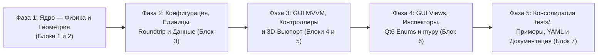

# Сводный отчет комплексного архитектурного, физического и контрактного ревью NMSimToolkit

Данный документ содержит полные результаты сквозного аудита репозитория `NMSimToolkit-Refactor` (**222 Python-файла**, **4 корневых YAML-конфига**, **26 документов `docs/`** и конфигурационные файлы сборки), проведенного по 8 этапам (Этап 0 + Блоки 1–7) согласно [`docs/plans/project_review_plan.md`](file:///d:/Python%20Projects/NMSimToolkit-Refactor/docs/plans/project_review_plan.md).

---

## 1. Исполнительное резюме (Executive Summary)

### 1.1. Базовые метрики скрининга (Этап 0)
* **Тестовый контур (`pytest`):** `442 passed in 30.30s` (при этом 2 файла с тестами не запускаются из-за отсутствия функций `test_*` или падают при прямом вызове с `NameError`).
* **Статическая типизация (`mypy`):**
  * Штатный вызов `.venv\Scripts\mypy.exe` падает с фатальной ошибкой парсинга `syntax error` в `numpy/__init__.pyi`, так как в [`mypy.ini`](file:///d:/Python%20Projects/NMSimToolkit-Refactor/mypy.ini#L2) зафиксирован `python_version = 3.10` при окружении Python 3.12 (PEP 695).
  * При запуске с `--python-version 3.12 --ignore-missing-imports core gui` выявлено **595 ошибок типизации в 81 файле**, из которых ~15 указывают на реальные дефекты времени выполнения (`NameError`, дублирование методов, вызов несуществующих методов суперкласса и неверные сигнатуры).
* **Соблюденные архитектурные инварианты (Граф `codebase-memory`):**
  * ✅ **0** запрещенных импортов `core -> gui` (`PySide6`, `vtk`, `pyvista`, `pyqtgraph`);
  * ✅ **0** запрещенных импортов `core.geometry -> core.config` и `core.physics -> core.config`;
  * ✅ **0** утечек `*_kernels.py` в публичные фасадные `__init__.py`;
  * ✅ **0** вызовов глобального `np.random.*` внутри `core/` и `gui/` (осталось 3 файла в `tests/`).

---

### 1.2. Топ-15 критических сквозных дефектов (🔴 Critical Blockers)

> [!CAUTION]
> Следующие дефекты напрямую искажают физику транспорта частиц, геометрическую навигацию, кинематику ОФЭКТ или вызывают падение (`NameError` / `TypeError`) и утечки процессов/памяти в рантайме.

1. **Искажение углового распределения и `NaN` в Рэлеевском рассеянии ([`core/physics/g4coherent.py:75-81`](file:///d:/Python%20Projects/NMSimToolkit-Refactor/core/physics/g4coherent.py#L75-L81)):**
   * В цикле неймановского отбора написано `if 2 * r3 < 1. + cost * cost or cost > -1.0: break` вместо `if cost >= -1.0 and 2.0 * r3 < 1.0 + cost * cost: break` (ошибка закона де Моргана при переносе из Geant4 `while (2*r3 >= 1+cost^2 || cost < -1)`).
   * Поляризационный множитель Томсона $(1 + \cos^2\theta)$ полностью игнорируется (так как `cost > -1.0` истинно для любого валидного косинуса), а при `cost < -1.0` неравенство `1 + cost^2 > 2 > 2*r3` всегда истинно, цикл прерывается с `cost < -1.0`, и `np.arccos(cost)` возвращает **`NaN`**, заражая координаты и направления в `ParticleBank`!
   * Дополнительно при `a2 == 0.0` деление `0.0 / 0.0` в `_form_factor_squared_cdf_Slot` (строки 21, 56) также дает `NaN`.

2. **Сэмплирование атомного номера $Z$ в сложных веществах по массовой доле вместо парциального сечения ([`core/physics/physics_compiler.py:78-104`](file:///d:/Python%20Projects/NMSimToolkit-Refactor/core/physics/physics_compiler.py#L78-L104), [`core/physics/processes_kernels.py:63-80`](file:///d:/Python%20Projects/NMSimToolkit-Refactor/core/physics/processes_kernels.py#L63-L80)):**
   * Функция `_sample_Z_scalar` выбирает атом-мишень в процессе по статическим массовым долям $w_i$ (`element_csr`). Для фотоэффекта и Рэлея ($\sigma \propto Z^{3..4}$) в кристалле $\text{NaI}$ или костной ткани это грубо искажает выбор атома-мишени (в воде в 11% случаев фотоэффект разыгрывается на водороде $Z=1$). Выбор атома обязан взвешиваться по парциальному сечению $w_i (\mu/\rho)_{p,i}(E)$ конкретного процесса при текущей энергии.

3. **Систематический сдвиг воксельной сетки на `-0.5` вокселя и усечение к нулю в `WoodcockVoxelVolume` ([`core/geometry/voxel_volumes.py:77-93`](file:///d:/Python%20Projects/NMSimToolkit-Refactor/core/geometry/voxel_volumes.py#L77-L93)):**
   * Формула `ix = Index((x + (size_x / 2.0 - vox_size_x / 2.0)) / vox_size_x)` смещает сетку на полвокселя влево и усекает дробную часть к нулю (`int(...)`) вместо `floor((x + 0.5 * size_x) / vox_size_x)`. Из-за этого интервал `(-0.5 * vox_size, +1.0 * vox_size)` целиком отображается в индекс `0`: нулевой воксель становится **в 1.5 раза шире**, а последний воксель `N-1` — **в 2 раза уже** (`0.5 * vox_size`).

4. **Пропуск воздушных каналов и выход за пределы коллиматора в RayCasting ([`core/geometry/geometry_kernels.py:288-386`](file:///d:/Python%20Projects/NMSimToolkit-Refactor/core/geometry/geometry_kernels.py#L288-L386)):**
   * В `_hex_prism_intersect` (строка 289) для частицы в перегородке на расстоянии $0 < t_{\text{enter}} \le 10^{-9}\text{ мм}$ перед входом в канал `channel_is_hit` ложно, и `time_next` прыгает сразу к границе ячейки Вороного позади канала, **пролетая воздушный канал насквозь**. При входе в коллиматор снаружи через торец $Z$ (`time_offset > 0`) в перегородку без пересечения канала текущей ячейки функция возвращает `np.inf, -np.inf`.
   * В `_trace_single_ray` (строка 383) ветка `elif tmin <= 0.0: closest_dist = tmax` перезаписывает расстояние до выхода из родительского `lead_body` без `min(closest_dist, tmax)`, позволяя частице в краевом отверстии `PeriodicHexPrism` выйти за пределы свинцового блока.

5. **Рассогласование единиц угла (`rad` vs `deg`) и времени (`ns` vs `s`) в конвейере протоколов ОФЭКТ ([`core/config/sweep_compiler.py:35-68`](file:///d:/Python%20Projects/NMSimToolkit-Refactor/core/config/sweep_compiler.py#L35-L68), [`core/config/template_binder.py:194-305`](file:///d:/Python%20Projects/NMSimToolkit-Refactor/core/config/template_binder.py#L194-L305), [`gui/viewmodels/procedure_viewmodel.py:807-831`](file:///d:/Python%20Projects/NMSimToolkit-Refactor/gui/viewmodels/procedure_viewmodel.py#L807-L831)):**
   * `StepAndShootProcedureViewModel.to_config()` сохраняет углы в радианах (`0..6.283`) и время в наносекундах (`1e9`). `SweepCompiler.compile_protocol` генерирует переменные `gantry_angle` в **радианах** и `step_time` в **наносекундах**, а `ConfigTemplateBinder` записывает шаблоны `"${gantry_angle} deg"` и `"${step_time} s"`. При подстановке радианы трактуются как градусы (поворот станины уменьшается в **57.3 раза** — $6.28^\circ$ за весь скан вместо $360^\circ$!), а время шага увеличивается в **$10^9$ раз**! Кроме того, `rotation_direction` (`CW`/`CCW`) полностью игнорируется.

6. **Физическая ошибка в $10^9$ раз при чтении `half_life` и `activity` в `SourceViewModel` ([`gui/viewmodels/nodes/source_vm.py:117-135`](file:///d:/Python%20Projects/NMSimToolkit-Refactor/gui/viewmodels/nodes/source_vm.py#L117-L135)):**
   * В `_sync_from_core` при чтении `core_node.half_life` (в базовых единицах `ns == 1.0`) значение делится только на `3600.0` без деления на `units.second` (`1e9`), превращая период полураспада 6 ч в **$6 \times 10^9$ часов** (именно этот баг породил `half_life: 4.752e+58` в [`simulation_config.yaml:52`](file:///d:/Python%20Projects/NMSimToolkit-Refactor/simulation_config.yaml#L52)!). А эвристика `total_activity if total_activity >= 1e3 else total_activity / units.Bq` занижает любую активность $\ge 1\text{ ТБк}$ в $10^9$ раз.

7. **Множественные нарушения Roundtrip-инварианта `export(build(config)) == config` ([`core/config/exporter.py`](file:///d:/Python%20Projects/NMSimToolkit-Refactor/core/config/exporter.py), [`core/config/template_binder.py`](file:///d:/Python%20Projects/NMSimToolkit-Refactor/core/config/template_binder.py)):**
   * `SceneExporter` экспортирует `MatrixTransformConfig` (`type: "matrix"`), поверх которого `ConfigTemplateBinder` дописывает новые `translate`/`rotate`, **удваивая трансформации** при повторном открытии.
   * При экспорте `GantryNode` теряется трансляция, у `Source` теряются `radionuclide` и `phantom_type`, у коллиматоров теряются дочерние узлы `children`, а в `Volume` строка 229 обращается к несуществующему `node.size` (`AttributeError`).

8. **Повторное определение `MainWindow.closeEvent` ([`gui/views/main_window.py:845,1177`](file:///d:/Python%20Projects/NMSimToolkit-Refactor/gui/views/main_window.py#L845-L1183)) и `SceneViewportController.disconnect_node` ([`gui/controllers/viewport_controller.py:292,497`](file:///d:/Python%20Projects/NMSimToolkit-Refactor/gui/controllers/viewport_controller.py#L292-L518)):**
   * В `MainWindow` метод `closeEvent` на строке 1177 полностью затирает метод на строке 845: при закрытии окна не закрываются `orchestrator_session`, `viewport_controller` и `VTKViewport`.
   * В `SceneViewportController` второе определение `disconnect_node` на строке 497 затирает первое (строка 292), оставляя на 3D-сцене висящие акторы отверстий коллиматора `holes_{node_id}`.

9. **Четыре скрытых `NameError` и `AttributeError` в модулях GUI при прямом импорте или вызове:**
   * [`gui/viewport_3d/transform_gizmo.py:69`](file:///d:/Python%20Projects/NMSimToolkit-Refactor/gui/viewport_3d/transform_gizmo.py#L69): `NodeViewModel` и `Set` используются в аннотациях без импорта и без `from __future__ import annotations`;
   * [`gui/viewmodels/nodes/voxel_volume_vm.py:120-123`](file:///d:/Python%20Projects/NMSimToolkit-Refactor/gui/viewmodels/nodes/voxel_volume_vm.py#L120-L123): `Any` и `Dict` не импортированы;
   * [`gui/views/distribution_import_dialog.py:42`](file:///d:/Python%20Projects/NMSimToolkit-Refactor/gui/views/distribution_import_dialog.py#L42): `Sequence` не импортирован;
   * [`gui/views/scene_tree_widget.py:121`](file:///d:/Python%20Projects/NMSimToolkit-Refactor/gui/views/scene_tree_widget.py#L121): `List` не импортирован;
   * [`gui/views/widgets/grid_chips_widget.py:118-119`](file:///d:/Python%20Projects/NMSimToolkit-Refactor/gui/views/widgets/grid_chips_widget.py#L118-L119): использование удаленного в PySide6 / Qt6 `Qt.Orientations`.

10. **Падение `TypeError` при отрисовке отверстий параметрического коллиматора ([`gui/controllers/viewport_controller.py:407`](file:///d:/Python%20Projects/NMSimToolkit-Refactor/gui/controllers/viewport_controller.py#L407)):**
    * В `self.collimator_hole_renderer.render_holes(...)` передается несуществующий аргумент `geometry_or_size=node_vm.size` вместо `geometry`.

11. **Потеря данных и утечки `SharedMemory` в мультипроцессных обработчиках ([`core/config/simulation_worker.py:145`](file:///d:/Python%20Projects/NMSimToolkit-Refactor/core/config/simulation_worker.py#L145), [`core/data/data_handlers.py:447-551`](file:///d:/Python%20Projects/NMSimToolkit-Refactor/core/data/data_handlers.py#L447-L551), [`core/data/dose_map_handler.py:270`](file:///d:/Python%20Projects/NMSimToolkit-Refactor/core/data/dose_map_handler.py#L270), [`gui/controllers/ipc_receiver.py:300`](file:///d:/Python%20Projects/NMSimToolkit-Refactor/gui/controllers/ipc_receiver.py#L300)):**
    * `HistoryAssemblerHandler` не имеет метода `finalize()`, теряя последний незаполненный батч историй в конце прогона;
    * `DoseMapHandler` перезаписывает `/dose/<name>` на каждом шаге свипа вместо накопления/шардирования, а его `SharedMemory` никогда не закрывается в воркере и в `IPCReceiver._multi_dose_shms`;
    * `Orchestrator` инициализирует `SeedSequence()` без пользовательского `seed` (невоспроизводимость мультипроцессных расчетов).

12. **Аллокация на горячем пути `@njit` и нарушение независимости потоков ГСЧ ([`core/transport/transport_kernels.py:105`](file:///d:/Python%20Projects/NMSimToolkit-Refactor/core/transport/transport_kernels.py#L105), [`core/transport/simulation_managers.py:81-99`](file:///d:/Python%20Projects/NMSimToolkit-Refactor/core/transport/simulation_managers.py#L81-L99)):**
    * В `woodcock_tracking_kernel` внутри цикла по частицам выполняется `process_lacs = np.empty(num_processes, dtype=Float)` (кучная `malloc`/`free` на каждый шаг каждой частицы);
    * `SimulationManager` передает один и тот же экземпляр `rng` и в `propagator`, и во все узлы `Source` вместо порождения независимых потоков через `SeedSequence.spawn()`, а сеттер `SimulationManager.rng` не обновляет `rng` внутри уже созданных `propagator.processes`.

13. **Ошибки обхода дерева сцены и инвалидации геометрии ([`core/scene/nodes.py:125-142`](file:///d:/Python%20Projects/NMSimToolkit-Refactor/core/scene/nodes.py#L125-L142), [`core/geometry/volumes.py:61-70`](file:///d:/Python%20Projects/NMSimToolkit-Refactor/core/geometry/volumes.py#L61-L70)):**
    * `Volume.material_list` обходит только прямых детей типа `Volume`, пропуская все объемы внутри промежуточных `CompositeNode` (`GantryNode`, `GammaCameraNode`, `DirectParallelCollimator`) и дочерние `WoodcockParametricVolume`;
    * `CompositeNode.remove_child` обнуляет `child.parent = None` до вызова `invalidate_geometry()`, блокируя инвалидацию корневой сцены.

14. **Искажение 3D-рендеринга воксельных/дозовых сеток и локального гизмо ([`gui/viewport_3d/voxel_volume_renderer.py:85-152`](file:///d:/Python%20Projects/NMSimToolkit-Refactor/gui/viewport_3d/voxel_volume_renderer.py#L85-L152), [`dose_volume_renderer.py:78-87`](file:///d:/Python%20Projects/NMSimToolkit-Refactor/gui/viewport_3d/dose_volume_renderer.py#L78-L87), [`transform_gizmo.py:427,1303`](file:///d:/Python%20Projects/NMSimToolkit-Refactor/gui/viewport_3d/transform_gizmo.py#L427)):**
    * Запись 3D-массива формы `(Nx, Ny, Nz)` в `point_data` при `dimensions=data_3d.shape` создает `(Nx-1, Ny-1, Nz-1)` ячеек, сжимая рендер фантома и дозы на 1 воксель по каждой оси;
    * В `TransformGizmo` в fallback-ветке мировая дельта `filtered_delta` складывается напрямую с локальным вектором `initial_matrix[0:3, 3]`, а `VTKViewport.render()` конфликтует с системным `QWidget.render(QPaintDevice, ...)`.

15. **Неработоспособность всех 4 примеров `examples/*.py` и корневого скрипта `tb161_nema_simulation.py`:**
    * Все скрипты в `examples/` падают при старте с `ModuleNotFoundError: No module named 'core.geometry.gamma_cameras'` и `AttributeError: 'WoodcockVoxelVolume' object has no attribute 'set_parent'`;
    * `tb161_nema_simulation.py:97` падает с `TypeError` из-за передачи строки `hole_shape="hexagonal"` вместо `CollimatorHoleShape.HEXAGONAL`.

---

## 2. Детальные результаты аудита по блокам (Блоки 1–7)

---

### Блок 1. Сцена, Геометрия и Пространственная математика (`core/scene/`, `core/geometry/`, `core/other/` — 25 файлов)

#### 🔴 Критические дефекты
1. **Сдвиг индексации вокселей на `-0.5` вокселя и утечка `@cache` в [`core/geometry/voxel_volumes.py`](file:///d:/Python%20Projects/NMSimToolkit-Refactor/core/geometry/voxel_volumes.py#L51-L93):**
   * В `_compile_cfunc` (строки 77–81) и `_parametric_function` (строки 89–92) необходимо заменить усечение `Index((x + (size_x / 2.0 - vox_size_x / 2.0)) / vox_size_x)` на `int(np.floor((x + 0.5 * size_x) / vox_size_x))` с проверкой `0 <= ix < nx`.
   * Декоратор `@cache` на методе экземпляра `material` (строка 51) удерживает `self` в глобальном кэше навсегда (утечка памяти гигабайтных массивов) и не сбрасывается при мутации `material_distribution`.
   * В `voxel_size.setter` (строки 36–41) пропущен вызов `self.invalidate_geometry()`.
2. **Ошибки RayCasting в [`core/geometry/geometry_kernels.py`](file:///d:/Python%20Projects/NMSimToolkit-Refactor/core/geometry/geometry_kernels.py#L288-L398):**
   * В `_hex_prism_intersect` (строки 289–309): устранить слепую зону $0 < t_{\text{enter}} \le 10^{-9}$ и возврат `np.inf, -np.inf` при входе через торец $Z$ (`time_offset > 0`) в перегородку.
   * В `_trace_single_ray` (строка 383): заменить `closest_dist = tmax` на `if tmax < closest_dist: closest_dist = tmax`.
   * В `cast_path_kernel` (строка 398): используется `prange` без `parallel=True` в `@njit`.
3. **Сломанный легаси-метод в [`core/geometry/woodcock_volumes.py:62-69`](file:///d:/Python%20Projects/NMSimToolkit-Refactor/core/geometry/woodcock_volumes.py#L62-L69):**
   * `WoodcockParametricVolume.get_material_by_position` передает 2 аргумента в `convert_to_local_position` (принимающий 1) и вызывает несуществующий `super().get_material_by_position`.
4. **Инвалидация дерева и сбор материалов в [`core/scene/nodes.py:125-142`](file:///d:/Python%20Projects/NMSimToolkit-Refactor/core/scene/nodes.py#L125-L142) и [`core/geometry/volumes.py:61-70`](file:///d:/Python%20Projects/NMSimToolkit-Refactor/core/geometry/volumes.py#L61-L70):**
   * В `CompositeNode.remove_child` вызывать `self.invalidate_geometry()` у родителя; в `add_child` при переносе узла между родителями вызывать `child.parent.remove_child(child)`.
   * В `Volume.material_list` рекурсивно обходить все `CompositeNode` и включать `child.material_list` для `WoodcockParametricVolume`.
5. **Нарушения `hepunits` и суффиксов единиц в ядре:**
   * [`core/geometry/spect_kinematics.py`](file:///d:/Python%20Projects/NMSimToolkit-Refactor/core/geometry/spect_kinematics.py#L43-L141): принимает и возвращает углы в градусах вместо радиан (`units.rad == 1.0`), содержит параметры `start_angle_deg`, `end_angle_deg`, `angle_deg`, `roll_deg`, переменные `rad`, `roll_rad` и легаси-алиас `axial_z`.
   * [`core/scene/gantry_node.py:35`](file:///d:/Python%20Projects/NMSimToolkit-Refactor/core/scene/gantry_node.py#L35): параметр `angle_rad`.
   * [`core/scene/dose_grid_node.py:17-37,73`](file:///d:/Python%20Projects/NMSimToolkit-Refactor/core/scene/dose_grid_node.py#L17-L73): отсутствие LBYL-валидации `size > 0` и `dose_voxel_size > 0` в `__init__` (допускает `ZeroDivisionError`), свойство `memory_mb` с суффиксом единиц.

#### 🟡 Архитектурные, контрактные и стилевые замечания
* Фазовая несимметричность центровки отверстий `SQUARE` (перекрестие перегородок в `(0,0)`) и `HEXAGONAL` (центр отверстия в `(0,0)`) в [`core/geometry/parametric_collimators.py:114-122`](file:///d:/Python%20Projects/NMSimToolkit-Refactor/core/geometry/parametric_collimators.py#L114-L122).
* Избыточные проверки `isinstance` при строгих аннотациях в [`parametric_collimators.py:54`](file:///d:/Python%20Projects/NMSimToolkit-Refactor/core/geometry/parametric_collimators.py#L54), [`direct_collimators.py:56`](file:///d:/Python%20Projects/NMSimToolkit-Refactor/core/geometry/direct_collimators.py#L56) и [`gamma_camera_node.py:72`](file:///d:/Python%20Projects/NMSimToolkit-Refactor/core/scene/gamma_camera_node.py#L72).
* Отсутствие `from __future__ import annotations` и `TYPE_CHECKING`-импортов `SpatialNode` в [`volumes.py:107`](file:///d:/Python%20Projects/NMSimToolkit-Refactor/core/geometry/volumes.py#L107) и [`voxel_volumes.py:97`](file:///d:/Python%20Projects/NMSimToolkit-Refactor/core/geometry/voxel_volumes.py#L97); использование переменной `CMaterialFunc` как типа в `volumes.py:51`; несовпадение типов `CompositeNode` vs `SpatialNode` в [`flattened_scene.py:35-45`](file:///d:/Python%20Projects/NMSimToolkit-Refactor/core/geometry/flattened_scene.py#L35-L45).
* Однобуквенные идентификаторы (`a, b, c`, `n`, `m`, `r`, `u`, `q`, `f`), англоязычные docstrings и отсутствие `__all__` в 18 внутренних модулях.

---

### Блок 2. Материалы, Частицы, Источники и Физика транспорта (`core/materials/`, `core/particles/`, `core/source/`, `core/physics/`, `core/transport/` — 32 файла)

#### 🔴 Критические дефекты
1. **Рэлеевское рассеяние ([`core/physics/g4coherent.py:21,56,75-81`](file:///d:/Python%20Projects/NMSimToolkit-Refactor/core/physics/g4coherent.py#L21-L81)):**
   * Исправить условие выхода из цикла отбора на `if cost >= -1.0 and 2.0 * r3 < 1.0 + cost * cost: break`, добавить `np.clip(cost, -1.0, 1.0)` перед `np.arccos(cost)` и защиту `if a2 <= 0.0: return 0.0` в `_form_factor_squared_cdf_Slot`.
2. **Комптоновское рассеяние ([`core/physics/g4compton.py:18,75-76`](file:///d:/Python%20Projects/NMSimToolkit-Refactor/core/physics/g4compton.py#L18-L76)):**
   * Добавить `cos_theta = min(1.0, max(-1.0, 1.0 - t * (1.0 - cos_theta_max)))` перед `np.arccos(cos_theta)` и защиту от `r2 == 0.0` перед `np.log(x)`.
3. **Выбор атома-мишени $Z$ в соединениях ([`core/physics/physics_compiler.py:78-104`](file:///d:/Python%20Projects/NMSimToolkit-Refactor/core/physics/physics_compiler.py#L78-L104), [`core/physics/processes_kernels.py:63-80`](file:///d:/Python%20Projects/NMSimToolkit-Refactor/core/physics/processes_kernels.py#L63-L80)):**
   * Перейти от отбора по массовым долям $w_i$ к отбору по парциальным макроскопическим сечениям конкретного процесса $\sigma_{p,i}(E)$.
4. **Небезопасная мажоранта Вудкока и обрезка сетки энергий на 1 МэВ ([`core/materials/materials.py:27-54`](file:///d:/Python%20Projects/NMSimToolkit-Refactor/core/materials/materials.py#L27-L54), [`core/physics/processes.py:33`](file:///d:/Python%20Projects/NMSimToolkit-Refactor/core/physics/processes.py#L33)):**
   * Заменить эвристический выбор мажорантного материала через `max(Zeff * density)` на поточечный максимум полного линейного коэффициента ослабления $\mu_{\max}(E) = \max_m \mu_m(E)$ на всей сетке энергий;
   * Расширить верхнюю границу сетки энергий в `Process.__init__` выше `1.0 * units.MeV` (или сделать конфигурируемой для высокоэнергетических гамма-линий и ПЭТ 511 кэВ / $^{124}\text{I}$);
   * В `Material.__gt__` и `__ge__` возвращать `NotImplemented` вместо `True` при сравнении с не-`Material`.
5. **Горячий путь, ГСЧ и компилятор физики:**
   * [`core/transport/transport_kernels.py:105`](file:///d:/Python%20Projects/NMSimToolkit-Refactor/core/transport/transport_kernels.py#L105): заменить аллокацию `np.empty(num_processes, dtype=Float)` внутри `@njit` на накопительный цикл в скалярной переменной (как в `direct_tracking_kernel`);
   * [`core/materials/attenuation_functions.py:24-25`](file:///d:/Python%20Projects/NMSimToolkit-Refactor/core/materials/attenuation_functions.py#L24-L25): удалить мутацию имени класса `self.__class__.__name__ += ...`;
   * [`core/transport/simulation_managers.py:81-99`](file:///d:/Python%20Projects/NMSimToolkit-Refactor/core/transport/simulation_managers.py#L81-L99): разделять потоки ГСЧ между `propagator` и источниками и обновлять `rng` в `propagator.processes`;
   * [`core/physics/physics_compiler.py:20,24,45-48`](file:///d:/Python%20Projects/NMSimToolkit-Refactor/core/physics/physics_compiler.py#L20-L48): вынести локальный импорт на уровень модуля, заменить `len(material_database) + 1` на `max_id + 1` и убрать подавляющий `except KeyError:`;
   * [`core/source/sources.py:31,34,69,74,150,308-415`](file:///d:/Python%20Projects/NMSimToolkit-Refactor/core/source/sources.py#L31-L415): устранить дублирование определений `energy` и `voxel_size`, исправить размытие `PointSource` на $1\text{ мм}^3$ (`voxel_size=0.0`) и удалить легаси-классы `Tc99m_MIBI`, `I123`, `SourcePhantom`, `efg3*`.

#### 🟡 Архитектурные, контрактные и стилевые замечания
* Суффикс единиц `poll_interval_seconds` в [`core/transport/ipc_pause_bridge.py:22`](file:///d:/Python%20Projects/NMSimToolkit-Refactor/core/transport/ipc_pause_bridge.py#L22).
* Несоответствие сигнатуры `ParticleBank.count` (`tuple.count`) в [`core/particles/particles.py:43`](file:///d:/Python%20Projects/NMSimToolkit-Refactor/core/particles/particles.py#L43), ошибки типов `mypy` в `interaction_buffers.py`, `processes.py`, `source_compiler.py`, `transport_kernels.py`.

---

### Блок 3. Конфигурация, Оркестрация, Сбор данных и Инфраструктура (`core/config/`, `core/data/`, `infra/`, `settings/`, `run_simulation.py` — 26 файлов)

#### 🔴 Критические дефекты
1. **Рассогласование единиц и направления вращения в [`core/config/sweep_compiler.py:35-68,120-135`](file:///d:/Python%20Projects/NMSimToolkit-Refactor/core/config/sweep_compiler.py#L35-L135) и [`core/config/template_binder.py:194-305`](file:///d:/Python%20Projects/NMSimToolkit-Refactor/core/config/template_binder.py#L194-L305):**
   * Привести `SweepCompiler` и `ConfigTemplateBinder` к единому каноническому контракту единиц `hepunits` (`rad`, `ns`, `mm`) либо форматировать макросы с явной размерностью;
   * Реализовать учет `protocol.rotation_direction` (`CW` vs `CCW`) при генерации углов в `SweepCompiler.compile_protocol`;
   * В `SweepCompiler.inject_variables` выбрасывать строгий `ValueError` при встрече любого неразрешенного макроса `${...}` (вместо тихого возврата сырой строки) и исправить поддержку нескольких макросов в одной строке `"${a}_${b}"`.
2. **Нарушения Roundtrip в [`core/config/exporter.py`](file:///d:/Python%20Projects/NMSimToolkit-Refactor/core/config/exporter.py), [`core/config/builder.py`](file:///d:/Python%20Projects/NMSimToolkit-Refactor/core/config/builder.py) и [`core/config/template_binder.py`](file:///d:/Python%20Projects/NMSimToolkit-Refactor/core/config/template_binder.py):**
   * Исключить дублирование трансформаций при экспорте `MatrixTransformConfig` и повторном наложении `translate`/`rotate` в `ConfigTemplateBinder`;
   * Сохранять смещение и точные углы `GantryNode` (без округления `:.4g`), поля `radionuclide`/`phantom_type` у `Source` и `children` у коллиматоров;
   * Исправить обращение `node.size` на `node.local_bound` в `exporter.py:229`.
3. **Мультипроцессинг, детерминизм ГСЧ и обработчики данных HDF5:**
   * [`core/config/orchestrator.py:92`](file:///d:/Python%20Projects/NMSimToolkit-Refactor/core/config/orchestrator.py#L92): добавить опциональное поле `seed: Optional[int] = None` в `SimulationManagerConfig` и передавать его в `np.random.SeedSequence(seed)`;
   * [`core/config/simulation_worker.py:145,286`](file:///d:/Python%20Projects/NMSimToolkit-Refactor/core/config/simulation_worker.py#L145-L286): гарантировать закрытие `DoseMapHandler.close()` в блоке `finally:`;
   * [`core/data/data_handlers.py:447-551`](file:///d:/Python%20Projects/NMSimToolkit-Refactor/core/data/data_handlers.py#L447-L551): реализовать `HistoryAssemblerHandler.finalize()` для сброса остатка буфера в конце симуляции;
   * [`core/data/dose_map_handler.py:242,270`](file:///d:/Python%20Projects/NMSimToolkit-Refactor/core/data/dose_map_handler.py#L242-L270): устранить перезапись `/dose/<name>` при многошаговом свипе в один HDF5-файл и исправить возвращаемый тип `get_dose_snapshot`;
   * [`core/data/distribution_loader.py:53,100,134,143`](file:///d:/Python%20Projects/NMSimToolkit-Refactor/core/data/distribution_loader.py#L53-L143): заменить приватный `np.lib.format._read_array_header` на публичный API (`np.load(..., mmap_mode='r').shape`) и передавать `order=order` по имени в `.reshape(target_shape, order=order)`.

#### 🟡 Архитектурные, контрактные и стилевые замечания
* Суффиксы единиц и легаси-дубликаты в метаданных HDF5 ([`core/data/data_manager.py:122-124`](file:///d:/Python%20Projects/NMSimToolkit-Refactor/core/data/data_manager.py#L122-L124), [`core/data/metadata_collector.py:230-296`](file:///d:/Python%20Projects/NMSimToolkit-Refactor/core/data/metadata_collector.py#L230-L296): `gantry_angle_deg`, `exposure_time` в секундах вместо `ns`, дублирование `pose_matrix_GammaCamera_N` и `pose_matrix_detector_N`).
* Дублирующий легаси-пакет `settings/` (`telegram_bot_settings.py`, `processes_settings.py`), перекрывающийся с `infra/monitoring/telegram.py` и `core/config/`.
* Широкие перехваты `except Exception:` в `simulation_worker.py`, `units.py`, `distribution_loader.py`, `dose_map_handler.py`, `models.py`, `data_manager.py`.

---

### Блок 4. Логика GUI: Models, ViewModels, Factories и Controllers (`gui/models/`, `gui/factories/`, `gui/viewmodels/`, `gui/controllers/` — 28 файлов)

#### 🔴 Критические дефекты
1. **Рассогласование единиц на стыке с `SweepCompiler` и ошибка в $10^9$ раз в `SourceViewModel`:**
   * [`gui/viewmodels/procedure_viewmodel.py:373-408,807-831`](file:///d:/Python%20Projects/NMSimToolkit-Refactor/gui/viewmodels/procedure_viewmodel.py#L373-L831), [`gui/controllers/orchestrator_session.py:288-363`](file:///d:/Python%20Projects/NMSimToolkit-Refactor/gui/controllers/orchestrator_session.py#L288-L363), [`gui/controllers/viewport_controller.py:902-930`](file:///d:/Python%20Projects/NMSimToolkit-Refactor/gui/controllers/viewport_controller.py#L902-L930): устранить конфликт `rad`/`deg` и `ns`/`s`.
   * [`gui/viewmodels/nodes/source_vm.py:117-135`](file:///d:/Python%20Projects/NMSimToolkit-Refactor/gui/viewmodels/nodes/source_vm.py#L117-L135): делить `half_life` на `3600.0 * units.second` в `_sync_from_core` и убрать порог `total_activity >= 1e3` при переводе `activity`.
2. **Ошибки времени выполнения (`NameError`, `TypeError`, дублирование методов):**
   * [`gui/viewmodels/nodes/voxel_volume_vm.py:3,120-123`](file:///d:/Python%20Projects/NMSimToolkit-Refactor/gui/viewmodels/nodes/voxel_volume_vm.py#L120-L123): импортировать `Any` и `Dict`;
   * [`gui/controllers/viewport_controller.py:292-308,407,497-518`](file:///d:/Python%20Projects/NMSimToolkit-Refactor/gui/controllers/viewport_controller.py#L292-L518): объединить дублирующиеся определения `disconnect_node` / `disconnect_all_nodes` (сохранив очистку `holes_{node_id}`) и заменить `geometry_or_size=node_vm.size` на `geometry=node_vm.size` на строке 407;
   * [`gui/viewmodels/nodes/gamma_camera_vm.py:363`](file:///d:/Python%20Projects/NMSimToolkit-Refactor/gui/viewmodels/nodes/gamma_camera_vm.py#L363): удалить запись в несуществующий атрибут `crystal.is_sensitive_detector = True`;
   * [`gui/viewmodels/scene_viewmodel.py:286-288`](file:///d:/Python%20Projects/NMSimToolkit-Refactor/gui/viewmodels/scene_viewmodel.py#L286-L288): исправить обращение `len(parent_vm.core_node.childs)` в ветке `else`, когда `parent_vm.core_node` не является `CompositeNode`.
3. **Запрещенная рефлексия (`getattr`/`setattr`) и проблемы многопоточности IPC:**
   * [`gui/viewmodels/decorators.py:86,99`](file:///d:/Python%20Projects/NMSimToolkit-Refactor/gui/viewmodels/decorators.py#L86-L99) и [`gui/viewmodels/procedure_viewmodel.py:850-851`](file:///d:/Python%20Projects/NMSimToolkit-Refactor/gui/viewmodels/procedure_viewmodel.py#L850-L851): избавиться от вызовов `getattr` и `setattr`;
   * [`gui/controllers/orchestrator_session.py:239,387-394,507`](file:///d:/Python%20Projects/NMSimToolkit-Refactor/gui/controllers/orchestrator_session.py#L239-L509): заменить `QThread.terminate()` на кооперативную остановку пула, передавать параметры 3D-дозы в `IPCReceiver` и вызывать `self._ipc_receiver.clear_accumulation()`;
   * [`gui/controllers/ipc_receiver.py:75-86,213-219,300-319`](file:///d:/Python%20Projects/NMSimToolkit-Refactor/gui/controllers/ipc_receiver.py#L75-L319): закрывать сегменты `self._multi_dose_shms` в `close()` и синхронизировать доступ к `_accumulated_energies` мьютексом.

#### 🟡 Архитектурные, контрактные и стилевые замечания
* Конфликт атрибута `NodeViewModel.children` с методом `QObject.children()` в [`base_node_vm.py:34`](file:///d:/Python%20Projects/NMSimToolkit-Refactor/gui/viewmodels/nodes/base_node_vm.py#L34); конфликт `GuiSimulationSettings.__iter__` с `pydantic.BaseModel` и легаси-методы словаря в [`gui_settings.py:63-88`](file:///d:/Python%20Projects/NMSimToolkit-Refactor/gui/models/gui_settings.py#L63-L88).
* Отсутствие параметризации `NodeViewModel[TCoreNode]` (десятки ошибок `mypy` при обращении к `self.core_node`).
* Тройная эмиссия сигналов `transform_changed` в `GammaCameraViewModel._rebuild_geometry` (строки 317–342).
* Хрупкий поиск детектора по подстроке `"detector" in node_name_lower` в [`stream_handlers.py:454-464`](file:///d:/Python%20Projects/NMSimToolkit-Refactor/gui/controllers/stream_handlers.py#L454-L464).

---

### Блок 5. 3D-вьюпорт, Рендереры и Кинематические манипуляторы (`gui/viewport_3d/` — 13 файлов)

#### 🔴 Критические дефекты
1. **`NameError` и математические дефекты в [`gui/viewport_3d/transform_gizmo.py`](file:///d:/Python%20Projects/NMSimToolkit-Refactor/gui/viewport_3d/transform_gizmo.py):**
   * Добавить `from __future__ import annotations` и импорт `Set`, `NodeViewModel` (под `if TYPE_CHECKING:`);
   * Ориентировать плашки плоскостей (`pv.Plane`) и наконечники масштабирования (`pv.Cube`) по локальному базису `basis` в режиме `GizmoSpace.LOCAL`;
   * В fallback-ветках перемещения (строки 427, 1303) переводить мировую `filtered_delta` в локальную систему координат родителя перед сложением с `initial_matrix[0:3, 3]`.
2. **Перекрытие системного метода `QWidget.render` в [`gui/viewport_3d/vtk_viewport.py:335`](file:///d:/Python%20Projects/NMSimToolkit-Refactor/gui/viewport_3d/vtk_viewport.py#L335):**
   * Переименовать `VTKViewport.render(self) -> None` (например, в `request_render()` или поддержать сигнатуру `QWidget.render` при передаче аргументов).
3. **Сброс угла крена (`roll`) и игнорирование `Shift` в [`gui/viewport_3d/kinematic_constraints.py:703-716`](file:///d:/Python%20Projects/NMSimToolkit-Refactor/gui/viewport_3d/kinematic_constraints.py#L703-L716):**
   * В `CameraMountKinematicConstraint.on_transform_changed` сохранять индивидуальный угол `sibling_roll` каждой синхронизируемой камеры и учитывать модификатор `Shift`.
4. **Невидимость пластика C-552 в [`gui/viewport_3d/material_palette.py:443-450`](file:///d:/Python%20Projects/NMSimToolkit-Refactor/gui/viewport_3d/material_palette.py#L443-L450):**
   * Заменить проверку подстроки `"air" in material_name_lower` на точное сравнение `material_name_lower in ("air", "air, dry (near sea level)", "vacuum")`.
5. **Сжатие воксельных и дозовых сеток на 1 воксель в [`voxel_volume_renderer.py:85-152`](file:///d:/Python%20Projects/NMSimToolkit-Refactor/gui/viewport_3d/voxel_volume_renderer.py#L85-L152) и [`dose_volume_renderer.py:78-87`](file:///d:/Python%20Projects/NMSimToolkit-Refactor/gui/viewport_3d/dose_volume_renderer.py#L78-L87):**
   * Использовать `dimensions=(Nx+1, Ny+1, Nz+1)` с `cell_data` либо смещать `origin` на `+0.5 * spacing`.

#### 🟡 Архитектурные, контрактные и стилевые замечания
* Повсеместное использование суффиксов `_deg`, `_rad` и хранение углов в градусах в `spect_manipulator.py`, `kinematic_constraints.py` и `transform_gizmo.py`.
* Накопление погрешности плавающей точки на матрицах в `CameraMountKinematicConstraint` и `PetSectorKinematicConstraint` без ортогонализации Грамма — Шмидта / SVD.

---

### Блок 6. Графические представления, Инспекторы свойств и Виджеты (`gui/views/`, `gui/views/inspectors/`, `gui/views/widgets/`, `gui/app.py` — 31 файл)

#### 🔴 Критические дефекты
1. **Повторное определение `MainWindow.closeEvent` ([`gui/views/main_window.py:845,1177`](file:///d:/Python%20Projects/NMSimToolkit-Refactor/gui/views/main_window.py#L845-L1183)):**
   * Объединить оба метода `closeEvent` в один, обеспечив снятие фильтра событий, остановку таймеров и закрытие `orchestrator_session`, `results_viewer`, `viewport_controller` и `viewport`.
2. **Ошибки `NameError` и `Qt.Orientations`:**
   * Импортировать `Sequence` в [`distribution_import_dialog.py:3`](file:///d:/Python%20Projects/NMSimToolkit-Refactor/gui/views/distribution_import_dialog.py#L3) и `List` в [`scene_tree_widget.py:2`](file:///d:/Python%20Projects/NMSimToolkit-Refactor/gui/views/scene_tree_widget.py#L2);
   * Заменить `Qt.Orientations(Qt.Orientation(0))` на `Qt.Orientation(0)` в [`grid_chips_widget.py:118-119`](file:///d:/Python%20Projects/NMSimToolkit-Refactor/gui/views/widgets/grid_chips_widget.py#L118-L119).
3. **Блокировка отвязки (`unbind`) переменных в [`gui/views/inspectors/transform_section.py:162-190`](file:///d:/Python%20Projects/NMSimToolkit-Refactor/gui/views/inspectors/transform_section.py#L162-L190):**
   * Удалить принудительный авто-биндинг `self.spin_y.bind_variable("radius")` и `self.spin_rot_x.bind_variable("gantry_angle")` внутри метода обновления UI `update_transform_fields`.
4. **Накопление дублирующихся подписок сигналов `procedure_vm` ([`main_window.py:646-663`](file:///d:/Python%20Projects/NMSimToolkit-Refactor/gui/views/main_window.py#L646-L663), [`procedure_selector_widget.py:145-166`](file:///d:/Python%20Projects/NMSimToolkit-Refactor/gui/views/procedure_selector_widget.py#L145-L166)):**
   * Отключать сигналы от предыдущего экземпляра `procedure_vm` перед подключением нового и контролировать флаг подключения.
5. **Дефекты LBYL и индексации строк в [`gui/views/distribution_import_dialog.py:428-432,555-642`](file:///d:/Python%20Projects/NMSimToolkit-Refactor/gui/views/distribution_import_dialog.py#L428-L642):**
   * При `elem_count is None` или `elem_count == 0` блокировать кнопку `Ok` с сообщением об ошибке;
   * Не захватывать статический индекс строки `target_row=row_idx` в замыкание `combo_mat.currentTextChanged` (определять текущую строку динамически после удаления строк).

#### 🟡 Архитектурные, контрактные и стилевые замечания
* Сотни обращений к устаревшим коротким перечислениям Qt5 (`Qt.AlignCenter`, `Qt.UserRole`, `QHeaderView.Stretch`, `QMessageBox.Yes`, `QDialog.Accepted`, `QPalette.Window`) вместо пространств имен Qt6 / PySide6.
* Локальные импорты `SceneTreeWidget` внутри методов событий перетаскивания в [`sensitive_volumes_editor.py:47,59,71`](file:///d:/Python%20Projects/NMSimToolkit-Refactor/gui/views/widgets/sensitive_volumes_editor.py#L46-L72).
* Мертвый виджет [`grid_variable_widget.py`](file:///d:/Python%20Projects/NMSimToolkit-Refactor/gui/views/widgets/grid_variable_widget.py) и костыль совместимости `@property def table` в [`grid_chips_widget.py:593-603`](file:///d:/Python%20Projects/NMSimToolkit-Refactor/gui/views/widgets/grid_chips_widget.py#L593-L603).

---

### Блок 7. Тестовый контур, Примеры, Конфигурации и Документация (`tests/`, `examples/`, `docs/`, корневые скрипты и `*.yaml` — 106 файлов)

#### 🔴 Критические дефекты
1. **Сломанные файлы в `tests/` и загрязнение корня проекта:**
   * [`tests/scratch_debug.py`](file:///d:/Python%20Projects/NMSimToolkit-Refactor/tests/scratch_debug.py): исполняется при импорте, открывает `MainWindow()`. **Удалить.**
   * [`tests/geometry/test_geometry_compiler.py:27-56,203`](file:///d:/Python%20Projects/NMSimToolkit-Refactor/tests/geometry/test_geometry_compiler.py#L27-L56): падает с `NameError: name 'TransformableVolumeWithChild' is not defined` и `psutil`.
   * [`tests/test_direct_collimator_gui.py:140`](file:///d:/Python%20Projects/NMSimToolkit-Refactor/tests/test_direct_collimator_gui.py#L140): падает с `NameError: name 'Any' is not defined`.
   * [`tests/test_full_benchmark.py:101`](file:///d:/Python%20Projects/NMSimToolkit-Refactor/tests/test_full_benchmark.py#L101) и [`tests/test_gui_refactoring_verification.py:315`](file:///d:/Python%20Projects/NMSimToolkit-Refactor/tests/test_gui_refactoring_verification.py#L315): создают мусорные файлы `benchmark_soa.hdf5` и `test_dm_stop.h5` в корне репозитория.
   * Вызовы глобального `np.random.*` в [`tests/test_stage4_views.py:70`](file:///d:/Python%20Projects/NMSimToolkit-Refactor/tests/test_stage4_views.py#L70), [`tests/geometry/test_geometry_compiler.py:62-66`](file:///d:/Python%20Projects/NMSimToolkit-Refactor/tests/geometry/test_geometry_compiler.py#L62-L66), [`tests/physics/test_processes.py:34-36`](file:///d:/Python%20Projects/NMSimToolkit-Refactor/tests/physics/test_processes.py#L34-L36).
   * Утечки `SharedMemory` в [`tests/test_gui_integration_fixes.py:384`](file:///d:/Python%20Projects/NMSimToolkit-Refactor/tests/test_gui_integration_fixes.py#L384) и незакрытые экземпляры `MainWindow`, `VTKViewport`, `OrchestratorSession` в 12 тестовых файлах.
2. **Неработоспособные примеры и корневые конфиги:**
   * [`examples/brain_main.py`](file:///d:/Python%20Projects/NMSimToolkit-Refactor/examples/brain_main.py), [`heart_main.py`](file:///d:/Python%20Projects/NMSimToolkit-Refactor/examples/heart_main.py), [`heart_32_main.py`](file:///d:/Python%20Projects/NMSimToolkit-Refactor/examples/heart_32_main.py), [`lung_cancer_main.py`](file:///d:/Python%20Projects/NMSimToolkit-Refactor/examples/lung_cancer_main.py): падают с `ModuleNotFoundError` (`core.geometry.gamma_cameras`) и `AttributeError` (`set_parent`).
   * [`tb161_nema_simulation.py:97`](file:///d:/Python%20Projects/NMSimToolkit-Refactor/tb161_nema_simulation.py#L97): падает с `TypeError` на `hole_shape="hexagonal"`.
   * [`simulation_config.yaml`](file:///d:/Python%20Projects/NMSimToolkit-Refactor/simulation_config.yaml): `sensitive_volumes: [Detector]` не совпадает с `Detector_1`/`Detector_2` (0 событий), `half_life: 4.752e+58`, лишний корневой ключ `Materials`.
   * [`mypy.ini:2`](file:///d:/Python%20Projects/NMSimToolkit-Refactor/mypy.ini#L2): `python_version = 3.10` вызывает `syntax error` в Python 3.12.

---

## 3. Карта консолидации тестового контура (`tests/`)

Согласно Разделу 2 [`03_dev_workflow.md`](file:///d:/Python%20Projects/NMSimToolkit-Refactor/.agents/rules/03_dev_workflow.md), в корне `tests/` должны остаться **только** `tests/__init__.py` и `tests/conftest.py`. Все 29 файлов `tests/test_*.py` из корня (и `tests/scratch_debug.py`) консолидируются в доменные подпапки:

| Исходный файл | Действие | Целевой доменный модуль |
| :--- | :--- | :--- |
| [`tests/scratch_debug.py`](file:///d:/Python%20Projects/NMSimToolkit-Refactor/tests/scratch_debug.py) | **Удалить** | — |
| [`tests/test_full_benchmark.py`](file:///d:/Python%20Projects/NMSimToolkit-Refactor/tests/test_full_benchmark.py) | Перенести + `TemporaryDirectory` | `tests/transport/test_simulation_benchmark.py` |
| [`tests/test_core_hotfix_stability.py`](file:///d:/Python%20Projects/NMSimToolkit-Refactor/tests/test_core_hotfix_stability.py) | Разделить по доменам ядра | `tests/physics/test_physics_compiler.py`, `tests/source/test_sources.py`, `tests/geometry/test_geometry_compiler.py`, `tests/transport/test_step5_transport.py` |
| [`tests/test_stage1_core.py`](file:///d:/Python%20Projects/NMSimToolkit-Refactor/tests/test_stage1_core.py) | Разделить по доменам ядра | `tests/geometry/test_voxel_volumes.py`, `tests/source/test_sources.py`, `tests/config/test_config.py` |
| [`tests/test_parametric_collimator.py`](file:///d:/Python%20Projects/NMSimToolkit-Refactor/tests/test_parametric_collimator.py) | Перенести | `tests/geometry/test_parametric_collimator.py` |
| [`tests/test_dose_grid_node.py`](file:///d:/Python%20Projects/NMSimToolkit-Refactor/tests/test_dose_grid_node.py) | Разделить (Core / GUI) | `tests/geometry/test_dose_grid_node.py`, `tests/viewmodels/test_dose_grid_viewmodel.py` |
| [`tests/test_data_handlers.py`](file:///d:/Python%20Projects/NMSimToolkit-Refactor/tests/test_data_handlers.py), [`tests/test_dose_and_track_fixes.py`](file:///d:/Python%20Projects/NMSimToolkit-Refactor/tests/test_dose_and_track_fixes.py), [`tests/test_scene_sensitive_volumes.py`](file:///d:/Python%20Projects/NMSimToolkit-Refactor/tests/test_scene_sensitive_volumes.py) | Объединить | `tests/data/test_data_handlers.py`, `tests/viewport_3d/test_track_renderer.py` |
| [`tests/test_spect_simulation_hdf5.py`](file:///d:/Python%20Projects/NMSimToolkit-Refactor/tests/test_spect_simulation_hdf5.py) | Объединить | `tests/data/test_hdf5_storage_and_metadata.py`, `tests/viewport_3d/test_viewport_controller.py` |
| [`tests/test_distribution_loader.py`](file:///d:/Python%20Projects/NMSimToolkit-Refactor/tests/test_distribution_loader.py) | Перенести | `tests/data/test_distribution_loader.py` |
| [`tests/test_template_binder_and_review_fixes.py`](file:///d:/Python%20Projects/NMSimToolkit-Refactor/tests/test_template_binder_and_review_fixes.py), [`tests/test_bindable_fields_and_bindings_roundtrip.py`](file:///d:/Python%20Projects/NMSimToolkit-Refactor/tests/test_bindable_fields_and_bindings_roundtrip.py), [`tests/test_protocol_standard_variables_and_grid_chips.py`](file:///d:/Python%20Projects/NMSimToolkit-Refactor/tests/test_protocol_standard_variables_and_grid_chips.py) | Разделить (Config / Views) | `tests/config/test_template_binder.py`, `tests/views/test_bindable_fields.py` |
| [`tests/test_voxel_phantom_mapping_and_saving.py`](file:///d:/Python%20Projects/NMSimToolkit-Refactor/tests/test_voxel_phantom_mapping_and_saving.py), [`tests/test_stage2_viewmodels.py`](file:///d:/Python%20Projects/NMSimToolkit-Refactor/tests/test_stage2_viewmodels.py), [`tests/test_direct_collimator_gui.py`](file:///d:/Python%20Projects/NMSimToolkit-Refactor/tests/test_direct_collimator_gui.py), [`tests/geometry/test_gantry_viewmodel_and_constraints.py`](file:///d:/Python%20Projects/NMSimToolkit-Refactor/tests/geometry/test_gantry_viewmodel_and_constraints.py) | Консолидировать в `tests/viewmodels/` | `tests/viewmodels/test_node_viewmodels.py`, `tests/viewmodels/test_voxel_volume_viewmodel.py`, `tests/viewmodels/test_gamma_camera_viewmodel.py`, `tests/viewmodels/test_gantry_viewmodel_and_constraints.py` |
| [`tests/test_stage3_viewport.py`](file:///d:/Python%20Projects/NMSimToolkit-Refactor/tests/test_stage3_viewport.py), [`tests/test_material_palette_and_viewport_enhancements.py`](file:///d:/Python%20Projects/NMSimToolkit-Refactor/tests/test_material_palette_and_viewport_enhancements.py), [`tests/test_node_viewmodel_sync_and_camera_fixes.py`](file:///d:/Python%20Projects/NMSimToolkit-Refactor/tests/test_node_viewmodel_sync_and_camera_fixes.py) | Консолидировать в `tests/viewport_3d/` | `tests/viewport_3d/test_viewport_and_gizmo.py`, `tests/viewport_3d/test_material_palette_and_clip_box.py`, `tests/viewport_3d/test_viewport_controller.py` |
| [`tests/test_stage4_views.py`](file:///d:/Python%20Projects/NMSimToolkit-Refactor/tests/test_stage4_views.py), [`tests/test_distribution_import_dialog.py`](file:///d:/Python%20Projects/NMSimToolkit-Refactor/tests/test_distribution_import_dialog.py), [`tests/test_all_14_gui_fixes.py`](file:///d:/Python%20Projects/NMSimToolkit-Refactor/tests/test_all_14_gui_fixes.py), [`tests/test_architectural_review_fixes.py`](file:///d:/Python%20Projects/NMSimToolkit-Refactor/tests/test_architectural_review_fixes.py), [`tests/test_gui_integration_and_fixes.py`](file:///d:/Python%20Projects/NMSimToolkit-Refactor/tests/test_gui_integration_and_fixes.py), [`tests/test_gui_integration_fixes.py`](file:///d:/Python%20Projects/NMSimToolkit-Refactor/tests/test_gui_integration_fixes.py), [`tests/test_gui_modularization.py`](file:///d:/Python%20Projects/NMSimToolkit-Refactor/tests/test_gui_modularization.py), [`tests/test_gui_refactoring_verification.py`](file:///d:/Python%20Projects/NMSimToolkit-Refactor/tests/test_gui_refactoring_verification.py), [`tests/test_gui_review_fixes.py`](file:///d:/Python%20Projects/NMSimToolkit-Refactor/tests/test_gui_review_fixes.py) | Расформировать свалки хотфиксов по доменам | `tests/views/test_main_window_and_views.py`, `tests/views/test_inspector_sections.py`, `tests/views/test_distribution_import_dialog.py` |
| [`tests/test_stage5_controllers.py`](file:///d:/Python%20Projects/NMSimToolkit-Refactor/tests/test_stage5_controllers.py) | Перенести в `tests/controllers/` | `tests/controllers/test_simulation_worker_and_session.py` |

---

## 4. Предлагаемый поэтапный план устранения замечаний (Remediation Roadmap)

Для безопасного и контролируемого исправления выявленных дефектов предлагается выполнить работу в **5 атомарных фаз** (каждая завершается проверкой `pytest`, `mypy` и коммитом):

- [x] **1. Фаза 1 — Исправление критических ошибок физики, геометрии и транспорта в `core/` (Блоки 1 и 2):**
   * Исправление закона де Моргана и `NaN` в `g4coherent.py` и `g4compton.py`;
   * Перевод отбора атомного номера $Z$ в соединениях на парциальные сечения процессов (`physics_compiler.py`, `processes_kernels.py`) и поточечная мажоранта Вудкока;
   * Исправление сдвига `-0.5` вокселя в `WoodcockVoxelVolume`, утечки `@cache` и инвалидации `voxel_size`;
   * Исправление слепой зоны `_hex_prism_intersect` и перезаписи `closest_dist` в `geometry_kernels.py`;
   * Исправление инвалидации `CompositeNode.remove_child`/`add_child` и обхода `Volume.material_list`;
   * Устранение аллокации `np.empty` в `woodcock_tracking_kernel`, разделение потоков ГСЧ (`SeedSequence.spawn`) в `SimulationManager`, очистка легаси-источников в `sources.py` и перевод `spect_kinematics.py` / `gantry_node.py` на канонические радианы `hepunits` без суффиксов `_deg`/`_rad`.

- [x] **2. Фаза 2 — Унификация единиц в протоколах, восстановление Roundtrip-инварианта и надежности HDF5/IPC в `core/config/` и `core/data/` (Блок 3):**
   * Устранение рассогласования `rad`/`deg` и `ns`/`s` между `SweepCompiler`, `ConfigTemplateBinder` и `StepAndShootProcedureViewModel`, поддержка `CW`/`CCW` и строгий `ValueError` на неразрешенных макросах;
   * Восстановление полного `Roundtrip` в `SceneExporter` / `SceneBuilder` / `ConfigTemplateBinder` (исключение дублирования `matrix`-трансформаций, сохранение смещения `GantryNode`, полей `Source` через `SourceMetadataConfig` / `source_metadata_registry` и детей коллиматоров);
   * Добавление `HistoryAssemblerHandler.finalize()`, исправление перезаписи `/dose/<name>` и закрытия `SharedMemory` в `DoseMapHandler` / `simulation_worker.py`, поддержка `seed` в `Orchestrator`.

- [x] **3. Фаза 3 — Исправление дефектов `gui/models/`, `gui/viewmodels/`, `gui/controllers/` и `gui/viewport_3d/` (Блоки 4 и 5):**
   * Исправление ошибки в $10^9$ раз в `SourceViewModel._sync_from_core`, импортов `Any`/`Dict`/`Set`/`NodeViewModel` в `voxel_volume_vm.py` и `transform_gizmo.py`;
   * Устранение дублирования `disconnect_node`/`disconnect_all_nodes` и `TypeError` (`geometry_or_size`) в `SceneViewportController`;
   * Устранение `getattr`/`setattr` в `decorators.py` и `procedure_viewmodel.py`, параметризация `NodeViewModel[TCoreNode]`;
   * Исправление геометрии `pv.ImageData` (`cell_data` / `dimensions`) в `voxel_volume_renderer.py` и `dose_volume_renderer.py`, локального перемещения и базиса в `TransformGizmo`, сохранения `roll` в `CameraMountKinematicConstraint`, видимости пластика C-552 и сигнатуры `VTKViewport.render`.

- [x] **4. Фаза 4 — Исправление дефектов `gui/views/`, секций инспектора, виджетов и приведение к чистому `mypy` на Python 3.12 (Блок 6):**
   * Объединение дублирующихся `MainWindow.closeEvent`, исправление утечки подписок `procedure_vm` и применения настроек треков;
   * Исправление `NameError` в `distribution_import_dialog.py` и `scene_tree_widget.py`, `Qt.Orientation` в `grid_chips_widget.py`, разблокировка `unbind()` в `transform_section.py`;
   * Обновление `mypy.ini` (`python_version = 3.12`), замена устаревших перечислений Qt5 на пространства имен PySide6 / Qt6 и доведение `mypy core gui` до **0 ошибок**.

- [x] **5. Фаза 5 — Консолидация `tests/`, восстановление `examples/*.py`, `tb161_nema_simulation.py`, корневых `*.yaml` и актуализация `docs/` (Блок 7):**
   * Удаление `tests/scratch_debug.py`, перенос и объединение 29 файлов из корня `tests/` в доменные подпапки, устранение утечек `MainWindow`/`VTKViewport`/`SharedMemory` и добавление регрессионных тестов на все исправленные дефекты Фаз 1–4;
   * Обновление `examples/*.py`, `tb161_nema_simulation.py` и корневых YAML-конфигураций под актуальный API ядра, удаление последнего легаси-класса `Tc99m_MIBI`;
   * Синхронизация `README.md`, `docs/*.md` и `docs/architecture_backlog.md`, очистка устаревших черновиков `docs/archive_drafts/`.

---

## 5. Кандидаты в архитектурный бэклог (🔵 Backlog Candidates)

Перенесены в [`docs/architecture_backlog.md`](../architecture_backlog.md) (разделы 17–20):
1. **Мульти-акторная визуализация нескольких сеток дозы в `DoseVolumeRenderer`** (`_volume_actors: Dict[str, Any]`).
2. **Декомпозиция геометрии манипулятора `TransformGizmo`** (разделение генерации полигональных мешей `GizmoMeshBuilder` и проекции луча `GizmoRayProjector`).
3. **Предрасчет обратных матриц трансформации на шаге симуляции (`GeometryCompiler`)** через аналитическое обращение ортонормированных SE(3)-матриц вместо `np.linalg.inv`.
4. **Унификация имен свойств без суффиксов единиц в `gui/viewmodels/` и `gui/viewport_3d/`** (хранение углов и времен строго в базовых единицах `hepunits` внутри `ViewModel`).

