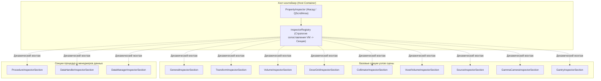

# Архитектурный план: Декомпозиция монолита PropertyInspector на компонентный реестр секций

## 1. Контекст и цели рефакторинга

Текущий файл [`gui/views/property_inspector.py`](file:///d:/Python%20Projects/NMSimToolkit-Refactor/gui/views/property_inspector.py) насчитывает **2499 строк кода** и объединяет в рамках одного монолитного класса `PropertyInspector` разнородную логику отображения и двустороннего связывания параметров для:
1. Базовых узлов графа сцены (имя, тип, пространственные трансформации TRS);
2. Геометрических объемов (`Volume`, материалы NIST);
3. Дозовых сеток (`DoseGridNode`, шаги вокселей, адаптация под родителя);
4. Коллиматоров (`CollimatorViewModel`, прямой и параметрический, геометрия ячеек);
5. Воксельных фантомов (`VoxelVolumeViewModel`, DICOM-палитры, ступенчатая прозрачность, маппинг материалов NIST);
6. Источников излучения (`SourceViewModel`, дискретные спектры, периоды полураспада, 3D-распределения);
7. Детекторных головок гамма-камер (`GammaCameraViewModel`, размеры слотов, защитные экраны Pb);
8. Станины томографа (`GantryViewModel`, угол ротора, направляющие);
9. Протоколов исследования (`ProcedureViewModel`: ОФЭКТ, ПЭТ, Step-and-Shoot, Custom Sweep, чипсы и таблицы переменных);
10. Обработчиков данных (`DataHandlerViewModel`, включая редактор чувствительных объемов `SensitiveVolumesEditorWidget`);
11. Менеджера данных (`DataManagerViewModel`, параметры HDF5 и емкость буфера).

### Проблемы текущей архитектуры:
* **Нарушение Single Responsibility Principle (SRP):** монолит управляет разметкой, конвертацией единиц `hepunits`, реактивной синхронизацией и логикой видимости для 11 различных доменов.
* **Нарушение Open-Closed Principle (OCP):** добавление любого нового типа узла сцены (например, пинхол-коллиматора или мультимодального детектора) требует прямого изменения монолитного файла.
* **Высокая когнитивная нагрузка и сложность тестирования:** изолированное тестирование интерфейсных элементов невозможно без инстанцирования всего монструозного инспектора.

### Цель рефакторинга:
Декомпозировать `PropertyInspector` на легковесный хост-контейнер (~150 строк) и семейство независимых, изолированных секций-виджетов (по 100–250 строк каждая) с компонентным реестром связывания (**Component-Based Inspector Registry**), сохранив 100% обратную совместимость с публичным API и существующими тестами.

---

## 2. Архитектурная модель: Component-Based Inspector Architecture



---

## 3. Детализация структуры пакета `gui/views/inspectors/`

Новая структура файлов в каталоге `gui/views/inspectors/`:

```
gui/views/inspectors/
├── __init__.py                     # Публичный фасад экспорта
├── base_section.py                 # Базовый класс BaseInspectorSection
├── inspector_registry.py           # Реестр сопоставления ViewModel -> Секции
├── general_section.py              # Имя и тип узла
├── transform_section.py            # Позиция и вращение (Roll, Pitch, Yaw)
├── volume_section.py               # Геометрия Box и материалы NIST
├── dose_grid_section.py            # Размеры, воксели, RAM, подгонка под родителя
├── collimator_section.py           # Тип (direct/param), форма каналов, септы
├── voxel_volume_section.py         # Файл фантома, палитра, LOD, прозрачность, NIST
├── source_section.py               # Спектр излучения, активность, распад
├── gamma_camera_section.py         # Размеры детектора, слоты, защита Pb, корпус
├── gantry_section.py               # Угол ротора, wireframe
├── procedure_section.py            # StepAndShoot, Spect, Pet, CustomSweep, чипсы
├── data_handler_section.py         # DirectStream, SensitiveVolume, HistoryAssembler
└── data_manager_section.py         # HDF5 путь, буфер, точность float
```

---

## 4. Спецификация контрактов и базового интерфейса

### 4.1 Базовый класс `BaseInspectorSection` (`base_section.py`)

```python
from typing import Any, Optional
from PySide6.QtWidgets import QGroupBox

class BaseInspectorSection(QGroupBox):
    """
    Абстрактная изолированная секция инспектора свойств.
    Управляет собственными виджетами ввода и реактивным связыванием с моделью представления.
    """
    def __init__(self, title: str, parent: Optional[Any] = None) -> None:
        super().__init__(title, parent)
        self._current_vm: Optional[Any] = None
        self._is_updating_ui: bool = False
        self._init_ui()

    def _init_ui(self) -> None:
        """Построение виджетов и компоновки секции."""
        raise NotImplementedError

    def bind_viewmodel(self, view_model: Any) -> None:
        """Связывание секции с целевой ViewModel и подписка на сигналы."""
        self.unbind()
        self._current_vm = view_model
        self.update_ui_from_vm()

    def unbind(self) -> None:
        """Отписка от сигналов текущей ViewModel и сброс состояния."""
        self._current_vm = None

    def update_ui_from_vm(self) -> None:
        """Синхронизация значений полей UI из текущей ViewModel."""
        raise NotImplementedError

    def can_handle(self, view_model: Any) -> bool:
        """Проверяет, применима ли данная секция к переданной модели представления."""
        raise NotImplementedError
```

### 4.2 Реестр секций `InspectorRegistry` (`inspector_registry.py`)

* Инкапсулирует словарь правил сопоставления:
  - `NodeViewModel` $\rightarrow$ `[GeneralSection, TransformSection]`
  - `VolumeViewModel` $\rightarrow$ `[GeneralSection, TransformSection, VolumeSection]`
  - `CollimatorViewModel` $\rightarrow$ `[GeneralSection, TransformSection, VolumeSection, CollimatorSection]`
  - `DoseGridViewModel` $\rightarrow$ `[GeneralSection, TransformSection, DoseGridSection]`
  - `VoxelVolumeViewModel` $\rightarrow$ `[GeneralSection, TransformSection, VoxelVolumeSection]`
  - `SourceViewModel` $\rightarrow$ `[GeneralSection, TransformSection, SourceSection]`
  - `GammaCameraViewModel` $\rightarrow$ `[GeneralSection, TransformSection, GammaCameraSection]`
  - `GantryViewModel` $\rightarrow$ `[GeneralSection, TransformSection, GantrySection]`
  - `BaseProcedureViewModel` $\rightarrow$ `[ProcedureSection]`
  - `BaseDataHandlerViewModel` $\rightarrow$ `[DataHandlerSection]`
  - `DataManagerViewModel` $\rightarrow$ `[DataManagerSection]`
* Предоставляет метод `get_active_sections(view_model: Any) -> List[BaseInspectorSection]`.
* Обеспечивает расширяемость: сторонние плагины или новые узлы могут регистрировать собственные секции без модификации хоста.

### 4.3 Хост-контейнер `PropertyInspector` (`property_inspector.py`)

* Управляет `QScrollArea`, вертикальным `QVBoxLayout` и экземпляром `InspectorRegistry`.
* Метод `set_target_viewmodel(vm: Optional[Any])`:
  1. Вызывает `unbind()` у всех секций.
  2. Запрашивает у `InspectorRegistry` список активных секций для `vm`.
  3. Прячет неактивные секции (`setVisible(False)`) и отображает активные (`setVisible(True)`).
  4. Вызывает `bind_viewmodel(vm)` для активных секций.
* **Гарантия 100% обратной совместимости:**
  - Предоставляет alias-свойства для прямого доступа к виджетам, используемым в существующих тестах:
    - `txt_name -> general_section.txt_name`
    - `spin_x, spin_y, spin_z -> transform_section.spin_x, ...`
    - `spin_rot_x, spin_rot_y, spin_rot_z -> transform_section.spin_rot_x, ...`
    - `spin_size_x, spin_size_y, spin_size_z -> volume_section.spin_size_x, ...`
    - `spin_dm_buffer -> data_manager_section.spin_dm_buffer`
  - Сохраняет публичные сигналы и методы: `dose_voxel_size_changed`, `set_scene_viewmodel`, `set_procedure_viewmodel`, `set_min_buffer_capacity`.

---

## 5. Пошаговый план реализации

### Этап 1: Создание базовой инфраструктуры и базового класса секций
1. Создать каталог `gui/views/inspectors/` и фасадный `__init__.py`.
2. Реализовать `base_section.py` с классом `BaseInspectorSection` и общими фабричными методами создания `BindableDoubleField` и `QDoubleSpinBox`.

### Этап 2: Вынос общих секций трансформации и базовых узлов
1. Реализовать `general_section.py` (`GeneralInspectorSection`: имя, тип узла).
2. Реализовать `transform_section.py` (`TransformInspectorSection`: трансляция, углы Эйлера, обработка кинематических ограничений `IKinematicConstraint`).
3. Реализовать `volume_section.py` (`VolumeInspectorSection`: габариты Box, выбор материалов NIST).

### Этап 3: Вынос специализированных секций узлов сцены
1. Реализовать `dose_grid_section.py` (`DoseGridInspectorSection`).
2. Реализовать `collimator_section.py` (`CollimatorInspectorSection`).
3. Реализовать `voxel_volume_section.py` (`VoxelVolumeInspectorSection`: палитры, LOD, порог фона, таблица NIST).
4. Реализовать `source_section.py` (`SourceInspectorSection`: спектр пиков, активность, полураспад, распределение).
5. Реализовать `gamma_camera_section.py` (`GammaCameraInspectorSection`: размеры, слоты, экраны).
6. Реализовать `gantry_section.py` (`GantryInspectorSection`: угол ротора, wireframe).

### Этап 4: Вынос секций процедур, обработчиков и менеджера данных
1. Реализовать `procedure_section.py` (`ProcedureInspectorSection`: чипсы переменных сетки, таблицы сцепленных параметров).
2. Реализовать `data_handler_section.py` (`DataHandlerInspectorSection`: интеграция с `SensitiveVolumesEditorWidget`).
3. Реализовать `data_manager_section.py` (`DataManagerInspectorSection`: путь HDF5, буфер с ограничением `min_buffer_capacity`).

### Этап 5: Реализация InspectorRegistry и рефакторинг PropertyInspector
1. Реализовать `inspector_registry.py` со строгой типизацией маппинга ViewModel $\rightarrow$ Секции.
2. Переписать `gui/views/property_inspector.py` в компактный хост-виджет с делегированием к секциям и сохранением alias-свойств.
3. Актуализировать фасадный импорт `gui/views/__init__.py`.

### Этап 6: Комплексная верификация и тестирование
1. Запуск тестового набора представлений: `tests/test_stage4_views.py`.
2. Запуск интеграционных тестов: `tests/test_gui_integration_and_fixes.py`.
3. Запуск полного регрессионного тестового набора проекта (257+ тестов).
4. Создание изолированных тестов для каждой новой секции инспектора в `tests/views/test_inspector_sections.py`.

---

## 6. Критерии приемки (Definition of Done)
1. Файл `gui/views/property_inspector.py` сокращен с 2499 строк до $\le 200$ строк.
2. Каждая секция в `gui/views/inspectors/` изолирована и не превышает 250 строк.
3. Полное отсутствие регрессий: все существующие тесты (257 из 257) проходят со 100% успехом.
4. Отсутствие утиной типизации (`hasattr`/`getattr`) в соответствии с `02_code_contracts.md`.
5. Чистая изоляция: ни одна секция не содержит прямых зависимостей от расчетного ядра вне контрактов ViewModel.
