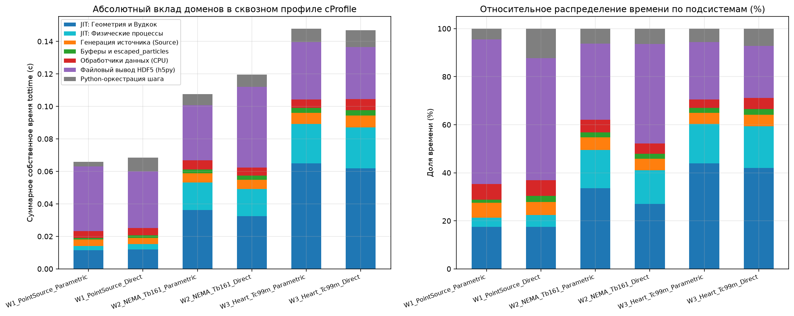
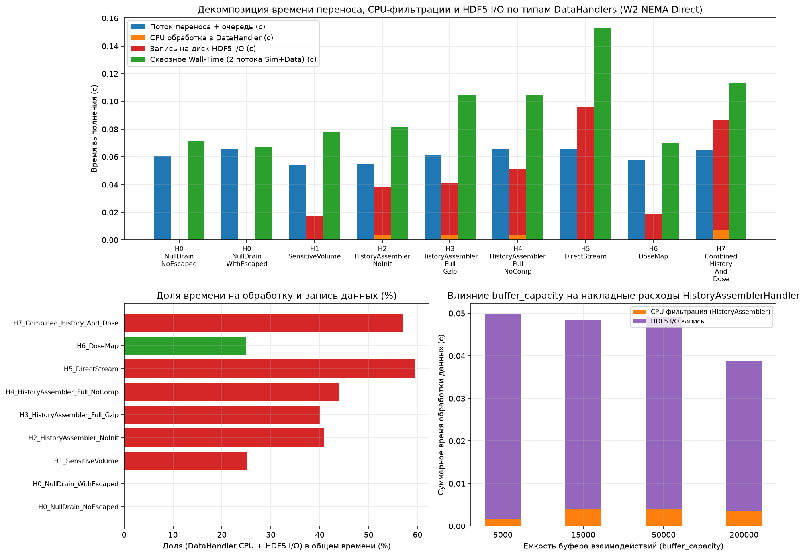
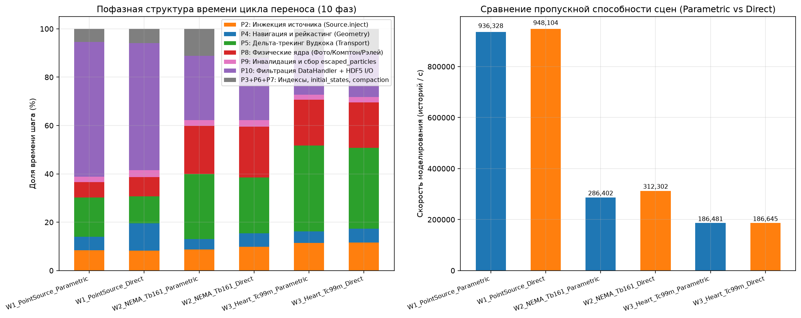
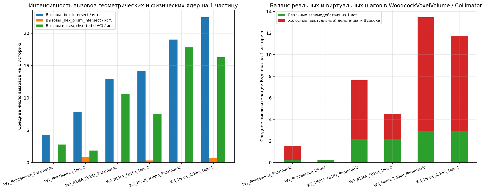
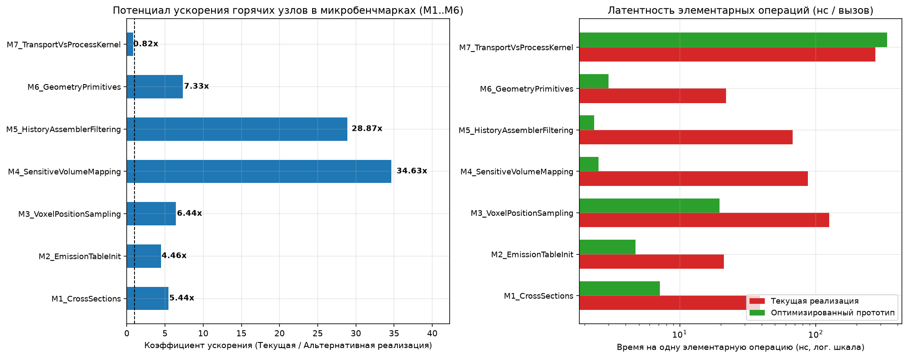
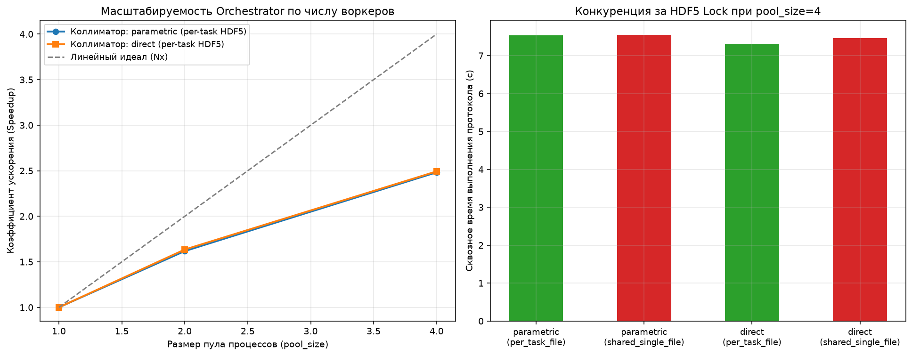
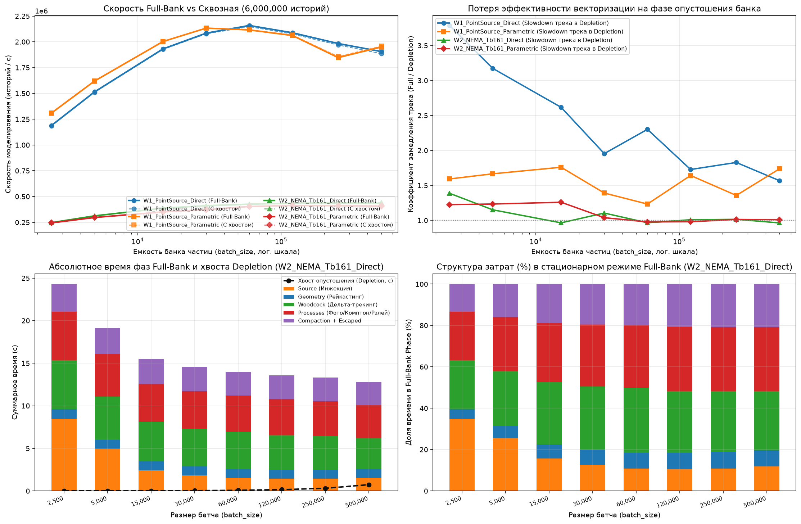

# Комплексный отчет по профилированию и анализу узких мест NMSimToolkit

**Общее время работы профилировочного стенда:** `474.26 с` | **Время холодного прогрева JIT/cfunc:** `7.86 с` | **Режим:** 100% Zero-Overhead для боевого ядра `core/` (Warm Steady-State + диагностика Cold Compile).

## 0. Контроль теплового режима и стабильности частоты CPU (Thermal Guard)

| Контрольная точка этапа | Время CPU-маяка (мс) | Относительная частота CPU (%) | Пауза охлаждения (с) |
| :--- | :---: | :---: | :---: |
| `01_Baseline_After_JIT_Warmup` | 34.62 | **100.0%** | 0.0 |
| `02_Before_cProfile_Suite` | 34.98 | **99.0%** | 4.5 |
| `03_Before_DataHandlers_Suite` | 34.66 | **99.9%** | 1.5 |
| `04_Before_StepProfiler_Suite` | 34.63 | **100.0%** | 1.5 |
| `05_Before_Telemetry_Suite` | 34.73 | **99.7%** | 1.5 |
| `06_Before_MicroBenchmarks` | 34.68 | **99.8%** | 1.5 |
| `07_Before_Orchestrator_Scaling` | 34.02 | **101.8%** | 1.5 |
| `08_Before_BatchSize_Sweep` | 33.86 | **102.3%** | 1.5 |
| `09_After_Full_Pipeline` | 34.90 | **99.2%** | 0.5 |

## 1. Профилирование конвейера CPython (`cProfile` / `pstats`, Warm Steady-State)

### 1.1. Сводная декомпозиция времени по доменам (сквозной однопоточный режим)

| Сцена | Коллиматор | Шагов | Историй | Steady-State (с) | Историй/с | JIT Транспорт (%) | JIT Процессы (%) | Источник (%) | Буферы+Escaped (%) | DataHandler CPU (%) | HDF5 I/O (%) | Дамп `.prof` |
| :--- | :---: | :---: | :---: | :---: | :---: | :---: | :---: | :---: | :---: | :---: | :---: | :--- |
| `W1_PointSource_Parametric` | `parametric` | 7 | 40,000 | 0.066 | **605,974** | 17.5% | 3.8% | 6.2% | 1.3% | 6.5% | 60.2% | `W1_PointSource_Parametric_end_to_end.prof` |
| `W1_PointSource_Direct` | `direct` | 28 | 40,000 | 0.068 | **584,400** | 17.5% | 4.9% | 5.5% | 2.4% | 6.5% | 50.8% | `W1_PointSource_Direct_end_to_end.prof` |
| `W2_NEMA_Tb161_Parametric` | `parametric` | 19 | 25,000 | 0.108 | **232,453** | 33.6% | 15.8% | 5.3% | 2.1% | 5.2% | 31.6% | `W2_NEMA_Tb161_Parametric_end_to_end.prof` |
| `W2_NEMA_Tb161_Direct` | `direct` | 24 | 25,000 | 0.120 | **208,952** | 27.0% | 14.1% | 4.8% | 2.1% | 4.3% | 41.4% | `W2_NEMA_Tb161_Direct_end_to_end.prof` |
| `W3_Heart_Tc99m_Parametric` | `parametric` | 22 | 25,000 | 0.148 | **168,968** | 43.8% | 16.5% | 4.6% | 2.1% | 3.5% | 23.8% | `W3_Heart_Tc99m_Parametric_end_to_end.prof` |
| `W3_Heart_Tc99m_Direct` | `direct` | 34 | 25,000 | 0.147 | **170,027** | 42.0% | 17.3% | 4.9% | 2.3% | 4.6% | 21.7% | `W3_Heart_Tc99m_Direct_end_to_end.prof` |

### 1.2. Штатный двухпоточный режим (`SimulationManager` + `DataManager` в разных потоках)

| Сцена | Коллиматор | Wall-Time (с) | Поток Sim (с) | Поток Data (с) | Ожидание `queue.put` (с) | Ожидание `queue.get` (с) | Активная работа Data (с) | Tail Drain Lag (мс) |
| :--- | :---: | :---: | :---: | :---: | :---: | :---: | :---: | :---: |
| `W1_PointSource_Parametric` | `parametric` | 0.075 | 0.022 | 0.056 | 0.0000 | 0.0220 | 0.034 | 52.99 |
| `W1_PointSource_Direct` | `direct` | 0.079 | 0.030 | 0.071 | 0.0000 | 0.0309 | 0.040 | 48.52 |
| `W2_NEMA_Tb161_Parametric` | `parametric` | 0.122 | 0.069 | 0.113 | 0.0000 | 0.0693 | 0.044 | 52.35 |
| `W2_NEMA_Tb161_Direct` | `direct` | 0.107 | 0.068 | 0.105 | 0.0000 | 0.0659 | 0.039 | 38.41 |
| `W3_Heart_Tc99m_Parametric` | `parametric` | 0.158 | 0.108 | 0.160 | 0.0000 | 0.1152 | 0.044 | 49.11 |
| `W3_Heart_Tc99m_Direct` | `direct` | 0.178 | 0.124 | 0.186 | 0.0000 | 0.1121 | 0.074 | 53.70 |

### 1.3. Топ-12 функций по собственному времени (`tottime`, без JIT-компиляции) — `W2_NEMA_Tb161_Parametric`

| № | Функция | Файл и строка | Вызовы (`ncalls`) | `tottime` (с) | `cumtime` (с) | Доля (%) |
| :---: | :--- | :--- | :---: | :---: | :---: | :---: |
| 1 | `step` | `core/transport/propagator.py:58` | 19 | 0.0361 | 0.0586 | **33.6%** |
| 2 | `make_fid` | `h5py/_hl/files.py:212` | 3 | 0.0186 | 0.0186 | **17.3%** |
| 3 | `apply` | `core/physics/processes.py:69` | 49 | 0.0170 | 0.0207 | **15.8%** |
| 4 | `flush` | `h5py/_hl/files.py:625` | 3 | 0.0051 | 0.0051 | **4.8%** |
| 5 | `generate_position` | `core/source/sources.py:252` | 1 | 0.0034 | 0.0039 | **3.1%** |
| 6 | `write_func` | `core/data/data_handlers.py:216` | 1 | 0.0033 | 0.0048 | **3.1%** |
| 7 | `_flush_dead_particles` | `core/data/data_handlers.py:584` | 1 | 0.0020 | 0.0313 | **1.8%** |
| 8 | `<built-in method numpy._core._multiarray_umath._unique_hash>` | `~:0` | 2 | 0.0013 | 0.0013 | **1.3%** |
| 9 | `make_new_dset` | `h5py/_hl/dataset.py:39` | 27 | 0.0013 | 0.0025 | **1.2%** |
| 10 | `write_func` | `core/data/data_handlers.py:243` | 1 | 0.0012 | 0.0045 | **1.1%** |
| 11 | `_isin` | `numpy/lib/_arraysetops_impl.py:806` | 5 | 0.0012 | 0.0013 | **1.1%** |
| 12 | `<method 'copy' of 'numpy.ndarray' objects>` | `~:0` | 26 | 0.0009 | 0.0009 | **0.9%** |

### 1.3. Топ-12 функций по собственному времени (`tottime`, без JIT-компиляции) — `W2_NEMA_Tb161_Direct`

| № | Функция | Файл и строка | Вызовы (`ncalls`) | `tottime` (с) | `cumtime` (с) | Доля (%) |
| :---: | :--- | :--- | :---: | :---: | :---: | :---: |
| 1 | `make_fid` | `h5py/_hl/files.py:212` | 3 | 0.0352 | 0.0352 | **29.4%** |
| 2 | `step` | `core/transport/propagator.py:58` | 24 | 0.0323 | 0.0554 | **27.0%** |
| 3 | `apply` | `core/physics/processes.py:69` | 51 | 0.0168 | 0.0209 | **14.0%** |
| 4 | `flush` | `h5py/_hl/files.py:625` | 3 | 0.0051 | 0.0051 | **4.3%** |
| 5 | `generate_position` | `core/source/sources.py:252` | 1 | 0.0033 | 0.0038 | **2.7%** |
| 6 | `write_func` | `core/data/data_handlers.py:216` | 1 | 0.0029 | 0.0040 | **2.4%** |
| 7 | `_flush_dead_particles` | `core/data/data_handlers.py:584` | 1 | 0.0016 | 0.0340 | **1.3%** |
| 8 | `<built-in method numpy._core._multiarray_umath._unique_hash>` | `~:0` | 2 | 0.0015 | 0.0015 | **1.2%** |
| 9 | `make_new_dset` | `h5py/_hl/dataset.py:39` | 27 | 0.0013 | 0.0026 | **1.1%** |
| 10 | `<method 'copy' of 'numpy.ndarray' objects>` | `~:0` | 26 | 0.0010 | 0.0010 | **0.9%** |
| 11 | `write_func` | `core/data/data_handlers.py:243` | 1 | 0.0009 | 0.0042 | **0.7%** |
| 12 | `_isin` | `numpy/lib/_arraysetops_impl.py:806` | 5 | 0.0009 | 0.0010 | **0.7%** |

## 2. Сравнительный анализ обработчиков данных (`DataHandlers`) и HDF5 I/O (Warm Steady-State)

| Сцена | Коллиматор | Код обработчика | Транспорт (с) | CPU хэндлера (с) | HDF5 I/O (с) | Доля Data (%) | Оверхед к Baseline (%) | Wall-Time 2 потока (с) | Tail Lag (мс) | Размер HDF5 (МБ) |
| :--- | :---: | :--- | :---: | :---: | :---: | :---: | :---: | :---: | :---: | :---: |
| `W1_PointSource_Parametric` | `parametric` | `H0_NullDrain_NoEscaped` | 0.013 | 0.000 | 0.000 | **0.2%** | +0.0% | 0.029 | 14.71 | 0.00 |
| `W1_PointSource_Parametric` | `parametric` | `H0_NullDrain_WithEscaped` | 0.016 | 0.000 | 0.000 | **0.1%** | +23.3% | 0.019 | 1.68 | 0.00 |
| `W1_PointSource_Parametric` | `parametric` | `H1_SensitiveVolume` | 0.012 | 0.000 | 0.005 | **32.1%** | +23.4% | 0.022 | 10.38 | 0.01 |
| `W1_PointSource_Parametric` | `parametric` | `H2_HistoryAssembler_NoInit` | 0.012 | 0.001 | 0.002 | **23.8%** | +20.7% | 0.016 | 4.10 | 0.01 |
| `W1_PointSource_Parametric` | `parametric` | `H3_HistoryAssembler_Full_Gzip` | 0.014 | 0.001 | 0.003 | **23.7%** | +37.0% | 0.018 | 4.93 | 0.01 |
| `W1_PointSource_Parametric` | `parametric` | `H4_HistoryAssembler_Full_NoComp` | 0.014 | 0.001 | 0.003 | **22.3%** | +38.5% | 0.017 | 3.85 | 0.01 |
| `W1_PointSource_Parametric` | `parametric` | `H5_DirectStream` | 0.013 | 0.000 | 0.036 | **74.1%** | +269.9% | 0.053 | 40.55 | 0.30 |
| `W1_PointSource_Parametric` | `parametric` | `H6_DoseMap` | 0.012 | 0.000 | 0.018 | **61.0%** | +127.1% | 0.025 | 13.35 | 0.40 |
| `W1_PointSource_Parametric` | `parametric` | `H7_Combined_History_And_Dose` | 0.014 | 0.001 | 0.014 | **52.0%** | +128.0% | 0.028 | 14.79 | 0.40 |
| `W1_PointSource_Direct` | `direct` | `H0_NullDrain_NoEscaped` | 0.017 | 0.000 | 0.000 | **0.1%** | +0.0% | 0.021 | 2.92 | 0.00 |
| `W1_PointSource_Direct` | `direct` | `H0_NullDrain_WithEscaped` | 0.021 | 0.000 | 0.000 | **0.1%** | +26.2% | 0.025 | 1.85 | 0.00 |
| `W1_PointSource_Direct` | `direct` | `H1_SensitiveVolume` | 0.017 | 0.000 | 0.003 | **16.2%** | +12.3% | 0.018 | 1.80 | 0.01 |
| `W1_PointSource_Direct` | `direct` | `H2_HistoryAssembler_NoInit` | 0.018 | 0.001 | 0.003 | **19.1%** | +37.5% | 0.020 | 4.17 | 0.01 |
| `W1_PointSource_Direct` | `direct` | `H3_HistoryAssembler_Full_Gzip` | 0.018 | 0.002 | 0.003 | **19.7%** | +35.2% | 0.022 | 4.34 | 0.01 |
| `W1_PointSource_Direct` | `direct` | `H4_HistoryAssembler_Full_NoComp` | 0.017 | 0.002 | 0.003 | **20.9%** | +33.2% | 0.023 | 5.02 | 0.01 |
| `W1_PointSource_Direct` | `direct` | `H5_DirectStream` | 0.017 | 0.000 | 0.041 | **71.7%** | +248.6% | 0.061 | 39.08 | 0.30 |
| `W1_PointSource_Direct` | `direct` | `H6_DoseMap` | 0.023 | 0.000 | 0.020 | **48.9%** | +150.4% | 0.024 | 7.45 | 0.40 |
| `W1_PointSource_Direct` | `direct` | `H7_Combined_History_And_Dose` | 0.018 | 0.002 | 0.009 | **36.6%** | +71.2% | 0.033 | 14.67 | 0.40 |
| `W2_NEMA_Tb161_Parametric` | `parametric` | `H0_NullDrain_NoEscaped` | 0.065 | 0.000 | 0.000 | **0.0%** | +0.0% | 0.076 | 10.30 | 0.00 |
| `W2_NEMA_Tb161_Parametric` | `parametric` | `H0_NullDrain_WithEscaped` | 0.069 | 0.000 | 0.000 | **0.0%** | +5.5% | 0.071 | 1.79 | 0.00 |
| `W2_NEMA_Tb161_Parametric` | `parametric` | `H1_SensitiveVolume` | 0.061 | 0.000 | 0.019 | **24.9%** | +19.7% | 0.089 | 31.58 | 0.03 |
| `W2_NEMA_Tb161_Parametric` | `parametric` | `H2_HistoryAssembler_NoInit` | 0.061 | 0.003 | 0.025 | **31.9%** | +36.2% | 0.086 | 26.89 | 0.03 |
| `W2_NEMA_Tb161_Parametric` | `parametric` | `H3_HistoryAssembler_Full_Gzip` | 0.067 | 0.003 | 0.029 | **32.4%** | +52.7% | 0.119 | 51.56 | 0.04 |
| `W2_NEMA_Tb161_Parametric` | `parametric` | `H4_HistoryAssembler_Full_NoComp` | 0.068 | 0.005 | 0.041 | **40.0%** | +72.9% | 0.104 | 35.70 | 0.04 |
| `W2_NEMA_Tb161_Parametric` | `parametric` | `H5_DirectStream` | 0.069 | 0.000 | 0.086 | **55.6%** | +137.6% | 0.152 | 80.19 | 2.45 |
| `W2_NEMA_Tb161_Parametric` | `parametric` | `H6_DoseMap` | 0.059 | 0.002 | 0.015 | **21.8%** | +15.1% | 0.080 | 19.79 | 1.45 |
| `W2_NEMA_Tb161_Parametric` | `parametric` | `H7_Combined_History_And_Dose` | 0.069 | 0.006 | 0.055 | **46.8%** | +99.6% | 0.114 | 47.07 | 1.48 |
| `W2_NEMA_Tb161_Direct` | `direct` | `H0_NullDrain_NoEscaped` | 0.061 | 0.000 | 0.000 | **0.0%** | +0.0% | 0.071 | 7.84 | 0.00 |
| `W2_NEMA_Tb161_Direct` | `direct` | `H0_NullDrain_WithEscaped` | 0.066 | 0.000 | 0.000 | **0.0%** | +7.9% | 0.067 | 2.14 | 0.00 |
| `W2_NEMA_Tb161_Direct` | `direct` | `H1_SensitiveVolume` | 0.054 | 0.000 | 0.017 | **25.3%** | +11.9% | 0.078 | 23.77 | 0.03 |
| `W2_NEMA_Tb161_Direct` | `direct` | `H2_HistoryAssembler_NoInit` | 0.055 | 0.004 | 0.034 | **40.8%** | +52.9% | 0.081 | 28.75 | 0.03 |
| `W2_NEMA_Tb161_Direct` | `direct` | `H3_HistoryAssembler_Full_Gzip` | 0.062 | 0.004 | 0.038 | **40.1%** | +68.8% | 0.104 | 44.67 | 0.04 |
| `W2_NEMA_Tb161_Direct` | `direct` | `H4_HistoryAssembler_Full_NoComp` | 0.066 | 0.004 | 0.047 | **43.8%** | +92.2% | 0.105 | 40.14 | 0.04 |
| `W2_NEMA_Tb161_Direct` | `direct` | `H5_DirectStream` | 0.066 | 0.000 | 0.096 | **59.4%** | +166.0% | 0.153 | 88.33 | 2.46 |
| `W2_NEMA_Tb161_Direct` | `direct` | `H6_DoseMap` | 0.057 | 0.000 | 0.019 | **24.9%** | +25.1% | 0.070 | 16.69 | 1.45 |
| `W2_NEMA_Tb161_Direct` | `direct` | `H7_Combined_History_And_Dose` | 0.065 | 0.007 | 0.079 | **57.1%** | +149.5% | 0.113 | 52.77 | 1.48 |

### 2.1. Зависимость времени обработки от емкости буфера (`buffer_capacity`)

| Сцена | Коллиматор | `buffer_capacity` | Чанков | Транзакций HDF5 | Транспорт (с) | CPU фильтрация (с) | HDF5 I/O (с) | Суммарно (с) |
| :--- | :---: | :---: | :---: | :---: | :---: | :---: | :---: | :---: |
| `W2_NEMA_Tb161_Parametric` | `parametric` | `5,000` | 6 | 4 | 0.073 | 0.004 | 0.050 | 0.127 |
| `W2_NEMA_Tb161_Parametric` | `parametric` | `15,000` | 6 | 4 | 0.067 | 0.003 | 0.039 | 0.109 |
| `W2_NEMA_Tb161_Parametric` | `parametric` | `50,000` | 4 | 4 | 0.070 | 0.004 | 0.031 | 0.105 |
| `W2_NEMA_Tb161_Parametric` | `parametric` | `200,000` | 3 | 4 | 0.070 | 0.004 | 0.035 | 0.108 |
| `W2_NEMA_Tb161_Direct` | `direct` | `5,000` | 6 | 4 | 0.077 | 0.002 | 0.048 | 0.127 |
| `W2_NEMA_Tb161_Direct` | `direct` | `15,000` | 6 | 4 | 0.065 | 0.004 | 0.044 | 0.114 |
| `W2_NEMA_Tb161_Direct` | `direct` | `50,000` | 4 | 4 | 0.061 | 0.004 | 0.045 | 0.110 |
| `W2_NEMA_Tb161_Direct` | `direct` | `200,000` | 3 | 4 | 0.063 | 0.004 | 0.035 | 0.101 |

## 3. Детальная 10-фазная декомпозиция пошагового цикла симуляции (Warm Steady-State)

| Сцена | Коллиматор | Шагов | Историй | Steady-State (с) | Историй/с | P2: Source (%) | P4: Geometry (%) | P5: Woodcock (%) | P8: Processes (%) | P9: Invalid+Esc (%) | P10: Data+HDF5 (%) |
| :--- | :---: | :---: | :---: | :---: | :---: | :---: | :---: | :---: | :---: | :---: | :---: |
| `W1_PointSource_Parametric` | `parametric` | 29 | 300,000 | 0.320 | **936,328** | 8.5% | 5.5% | 16.4% | 6.3% | 2.2% | 55.8% |
| `W1_PointSource_Direct` | `direct` | 58 | 300,000 | 0.316 | **948,104** | 8.2% | 11.3% | 11.3% | 8.0% | 2.8% | 52.6% |
| `W2_NEMA_Tb161_Parametric` | `parametric` | 34 | 150,000 | 0.524 | **286,402** | 8.7% | 4.3% | 26.9% | 19.9% | 2.4% | 26.6% |
| `W2_NEMA_Tb161_Direct` | `direct` | 37 | 150,000 | 0.480 | **312,302** | 9.9% | 5.5% | 23.2% | 21.0% | 2.8% | 25.7% |
| `W3_Heart_Tc99m_Parametric` | `parametric` | 48 | 150,000 | 0.804 | **186,481** | 11.4% | 4.9% | 35.4% | 19.0% | 2.0% | 17.9% |
| `W3_Heart_Tc99m_Direct` | `direct` | 63 | 150,000 | 0.804 | **186,645** | 11.6% | 5.8% | 33.4% | 18.7% | 2.3% | 18.4% |

### 3.1. Внутренняя декомпозиция `Source.inject` и физических процессов (Warm Steady-State)

| Сцена | Коллиматор | `position` (мс) | `direction` (мс) | `energy+time` (мс) | `bank.inject` (мс) | `_collect_escaped` (мс) | Фотоэффект (мс) | Комптон (мс) | Рэлей (мс) |
| :--- | :---: | :---: | :---: | :---: | :---: | :---: | :---: | :---: | :---: |
| `W1_PointSource_Parametric` | `parametric` | 6.80 | 8.14 | 3.75 | 7.48 | 0.03 | 13.25 | 4.07 | 3.07 |
| `W1_PointSource_Direct` | `direct` | 5.32 | 7.82 | 4.19 | 7.79 | 0.05 | 15.46 | 5.56 | 4.28 |
| `W2_NEMA_Tb161_Parametric` | `parametric` | 31.18 | 4.24 | 4.01 | 5.23 | 0.03 | 19.16 | 69.47 | 15.62 |
| `W2_NEMA_Tb161_Direct` | `direct` | 32.59 | 4.64 | 4.06 | 5.15 | 0.04 | 18.34 | 66.77 | 16.25 |
| `W3_Heart_Tc99m_Parametric` | `parametric` | 74.85 | 4.75 | 3.63 | 7.48 | 0.05 | 14.19 | 127.57 | 11.23 |
| `W3_Heart_Tc99m_Direct` | `direct` | 76.75 | 4.63 | 3.92 | 6.96 | 0.06 | 14.83 | 125.11 | 11.10 |

### 3.2. Сравнение `Cold Propagator Overhead` vs `Warm Steady-State`

| Сцена | Коллиматор | Историй | Cold JIT пропагатора (с) | Полное время Cold (с) | Чистое время Warm (с) | Speedup (Warm/Cold) | Скорость Cold (ист./с) | Скорость Warm (ист./с) |
| :--- | :---: | :---: | :---: | :---: | :---: | :---: | :---: | :---: |
| `W1_PointSource_Parametric` | `parametric` | 300,000 | 3.567 | 3.887 | **0.320** | **12.1x** | 77,171 | **936,328** |
| `W1_PointSource_Direct` | `direct` | 300,000 | 3.567 | 3.883 | **0.316** | **12.3x** | 77,250 | **948,104** |
| `W2_NEMA_Tb161_Parametric` | `parametric` | 150,000 | 3.567 | 4.091 | **0.524** | **7.8x** | 36,668 | **286,402** |
| `W2_NEMA_Tb161_Direct` | `direct` | 150,000 | 3.567 | 4.047 | **0.480** | **8.4x** | 37,061 | **312,302** |
| `W3_Heart_Tc99m_Parametric` | `parametric` | 150,000 | 3.567 | 4.371 | **0.804** | **5.4x** | 34,314 | **186,481** |
| `W3_Heart_Tc99m_Direct` | `direct` | 150,000 | 3.567 | 4.371 | **0.804** | **5.4x** | 34,319 | **186,645** |

### 3.3. Разделение стационарной фазы полного банка (`Full-Bank Phase`) и фазы опустошения (`Tail Depletion Phase`)

| Сцена | Коллиматор | Емкость банка | Историй | Шагов `Full-Bank` | Шагов `Depletion` | Транспорт `Full-Bank` (мс) | Транспорт `Depletion` (мс) | Треков/с `Full-Bank` | Треков/с `Depletion` | Замедление на хвосте (`x`) |
| :--- | :---: | :---: | :---: | :---: | :---: | :---: | :---: | :---: | :---: | :---: |
| `W1_PointSource_Parametric` | `parametric` | `25,000` | 300,000 | 24 | 5 | 137.87 | 4.24 | **5,405,352** | 2,389,491 | **2.26x** |
| `W1_PointSource_Direct` | `direct` | `25,000` | 300,000 | 29 | 29 | 131.04 | 19.74 | **6,865,725** | 2,921,113 | **2.35x** |
| `W2_NEMA_Tb161_Parametric` | `parametric` | `25,000` | 150,000 | 17 | 17 | 330.19 | 53.11 | **1,480,845** | 1,331,703 | **1.11x** |
| `W2_NEMA_Tb161_Direct` | `direct` | `25,000` | 150,000 | 18 | 19 | 314.32 | 43.26 | **1,673,573** | 1,654,699 | **1.01x** |
| `W3_Heart_Tc99m_Parametric` | `parametric` | `25,000` | 150,000 | 27 | 21 | 591.25 | 68.56 | **1,345,408** | 1,105,098 | **1.22x** |
| `W3_Heart_Tc99m_Direct` | `direct` | `25,000` | 150,000 | 29 | 34 | 586.69 | 70.38 | **1,462,633** | 1,280,133 | **1.14x** |

## 4. Алгоритмическая телеметрия ядер переноса (Geometry & Woodcock)

| Сцена | Коллиматор | Историй | Лучей/ист. | Примитивов/луч | `_box_intersect` | `_hex_prism_intersect` | Шагов Вудкока/ист. | Холостых Вудкока (%) | `searchsorted`/ист. | `@cfunc`/ист. |
| :--- | :---: | :---: | :---: | :---: | :---: | :---: | :---: | :---: | :---: | :---: |
| `W1_PointSource_Parametric` | `parametric` | 12,000 | 2.03 | 2.09 | 51,054 | 0 | 1.53 | **83.1%** | 2.77 | 1.51 |
| `W1_PointSource_Direct` | `direct` | 12,000 | 2.63 | 3.30 | 94,110 | 9,996 | 0.26 | **0.0%** | 1.86 | 0.00 |
| `W2_NEMA_Tb161_Parametric` | `parametric` | 12,000 | 3.31 | 3.89 | 154,716 | 0 | 7.63 | **71.4%** | 10.60 | 7.61 |
| `W2_NEMA_Tb161_Direct` | `direct` | 12,000 | 3.47 | 4.17 | 170,043 | 3,686 | 4.50 | **51.4%** | 7.49 | 4.34 |
| `W3_Heart_Tc99m_Parametric` | `parametric` | 12,000 | 5.00 | 3.81 | 228,464 | 0 | 13.46 | **78.5%** | 17.82 | 13.44 |
| `W3_Heart_Tc99m_Direct` | `direct` | 12,000 | 5.41 | 4.27 | 269,580 | 7,914 | 11.74 | **75.3%** | 16.28 | 11.49 |

## 5. Изолированные микробенчмарки горячих узлов (`M1..M7`)

| ID | Узел конвейера | Текущая реализация / База | Альтернатива / Сравнение | Текущее (нс/оп) | Альтернатива (нс/оп) | Отношение (`Speedup / Ratio`) |
| :--- | :--- | :--- | :--- | :---: | :---: | :---: |
| `M1_CrossSections` | Интерполяция макроскопических сечений LAC (5 млн запросов) | `np.searchsorted O(log K)` | `Равномерная лог-сетка O(1)` | 39.0 | 7.2 | **5.44x** |
| `M2_EmissionTableInit` | Инициализация таблицы эмиссии 3D-фантома 128x128x92 | `3D np.meshgrid + stack` | `Разреженный flatnonzero + unravel` | 21.1 | 4.7 | **4.46x** |
| `M3_VoxelPositionSampling` | Генерация 500 тыс. позиций частиц в воксельном фантоме | `rng.choice(origins, p=prob)` | `Vose's Alias O(1) + Direct SoA` | 125.8 | 19.5 | **6.44x** |
| `M4_SensitiveVolumeMapping` | Маппинг идентификаторов объемов в SensitiveVolumeHandler (200 тыс. событий) | `Python for-loop + dtype=object` | `Векторизованный целочисленный LUT` | 87.2 | 2.5 | **34.63x** |
| `M5_HistoryAssemblerFiltering` | Фильтрация историй по particle_ID в HistoryAssemblerHandler (450 тыс. взаимод.) | `intersect1d + 4x np.isin` | `Прямая булева индексация O(1)` | 67.5 | 2.3 | **28.87x** |
| `M6_GeometryPrimitives` | Аналитическое пересечение примитивов (5 млн лучей) | `_hex_prism_intersect (Voronoi 6-slab)` | `_box_intersect (AABB 3-slab)` | 22.0 | 3.0 | **7.33x** |
| `M7_TransportVsProcessKernel` | 1 шаг Raycast+Woodcock против 1 шага ComptonScattering (100 тыс. частиц) | `cast_path + _transport_kernel` | `_compton_kernel + rotate` | 275.0 | 335.4 | **0.82x** |

## 6. Масштабируемость параллельного `Orchestrator` и конкуренция за HDF5

| Коллиматор | `pool_size` | Задач | Режим файлов HDF5 | Время `Wall-Time` (с) | Задач/с | Ускорение (`Speedup`) | Параллельная эффективность (%) |
| :---: | :---: | :---: | :---: | :---: | :---: | :---: | :---: |
| `parametric` | 1 | 4 | `per_task_file` | 18.706 | 0.21 | **1.00x** | 100.0% |
| `parametric` | 2 | 4 | `per_task_file` | 11.562 | 0.35 | **1.62x** | 80.9% |
| `parametric` | 4 | 4 | `per_task_file` | 7.535 | 0.53 | **2.48x** | 62.1% |
| `parametric` | 4 | 4 | `shared_single_file` | 7.550 | 0.53 | **2.48x** | 61.9% |
| `direct` | 1 | 4 | `per_task_file` | 18.210 | 0.22 | **1.00x** | 100.0% |
| `direct` | 2 | 4 | `per_task_file` | 11.138 | 0.36 | **1.63x** | 81.7% |
| `direct` | 4 | 4 | `per_task_file` | 7.305 | 0.55 | **2.49x** | 62.3% |
| `direct` | 4 | 4 | `shared_single_file` | 7.465 | 0.54 | **2.44x** | 61.0% |

## 7. Исследование размера батча частиц (`ParticleBank` capacity / Batch Size Sweep, 6,000,000 историй)

### 7.1. Сравнение стационарной фазы полного банка (`Full-Bank Sustained Phase`) и фазы опустошения (`Tail Depletion Phase`)

| Сцена | Коллиматор | `batch_size` | Историй | Шагов (`Full / Depl`) | Время `Full-Bank` (с) | Время `Depletion` (с) | Доля хвоста (%) | Скорость `Full-Bank` (ист./с) | Скорость сквозная (ист./с) | Треков/с (`Full / Depl`) | Замедление на хвосте (`x`) |
| :--- | :---: | :---: | :---: | :---: | :---: | :---: | :---: | :---: | :---: | :---: | :---: |
| `W1_PointSource_Parametric` | `parametric` | `2,500` | 6,000,000 | 4882 / 5 | 4.579 | 0.002 | 0.0% | **1,309,805** | 1,305,446 | 3,392,771 / 2,130,354 | **1.59x** |
| `W1_PointSource_Parametric` | `parametric` | `5,000` | 6,000,000 | 2440 / 5 | 3.700 | 0.003 | 0.1% | **1,620,357** | 1,616,785 | 4,056,476 / 2,434,468 | **1.67x** |
| `W1_PointSource_Parametric` | `parametric` | `15,000` | 6,000,000 | 813 / 8 | 2.990 | 0.005 | 0.2% | **2,003,169** | 2,000,946 | 4,886,352 / 2,776,537 | **1.76x** |
| `W1_PointSource_Parametric` | `parametric` | `30,000` | 6,000,000 | 406 / 5 | 2.803 | 0.008 | 0.3% | **2,132,885** | 2,132,664 | 5,200,377 / 3,737,665 | **1.39x** |
| `W1_PointSource_Parametric` | `parametric` | `60,000` | 6,000,000 | 202 / 6 | 2.809 | 0.023 | 0.8% | **2,115,568** | 2,117,744 | 5,258,350 / 4,261,487 | **1.23x** |
| `W1_PointSource_Parametric` | `parametric` | `120,000` | 6,000,000 | 101 / 7 | 2.875 | 0.028 | 1.0% | **2,061,218** | 2,066,062 | 5,330,961 / 3,245,939 | **1.64x** |
| `W1_PointSource_Parametric` | `parametric` | `250,000` | 6,000,000 | 48 / 10 | 3.168 | 0.062 | 1.9% | **1,847,163** | 1,857,336 | 4,934,770 / 3,635,664 | **1.36x** |
| `W1_PointSource_Parametric` | `parametric` | `500,000` | 6,000,000 | 24 / 14 | 2.992 | 0.072 | 2.3% | **1,950,056** | 1,958,411 | 5,336,743 / 3,071,946 | **1.74x** |
| `W1_PointSource_Direct` | `direct` | `2,500` | 6,000,000 | 6249 / 18 | 5.046 | 0.004 | 0.1% | **1,188,688** | 1,183,721 | 3,994,127 / 1,054,983 | **3.79x** |
| `W1_PointSource_Direct` | `direct` | `5,000` | 6,000,000 | 3125 / 29 | 3.957 | 0.008 | 0.2% | **1,515,166** | 1,509,848 | 4,949,350 / 1,559,615 | **3.17x** |
| `W1_PointSource_Direct` | `direct` | `15,000` | 6,000,000 | 1041 / 29 | 3.100 | 0.011 | 0.4% | **1,931,653** | 1,925,837 | 6,162,638 / 2,355,425 | **2.62x** |
| `W1_PointSource_Direct` | `direct` | `30,000` | 6,000,000 | 519 / 31 | 2.865 | 0.020 | 0.7% | **2,084,210** | 2,077,206 | 6,572,802 / 3,362,510 | **1.95x** |
| `W1_PointSource_Direct` | `direct` | `60,000` | 6,000,000 | 259 / 59 | 2.761 | 0.031 | 1.1% | **2,158,467** | 2,147,303 | 6,854,468 / 2,978,112 | **2.30x** |
| `W1_PointSource_Direct` | `direct` | `120,000` | 6,000,000 | 128 / 36 | 2.821 | 0.068 | 2.4% | **2,087,967** | 2,075,896 | 7,020,331 / 4,063,298 | **1.73x** |
| `W1_PointSource_Direct` | `direct` | `250,000` | 6,000,000 | 61 / 43 | 2.941 | 0.105 | 3.4% | **1,983,609** | 1,969,404 | 6,676,068 / 3,651,692 | **1.83x** |
| `W1_PointSource_Direct` | `direct` | `500,000` | 6,000,000 | 29 / 43 | 2.897 | 0.284 | 8.9% | **1,905,748** | 1,885,341 | 6,801,876 / 4,336,763 | **1.57x** |
| `W2_NEMA_Tb161_Parametric` | `parametric` | `2,500` | 6,000,000 | 7916 / 13 | 24.516 | 0.008 | 0.0% | **244,633** | 244,348 | 1,196,032 / 975,964 | **1.23x** |
| `W2_NEMA_Tb161_Parametric` | `parametric` | `5,000` | 6,000,000 | 3959 / 15 | 20.191 | 0.010 | 0.0% | **296,986** | 296,741 | 1,284,596 / 1,040,719 | **1.23x** |
| `W2_NEMA_Tb161_Parametric` | `parametric` | `15,000` | 6,000,000 | 1317 / 17 | 17.058 | 0.039 | 0.2% | **350,915** | 350,742 | 1,353,273 / 1,074,297 | **1.26x** |
| `W2_NEMA_Tb161_Parametric` | `parametric` | `30,000` | 6,000,000 | 658 / 15 | 16.028 | 0.042 | 0.3% | **373,033** | 373,223 | 1,387,952 / 1,335,748 | **1.04x** |
| `W2_NEMA_Tb161_Parametric` | `parametric` | `60,000` | 6,000,000 | 328 / 20 | 14.758 | 0.082 | 0.6% | **403,477** | 404,202 | 1,479,216 / 1,511,367 | **0.98x** |
| `W2_NEMA_Tb161_Parametric` | `parametric` | `120,000` | 6,000,000 | 163 / 18 | 14.307 | 0.157 | 1.1% | **413,105** | 414,727 | 1,513,391 / 1,542,193 | **0.98x** |
| `W2_NEMA_Tb161_Parametric` | `parametric` | `250,000` | 6,000,000 | 77 / 20 | 14.105 | 0.372 | 2.6% | **411,081** | 414,404 | 1,512,671 / 1,491,341 | **1.01x** |
| `W2_NEMA_Tb161_Parametric` | `parametric` | `500,000` | 6,000,000 | 37 / 21 | 13.651 | 0.879 | 6.0% | **405,676** | 412,925 | 1,521,429 / 1,506,365 | **1.01x** |
| `W2_NEMA_Tb161_Direct` | `direct` | `2,500` | 6,000,000 | 8310 / 19 | 24.289 | 0.008 | 0.0% | **246,933** | 246,609 | 1,312,257 / 945,564 | **1.39x** |
| `W2_NEMA_Tb161_Direct` | `direct` | `5,000` | 6,000,000 | 4152 / 14 | 19.166 | 0.009 | 0.0% | **312,866** | 312,598 | 1,454,388 / 1,262,750 | **1.15x** |
| `W2_NEMA_Tb161_Direct` | `direct` | `15,000` | 6,000,000 | 1383 / 16 | 15.457 | 0.019 | 0.1% | **387,491** | 387,493 | 1,591,269 / 1,648,151 | **0.97x** |
| `W2_NEMA_Tb161_Direct` | `direct` | `30,000` | 6,000,000 | 690 / 25 | 14.536 | 0.049 | 0.3% | **411,064** | 411,216 | 1,627,590 / 1,472,553 | **1.11x** |
| `W2_NEMA_Tb161_Direct` | `direct` | `60,000` | 6,000,000 | 344 / 24 | 13.970 | 0.078 | 0.6% | **426,154** | 426,997 | 1,656,188 / 1,713,975 | **0.97x** |
| `W2_NEMA_Tb161_Direct` | `direct` | `120,000` | 6,000,000 | 171 / 28 | 13.569 | 0.157 | 1.1% | **435,307** | 437,015 | 1,693,565 / 1,677,325 | **1.01x** |
| `W2_NEMA_Tb161_Direct` | `direct` | `250,000` | 6,000,000 | 81 / 76 | 13.310 | 0.311 | 2.3% | **436,679** | 440,461 | 1,705,734 / 1,679,225 | **1.02x** |
| `W2_NEMA_Tb161_Direct` | `direct` | `500,000` | 6,000,000 | 39 / 39 | 12.782 | 0.737 | 5.4% | **434,327** | 443,789 | 1,730,607 / 1,794,730 | **0.96x** |

### 7.2. Пофазная структура времени в стационарном режиме полного банка (`Full-Bank Sustained Phase`)

| Сцена | Коллиматор | `batch_size` | Скорость `Full-Bank` (ист./с) | `Full` Source (%) | `Full` Geometry (%) | `Full` Woodcock (%) | `Full` Processes (%) | `Full` Compaction+Esc (%) | Заполнение банка общ. / в `Depletion` (%) |
| :--- | :---: | :---: | :---: | :---: | :---: | :---: | :---: | :---: | :---: |
| `W1_PointSource_Parametric` | `parametric` | `2,500` | **1,309,805** | 21.4% | 9.7% | 29.2% | 24.3% | 15.4% | 99.9% / 25.7% |
| `W1_PointSource_Parametric` | `parametric` | `5,000` | **1,620,357** | 18.7% | 11.7% | 32.4% | 21.1% | 16.0% | 99.9% / 30.1% |
| `W1_PointSource_Parametric` | `parametric` | `15,000` | **2,003,169** | 16.5% | 14.0% | 35.6% | 16.9% | 16.9% | 99.1% / 10.6% |
| `W1_PointSource_Parametric` | `parametric` | `30,000` | **2,132,885** | 16.4% | 14.8% | 36.5% | 14.9% | 17.4% | 99.0% / 18.8% |
| `W1_PointSource_Parametric` | `parametric` | `60,000` | **2,115,568** | 17.9% | 14.7% | 36.6% | 13.9% | 16.8% | 97.8% / 24.1% |
| `W1_PointSource_Parametric` | `parametric` | `120,000` | **2,061,218** | 20.9% | 14.2% | 35.4% | 13.1% | 16.5% | 94.2% / 10.5% |
| `W1_PointSource_Parametric` | `parametric` | `250,000` | **1,847,163** | 23.2% | 12.3% | 35.4% | 11.4% | 17.7% | 84.2% / 8.3% |
| `W1_PointSource_Parametric` | `parametric` | `500,000` | **1,950,056** | 24.8% | 12.0% | 33.4% | 12.0% | 17.8% | 64.3% / 3.0% |
| `W1_PointSource_Direct` | `direct` | `2,500` | **1,188,688** | 22.5% | 15.5% | 20.4% | 25.7% | 15.9% | 99.7% / 9.7% |
| `W1_PointSource_Direct` | `direct` | `5,000` | **1,515,166** | 20.2% | 19.3% | 22.2% | 21.0% | 17.3% | 99.2% / 8.1% |
| `W1_PointSource_Direct` | `direct` | `15,000` | **1,931,653** | 18.3% | 23.9% | 22.2% | 17.6% | 18.0% | 97.4% / 5.9% |
| `W1_PointSource_Direct` | `direct` | `30,000` | **2,084,210** | 17.3% | 25.6% | 22.5% | 15.7% | 18.8% | 94.8% / 7.0% |
| `W1_PointSource_Direct` | `direct` | `60,000` | **2,158,467** | 17.9% | 26.4% | 22.8% | 14.1% | 18.8% | 81.9% / 2.6% |
| `W1_PointSource_Direct` | `direct` | `120,000` | **2,087,967** | 22.4% | 25.5% | 21.3% | 12.8% | 17.9% | 79.4% / 6.1% |
| `W1_PointSource_Direct` | `direct` | `250,000` | **1,983,609** | 22.3% | 23.9% | 21.2% | 11.9% | 20.7% | 60.1% / 3.5% |
| `W1_PointSource_Direct` | `direct` | `500,000` | **1,905,748** | 26.4% | 22.8% | 20.1% | 11.0% | 19.7% | 43.4% / 5.3% |
| `W2_NEMA_Tb161_Parametric` | `parametric` | `2,500` | **244,633** | 32.5% | 3.9% | 27.9% | 22.8% | 12.8% | 99.9% / 21.3% |
| `W2_NEMA_Tb161_Parametric` | `parametric` | `5,000` | **296,986** | 23.7% | 4.7% | 31.7% | 24.7% | 15.2% | 99.7% / 12.5% |
| `W2_NEMA_Tb161_Parametric` | `parametric` | `15,000` | **350,915** | 14.4% | 5.5% | 36.0% | 26.7% | 17.4% | 98.9% / 15.6% |
| `W2_NEMA_Tb161_Parametric` | `parametric` | `30,000` | **373,033** | 11.3% | 5.6% | 38.3% | 27.1% | 17.7% | 98.0% / 12.1% |
| `W2_NEMA_Tb161_Parametric` | `parametric` | `60,000` | **403,477** | 9.9% | 6.1% | 37.3% | 28.4% | 18.4% | 94.8% / 10.1% |
| `W2_NEMA_Tb161_Parametric` | `parametric` | `120,000` | **413,105** | 9.7% | 6.2% | 36.5% | 28.7% | 18.9% | 91.1% / 11.0% |
| `W2_NEMA_Tb161_Parametric` | `parametric` | `250,000` | **411,081** | 9.8% | 6.1% | 36.4% | 28.7% | 19.1% | 81.6% / 10.9% |
| `W2_NEMA_Tb161_Parametric` | `parametric` | `500,000` | **405,676** | 10.9% | 6.3% | 35.6% | 28.2% | 19.0% | 68.2% / 12.2% |
| `W2_NEMA_Tb161_Direct` | `direct` | `2,500` | **246,933** | 34.8% | 4.7% | 23.6% | 23.6% | 13.3% | 99.8% / 13.3% |
| `W2_NEMA_Tb161_Direct` | `direct` | `5,000` | **312,866** | 25.5% | 5.8% | 26.6% | 26.1% | 16.0% | 99.7% / 14.6% |
| `W2_NEMA_Tb161_Direct` | `direct` | `15,000` | **387,491** | 15.7% | 6.8% | 30.1% | 28.8% | 18.6% | 99.0% / 12.2% |
| `W2_NEMA_Tb161_Direct` | `direct` | `30,000` | **411,064** | 12.5% | 7.3% | 30.6% | 30.0% | 19.5% | 96.8% / 9.3% |
| `W2_NEMA_Tb161_Direct` | `direct` | `60,000` | **426,154** | 10.8% | 7.6% | 31.4% | 30.5% | 19.7% | 94.1% / 9.0% |
| `W2_NEMA_Tb161_Direct` | `direct` | `120,000` | **435,307** | 10.7% | 7.7% | 29.8% | 31.2% | 20.6% | 87.0% / 7.7% |
| `W2_NEMA_Tb161_Direct` | `direct` | `250,000` | **436,679** | 10.8% | 7.9% | 29.6% | 30.9% | 20.8% | 52.9% / 2.7% |
| `W2_NEMA_Tb161_Direct` | `direct` | `500,000` | **434,327** | 11.8% | 7.9% | 28.6% | 30.9% | 20.8% | 53.3% / 6.6% |

---

## 8. Главные аналитические выводы и приоритизированная матрица оптимизаций

### 8.1. Методологическое очищение профиля: `Cold Propagator Overhead` vs `Warm Steady-State`

* **Суть исправленного искажения:** в `ParticlePropagator.__init__` при каждом создании экземпляра заново вызываются фабрики замыканий `make_transport_kernel` (фаза `P5`) и `make_photoelectric_kernel`, `make_compton_kernel`, `make_coherent_kernel` (фаза `P8`), тогда как функция трассировки лучей `cast_path_kernel` (`P4`) объявлена на уровне модуля и компилируется один раз. При замере без предварительного прогрева инстанса `ParticlePropagator` (`warmup_propagator_instance`) на Шаге №1 происходила `~3.22–3.57 с` компиляция LLVM, из-за чего в старом отчете фаза `P8_Physics_Processes` искусственно занимала `~75.5%` времени (`2,570 мс`), `P5_Woodcock_Transport` — `~22.4%` (`780 мс`), а `P4_Geometry_Raycast` — `0.1%`.
* **Истинная картина в установившемся режиме (`Warm Steady-State`, Раздел 3):** после выноса компиляции замыканий `ParticlePropagator` в предстартовый прогрев и внедрения типизированной маршрутизации `ChunkType` + JIT-буферизации телеметрии выяснилось, что:
  1. В 10-фазном профилировщике (`step_profiler.py`, емкость банка `25,000`, общее число историй `150,000–300,000`) в установившемся режиме симуляция с полной записью HDF5 проходит за `0.32–0.80 с` вместо `3.88–4.37 с` Cold-старта (**ускорение `5.4x – 12.3x`**), а в чистом транспорте без HDF5 достигает **свыше `2.15 млн историй/с` в `W1` и до `437 тыс. историй/с` в `W2_NEMA_Tb161`**.
  2. Доля физических процессов `P8_Physics_Processes` (Фотоэффект + Комптон + Рэлей) составляет всего **`6.3% – 21.0%`** от общего времени с HDF5. Микробенчмарк `M7_TransportVsProcessKernel` объясняет соотношение внутри чистого транспорта: 1 шаг `cast_path + _transport_kernel` стоит `~275.0 нс/частицу`, а 1 вызов `ComptonScattering.apply` (включающий сэмплирование Клейна–Нишины, запись в `InteractionBuffer` и пересчет локальных нормалей в `update_navigation_state_rotate_kernel`) стоит `~335.4 нс` на рассеявшуюся частицу.
  3. Внедрение декларативной подписки `consumed_chunk_types` (`ChunkType`) и кольцевой JIT-буферизации (`_push_first_interacting_to_initial_state_kernel`, `_push_to_dead_particles_kernel`) сократило долю буферного управления в `cProfile` до **`1.3% – 2.4%`**, долю фазы `P9_Invalidation_Escaped` — до **`2.0% – 2.8%`**, а суммарное время `_collect_escaped_particles` — до **`0.03 – 0.06 мс`** (включение `ESCAPED_PARTICLES` в `H0_NullDrain_WithEscaped` добавляет `+23.3%..+26.2%` оверхеда в `W1` и `+5.5%..+7.9%` в `W2`, который полностью исключен в боевых обработчиках `H1..H7`).
  4. Доля геометрического рейкастинга `P4_Geometry_Raycast` закономерно отражает сложность сцены: для `DirectParallelCollimator` доля `P4` выше, чем для `ParametricParallelCollimator`, тогда как `ParametricParallelCollimator` тратит больше времени в `P5_Woodcock_Transport` из-за дельта-шагов сквозь свинец.

### 8.2. Двухфазная динамика банка частиц (`Full-Bank Sustained Phase` vs `Tail Depletion Phase`) на выборке 6,000,000 историй

* **Зачем необходимо разделение `Full-Bank Phase` и `Tail Depletion Phase` (Разделы 3.3 и 7):** в полномасштабной симуляции (`6,000,000` историй) жизненный цикл банка `ParticleBank` делится на два качественно различных режима:
  1. **Фаза A (`Full-Bank Sustained Phase` — стационарный режим полного банка):** пока квота источника не исчерпана, после каждого шага освободившиеся слоты `dead_indices` немедленно докачиваются из источника до 100% емкости банка (`active_indices.size == batch_size`). Все JIT-ядра (`cast_path_kernel`, `_transport_kernel`, процессы) работают на плотно заполненных массивах размера `batch_size`.
  2. **Фаза B (`Tail Depletion Phase` — хвостовая фаза опустошения банка):** когда квота источника исчерпана, генерация новых частиц прекращается (`Source.inject = 0%`), и оставшиеся в банке частицы долетывают за 5–76 шагов до полного поглощения или вылета (`active_indices.size` монотонно падает от `batch_size` до `1`, среднее заполнение банка падает до **`2.6%–30.1%`**). Для точечного источника в воздухе (`W1_PointSource`) удельная чистая скорость трекинга (`Треков/с` без `Source.inject`) на хвосте замедляется в **`1.23x – 3.79x` раз** (`depletion_track_slowdown_factor`), так как в банке остаются только многократно рассеивающиеся в септах и кристалле фотоны при разреженном массиве `active_indices`. В объемном воксельном фантоме (`W2_NEMA_Tb161`) при малых батчах (`2,500–5,000`) чистый трекинг на хвосте также замедляется в **`1.15x – 1.39x` раз**, а при больших батчах (`30,000–500,000`) отношение составляет `0.96x–1.11x`, поскольку на хвосте долетывают периферийные фотоны, покинувшие плотное водное ядро фантома.
* **Выводы по выбору оптимального `batch_size` на дистанции 6,000,000 историй:**
  1. **Малые батчи (`2,500 – 5,000`):** требуют от `2,440` до `8,310` вызовов `Source.inject`. В воксельном фантоме `W2_NEMA_Tb161` при `batch_size = 2,500` генерация источника `Source.inject` съедает **`32.5% – 34.8%` времени стационарной фазы**, так как `rng.choice(origins, size=num_to_inject, p=probabilities)` на каждом шаге заново сканирует распределение вероятностей вокселей (`244.6–246.9 тыс. ист./с` против `413.1–436.7 тыс. ист./с` в оптимуме).
  2. **Оптимальный стационарный диапазон (`30,000 – 120,000`):** обеспечивает высокую скорость как в стационарном режиме полного банка (`Full-Bank Sustained`), так и по сквозному времени (`Total Throughput`). В `W1_PointSource` пик достигается при `batch_size = 30,000 – 60,000` (**`2.13 – 2.16 млн историй/с`**), а в `W2_NEMA_Tb161` — при `batch_size = 60,000 – 120,000` (**`403.5 – 413.1 тыс. ист./с` в Parametric и `426.2 – 435.3 тыс. ист./с` в Direct**), где доля `Source.inject` снижается с `~34%` до `9.7%–10.8%`, рабочие SoA-буферы укладываются в кэш L3, а доля хвостовой фазы опустошения `Tail Depletion Phase` на 6 млн историй не превышает `0.6%–1.1%` времени.
  3. **Сверхбольшие батчи (`250,000 – 500,000`):** рабочий набор SoA-массивов (`20–40 МБ`) выходит за пределы L3-кэша CPU. В `W1_PointSource` это снижает стационарную скорость `Full-Bank` на **9%–14%** (`2.16 млн -> 1.85–1.91 млн ист./с`), а в `W2_NEMA_Tb161` прекращает рост стационарной скорости (`413.1 тыс. -> 405.7 тыс. ист./с` в Parametric) при росте доли хвостовой фазы `Depletion` до `5.4%–6.0%`.
* **Архитектурный дефект `SimulationManager._replenish_bank` (Бэклог п. 24):** в `_replenish_bank()` отсутствует клиппинг `target_time = min(target_time, self.stop_time)` при вычислении `num_to_inject`. Поэтому, если `bank.capacity` превышает ожидаемое число историй за `stop_time`, менеджер инжектирует полный банк на первом же шаге и никогда не входит в многошаговый стационарный режим `Full-Bank Phase`. В профилировщиках (`step_profiler.py`, `batch_size_benchmark.py`) и верификационном стенде (`QuotaBoundedSimulationManager`) это исправлено раздельным заданием емкости банка `bank_capacity` и строгим контролем квоты историй `particles_number`.

### 8.3. Приоритизированная матрица оптимизаций (Roadmap)

| Приоритет | Узел / Модуль | Описание узкого места | Предлагаемое решение | Ожидаемый эффект (`Speedup`) |
| :---: | :--- | :--- | :--- | :---: |
| **P0 (Critical)** | [`core/physics/processes_kernels.py`](file:///d:/Python%20Projects/NMSimToolkit-Refactor/core/physics/processes_kernels.py), [`core/transport/transport_kernels.py`](file:///d:/Python%20Projects/NMSimToolkit-Refactor/core/transport/transport_kernels.py) | Повторная компиляция `@njit`-замыканий (`make_*_kernel`, `make_transport_kernel`) при каждом создании `ParticlePropagator` | Вынос ядер на уровень модуля / кэширование фабрик через `@lru_cache` по `process_id` и `tuple(process_ids)`, удаление двойной инициализации в `ComptonScattering` | **`~3.57 с -> < 1 мс`** на старт пропагатора (**5.4x–12.3x** на коротких запусках и в `Orchestrator`) |
| **P1 (High)** | [`core/transport/transport_kernels.py`](file:///d:/Python%20Projects/NMSimToolkit-Refactor/core/transport/transport_kernels.py) (`M1`) | Многократный бинарный поиск `np.searchsorted` (до 18 раз на историю) по неравномерной сетке энергий при каждом шаге Вудкока | Предрасчет макроскопических сечений ($\mu$, $\mu_{\max}$) на единой равномерной логарифмической сетке с $\mathcal{O}(1)$ вычислением индекса | **5.44x** ускорение выборки сечений (`P5_Woodcock_Transport` занимает до 38% времени чистого транспорта) |
| **P1 (High)** | [`core/source/sources.py`](file:///d:/Python%20Projects/NMSimToolkit-Refactor/core/source/sources.py) (`M2`, `M3`) | Аллокация полных 3D-массивов `np.meshgrid` при инициализации `EmissionTable` и $\mathcal{O}(N_{\text{vox}} + M\log N_{\text{vox}})$ выборка в `rng.choice` | Разреженная инициализация через `np.flatnonzero` + таблица `Vose's Alias Method` ($\mathcal{O}(1)$ на выборку) с прямой записью в SoA-массивы `Vector3D` | **4.46x** инициализация фантома + **6.44x** генерация позиций (`Source` занимает до 35% при малых батчах и 10–11% при больших) |
| **P1 (High)** | [`core/transport/simulation_managers.py`](file:///d:/Python%20Projects/NMSimToolkit-Refactor/core/transport/simulation_managers.py) (Раздел 7, Бэклог п. 24) | Отсутствие клиппинга `target_time <= stop_time` в `_replenish_bank` и деградация скорости трекинга на разреженном хвосте `Depletion Phase` | Ограничить `target_time` по `stop_time`, разделить `bank_capacity` (`30,000–60,000`) и общее число историй, добавить периодическую компактификацию активных треков на хвосте | **1.7x–3.8x** ускорение относительно неоптимальных батчей + точное соблюдение квоты частиц |
| **P2 (Medium)** | [`core/data/data_handlers.py`](file:///d:/Python%20Projects/NMSimToolkit-Refactor/core/data/data_handlers.py) (`M4`, `M5`) | Python-цикл `[vol_map.get(v) for v in ...]` (`dtype=object`) и `np.intersect1d + 4x np.isin` при фильтрации чанков | Векторизованный целочисленный LUT чувствительных `volume_id` и прямая булева индексация `mask[particle_id - min_id]` $\mathcal{O}(N)$ | **34.63x** ускорение фильтрации `SensitiveVolume` и **28.87x** ускорение `HistoryAssembler` |
| **P2 (Medium)** | [`core/data/dose_map_handler.py`](file:///d:/Python%20Projects/NMSimToolkit-Refactor/core/data/dose_map_handler.py) (Бэклог п. 21) | Безусловное обращение к `SharedMemory` в автономном/CLI-режиме и спам предупреждений при `create_shm=False` | Явное разделение режимов In-Memory (`shm_name=None`) и IPC `SharedMemory` | Чистый лог и отсутствие лишних системных вызовов ОС |
